<link rel="stylesheet" href="教材.css">

<div class="cover">
  
  <p class="cover-label">基本情報技術者試験　科目B対策</p>
  <h1>擬似言語とAIで学ぶ<br>アルゴリズム入門</h1>
  <p class="cover-subtitle">はじめての変数から、配列のトレースまで</p>
  <div class="cover-rule"></div>
  <p class="cover-message">「答えを聞く」のではなく、<br>「分からない場所を見つける」ためにAIを使おう。</p>
  <p class="edition">基本情報技術者試験　科目B対策教材</p>
</div>

<div class="page-break"></div>

# はじめに

この教材は、基本情報技術者試験の科目Bで出題されるアルゴリズムとプログラミングを、プログラミング未経験者が擬似言語から学ぶための入門書です。

科目Bの問題を解くために、難しいプログラム言語を最初から覚える必要はありません。まず必要なのは、次の三つの力です。

1. 擬似言語を上から順番に読む力
2. 変数や配列の値がどう変化するかを追う力
3. 分からない箇所を言葉にして、質問する力

本研修では、処理の基本となる**順次・選択・繰返し**を擬似言語で学びます。各演習の解説には、処理の進み方を矢印で示すフローチャートも掲載します。コードの一行と図の一つの処理を対応させて読みましょう。

**トレース**とは、処理を一行ずつたどり、その時の値を紙に記録することです。変数は値を覚える場所、配列は複数の値を順に並べて覚える場所です。詳しい仕組みは第1〜6章で学びます。

また、本書では生成AIへ質問するための例文を紹介します。AIに正解を直接聞くのではなく、考え方の整理、ヒント、トレースの確認、間違いの発見に利用します。

<div class="goal-box">
  <p class="box-title">本研修の到達目標</p>
  <ul>
    <li>変数・代入・配列を説明できる</li>
    <li>選択処理と繰返し処理を読める</li>
    <li>短い擬似言語をトレースできる</li>
    <li>合計・件数・最大値を求める処理を理解できる</li>
    <li>AIを使って、自分で学習を続けられる</li>
  </ul>
</div>

## この教材の使い方

第0章は、全員が最初に学ぶ「AIの安全で有効な活用」です。第1〜8章には各6問、合計48問を用意しています。第1章は★を3問、★★を3問、第4章は★を2問、★★を3問、★★★を1問、ほかの章は★・★★・★★★を各2問用意しています。

| 難易度 | 取り組み方 |
|---|---|
| ★☆☆ 基礎 | 一つの処理・値・条件を確認する |
| ★★☆ 応用 | 複数の処理を組み合わせ、途中の値を説明する |
| ★★★ 実践 | 仕様や利用場面を読み、境界や処理順も検証する |

まず★の問題から確認します。早く終わった人は上の難易度へ進み、条件や入力を変えても説明できるか確かめます。AIへの質問例は、第0章と同じ「分かっていること・試したこと・分からないこと」の形です。自分の考えや疑問点に書き替えて使います。

各節は、次の順番で進みます。

<div class="learning-cycle">
  <div><span>1</span><strong>概念を読む</strong><small>何をする仕組みか理解する</small></div>
  <div><span>2</span><strong>処理をたどる</strong><small>値が変わる順番を手で記録する</small></div>
  <div><span>3</span><strong>自力で解く</strong><small>最初からAIに聞かない</small></div>
  <div><span>4</span><strong>AIに質問する</strong><small>分からない箇所だけ尋ねる</small></div>
  <div><span>5</span><strong>解き直す</strong><small>AIを閉じてもう一度解く</small></div>
</div>

<div class="important-box">
  <p class="box-title">大切なルール</p>
  <p>AIの説明は、いつも正しいとは限りません。本書の解説や公式資料と照合し、自分で値を追って検証しましょう。「AIが言ったから正しい」ではなく、「自分でも同じ結果を確かめられたから正しい」と判断します。</p>
</div>

<div class="toc-box">

## 目次

<ol class="toc-list">
  <li><a href="#chapter-0"><span>第0章　AIを学習相手にする</span><b>5</b></a></li>
  <li><a href="#chapter-1"><span>第1章　アルゴリズムと擬似言語</span><b>9</b></a></li>
  <li><a href="#chapter-2"><span>第2章　変数・データ型・代入</span><b>19</b></a></li>
  <li><a href="#chapter-3"><span>第3章　順次処理</span><b>30</b></a></li>
  <li><a href="#chapter-4"><span>第4章　選択処理</span><b>38</b></a></li>
  <li><a href="#chapter-5"><span>第5章　繰返し処理</span><b>50</b></a></li>
  <li><a href="#chapter-6"><span>第6章　配列</span><b>66</b></a></li>
  <li><a href="#chapter-7"><span>第7章　トレースの技術</span><b>80</b></a></li>
  <li><a href="#chapter-8"><span>第8章　総合演習</span><b>90</b></a></li>
  <li><a href="#answers"><span>解答・解説</span><b>99</b></a></li>
  <li><a href="#roadmap"><span>研修後の学習ロードマップ</span><b>148</b></a></li>
</ol>

</div>

<div class="page-break"></div>

<a id="chapter-0"></a>

# 第0章　AIを学習相手にする

## 0.1 学習の目的と利用ルール

この研修では、AIを**自分で解けるようになるための学習相手**として使います。答えだけを受け取っても、どこでつまずいたのかは分かりません。自分で考えた後に、疑問点の整理やヒント、自分の解答の点検を頼みます。

### 0.1.1 入力する情報と共有リンクの扱い

| 守ること | 具体的な行動 |
|---|---|
| 個人情報・機密情報を渡さない | 氏名、連絡先、顧客情報、社内資料、パスワードは入力しません。学習に必要な例は架空の名前・数値に置き換えます。 |
| 指定された場所で利用する | 講師が指定した共有ノートブックを使い、所属先・研修の利用ルールを守ります。共有リンクを研修外へ転送しません。 |

例えば、実際の顧客の購入履歴を送らず、「架空の購入額が1000円の場合」として質問します。

### 0.1.2 場面に合わせたAIの使い方

研修中は、次のページの質問方法を使います。自分の参考書で学ぶときは0.3、解けた問題の練習を増やすときは0.4を参照します。

| 節 | 使う場面 |
|---|---|
| 0.2 研修中の質問と確認 | 本書の演習で分からないところがある |
| 0.3 研修後の自習 | 別の参考書の問題をAIへ渡したい |
| 0.4 類題での練習 | 学んだ考え方を別の数値でも確かめたい |

<div class="page-break"></div>

## 0.2 研修中：質問して、自分で確かめる

### 0.2.1 共有ノートブックを開く

講師から案内されたGoogleアカウントで、Gemini Notebook（NotebookLM）の共有リンクを開きます。研修用のノートブックであることと、リンクの利用期間を確認してください。本書のPDFは登録済みなので、問題文の貼り付けやPDFの再アップロードは不要です。

講師が学習支援用の設定を準備するため、受講者は初回設定を送らず、チャット欄に問題番号と質問を書きます。開けない場合は講師へ伝えてください。準備する側は[講師向けの確認手順](講師向け_AI学習支援の準備.md)を参照します。

### 0.2.2 自分の考えと疑問点を一緒に送る

**問題番号・分かっていること・試したこと・分からないこと**を伝えます。次は第1章の「朝の手順」を使った例です。実際には自分の内容に書き替えます。

<div class="ai-box">
  <p class="ai-label">質問の記入例</p>
  <p>問題1-Aについて質問です。</p>
  <p><strong>分かっていること：</strong>靴下を履いてから靴を履くことは分かります。<br><strong>試したこと：</strong>三つの作業を紙に書いて並べ直しました。<br><strong>分からないこと：</strong>「三つの基本構造」の意味が分かりません。教材のどこを読むとよいか、一つ教えてください。</p>
</div>

まだ何も分からなければ、分からない言葉を一つ挙げるだけでも構いません。

### 0.2.3 返答を受けた後にすること

1. AIが参照した教材の箇所を開き、説明と見比べます。AIは、設定どおりに答えないことや、説明を間違えることがあります。
2. ヒントを使って続きを考えます。分からない言葉や説明が残ったら、その箇所を具体的に聞き返します。先に答え全体が出たら、「答えはまだ示さず、次に確認する点を一つだけ教えてください」と送り直します。
3. 解答と理由を示して点検を頼みます。詳しい解説が必要なら、その時に依頼します。最後はAIを閉じ、同じ問題を自力で解き直します。

<div class="page-break"></div>

## 0.3 研修後：別の参考書で自習する

### 0.3.1 手順1　新しいチャットで初回設定を送る

初回設定は、新しいチャットを始めるたびに一度送ります。

<div class="ai-box">
  <p class="ai-label">最初の設定として送る文</p>
  <p>私はプログラミング未経験です。まず私が分かっていることを確認してください。解く途中は、次に確認するヒントを一度に一つだけ示し、私の返答を待ってください。条件・コード・表が足りないときは、推測して補わずに質問してください。私が解答と理由を示した後に点検し、誤りがなければその旨を伝えてください。詳しい解説を希望したときに解答全体を説明してください。</p>
</div>

### 0.3.2 手順2　問題を渡し、読み取りを確認する

使うAIの機能に合わせ、問題文・擬似言語・図表・選択肢を次のいずれかの方法で渡します。

| 方法 | 渡し方と確認すること |
|---|---|
| <span style="white-space:nowrap">コピー</span> | 文字を選択できるWebページ・PDFで使います。問題文・コード・選択肢などを分けて貼り、文字・記号・行順を元の資料と照合します。 |
| <span style="white-space:nowrap">画像</span> | 写真・スクリーンショットで問題全体を送ります。文字を影や手で隠さず、途中で切らず、複数ページは順番に添付します。下の読み取り確認を行います。 |
| <span style="white-space:nowrap">手入力</span> | コピー・画像添付ができない場合に使います。途中の値の質問には、初期化から該当行までのコード、入力、分岐・繰返しの条件が必要です。途中まで計算した値も文章で示します。初期値と一行だけでは、それまでの更新が分かりません。 |

**画像の読み取り確認：**「画像から読み取った問題文・擬似言語・選択肢と、図や表の内容を書き出してください」と頼み、元画像と見比べます。数字や記号の読み間違いがあれば、訂正してから質問します。

### 0.3.3 手順3　自分の疑問点を質問する

0.2の質問例の冒頭を「添付した問題について質問です」などに置き換え、自分の考えや疑問点を送ります。返答後も0.2の手順で確認し、解き直します。

<div class="page-break"></div>

## 0.4 学習後：類題で練習を増やす

数値を使う問題を自力で解けるようになったら、同じ考え方で解ける**類題**を一問作ってもらいます。

### 0.4.1 元の問題と、作ってほしい範囲を指定する

下の「問題○○」を、本書の問題番号に置き換えます。別の参考書なら、元の問題を0.3の方法で先に渡してください。

<div class="ai-box">
  <p class="ai-label">類題を作るときに送る文</p>
  <p>問題○○と同じ解き方で、数値だけを変えた易しい類題を一問作ってください。まず問題だけを出し、私が答えた後に解説してください。</p>
</div>

<div class="page-break"></div>

<a id="chapter-1"></a>

# 第1章　アルゴリズムと擬似言語

## 1.1 アルゴリズムとは

アルゴリズムとは、目的を達成するための**処理手順**です。

<div class="concept-visual">
  <div class="concept-copy">
    <p class="visual-kicker">身近なたとえ</p>
    <p class="visual-title">アルゴリズムは「料理のレシピ」と同じ</p>
    <p>カレーを作るとき、材料だけを渡されても完成しません。「切る → 炒める → 煮る」のように、作業の順番が必要です。コンピュータにも、同じように具体的な手順を一つずつ伝えます。</p>
  </div>
  
</div>

<div class="visual-steps">
  <div><span>材料</span><strong>入力</strong><small>数値や文字を受け取る</small></div>
  <b>→</b>
  <div><span>レシピ</span><strong>処理</strong><small>順番どおりに計算する</small></div>
  <b>→</b>
  <div><span>料理</span><strong>出力</strong><small>答えを表示する</small></div>
</div>

<section class="example-explanation">

例えば、「三つの数の中から最大の数を見つける」という目的に対して、次の手順を考えられます。

<div class="number-race">
  <p class="visual-title">例：3、10、7の中から最大値を探す</p>
  <div class="race-row"><span class="candidate current">3</span><b>最初の暫定1位</b></div>
  <div class="race-row"><span class="candidate">10</span><b>3より大きいので、暫定1位を10へ交代</b></div>
  <div class="race-row"><span class="candidate">7</span><b>10より小さいので、そのまま</b></div>
  <p class="race-result">最後の暫定1位「10」が答え</p>
</div>

1. 一つ目の数を、現在の最大値として覚える
2. 二つ目の数が現在の最大値より大きければ、最大値を更新する
3. 三つ目の数も同じように比較する
4. 最後に残った最大値を表示する

人間が何となく行っている判断を、コンピュータが実行できる順序に分解したものがアルゴリズムです。

</section>

### 1.1.1 良いアルゴリズムの条件

アルゴリズムには、少なくとも次の性質が必要です。

- 手順が明確である
- 同じ入力に対して、決められた結果になる
- いつか処理が終了する
- 実行できない曖昧な指示がない

「いい感じに並べる」「適切な回数だけ繰り返す」という表現は、人間には伝わってもコンピュータには伝わりません。

<div class="compare-instructions">
  <div class="bad-instruction">
    <strong>人には通じるかもしれない</strong>
    <p>「数字をいい感じに並べて」</p>
    <small>何を基準に？　大きい順？　小さい順？</small>
  </div>
  <div class="good-instruction">
    <strong>並べる基準が明確になる</strong>
    <p>「左から右へ、小さい順に並べる」</p>
    <small>実行する比較・交換・終了の手順も必要</small>
  </div>
</div>

## 1.2 擬似言語とは

擬似言語は、アルゴリズムをプログラムに近い形で表現するための記述方法です。特定のプログラミング言語に依存せず、処理の考え方を表します。

ここでは、`price`、`count`、`total`を**変数**と呼びます。変数とは、値を覚えておくための「名前付きの箱」です。英単語そのものを暗記する必要はありません。何を入れている箱かを考えて読んでください。

画面へ値を見せる命令は、<code class="syntax-keyword">表示する(値)</code>と書きます。丸括弧の中には表示したい数や変数を入れます。<code class="syntax-keyword">表示する(total)</code>なら、箱`total`の中身を表示し、次の行へ移ります。この画面への表示を**出力**と呼びます。

<div class="bridge-visual">
  <div><span>人の言葉</span><strong>合計を計算して表示する</strong></div>
  <b>→</b>
  <div class="bridge-center"><span>擬似言語</span><strong>total ← price × count<br>表示する(total)</strong></div>
  <b>→</b>
  <div><span>プログラム</span><strong>各言語の書き方へ変換</strong></div>
</div>

本書では、IPAが定める基本情報技術者試験用の擬似言語の記述形式に合わせます。

<div class="code-example" data-example="1">
<p class="example-task"><strong>問題：</strong>一つ150円の商品を3個買うときの合計金額を計算し、表示する。</p>

```text
整数型: price
整数型: count
整数型: total

price ← 150
count ← 3
total ← price × count
表示する(total)
```

<div class="display-result" data-example="1">
  <p class="result-title">表示結果</p>
  <div class="result-case"><samp class="result-lines">450</samp></div>
</div>

</div>

上から一行ずつ実行すると、`total` には450が入り、450が表示されます。

### 1.2.1 はじめて出てくる記号と言葉の読み方

上の例には、これから何度も使う基本の書き方が含まれています。分からない英単語や記号があっても、最初は一つずつ意味を対応させれば大丈夫です。

<div class="syntax-table">

| 書き方 | 読み方・役割 |
|---|---|
| `整数型: price` | `price`という名前の「整数を入れる箱」を用意する。**整数型**は、小数点のない数（`0`、`150`、`-3`など）を入れるという意味。 |
| `price ← 150` | 右側の`150`を、左側の箱`price`に入れる。`←`は「代入（だいにゅう）」といい、等しいという意味ではない。 |
| `price × count` | `price`の値と`count`の値を掛け算する。`×`は掛け算、`＋`は足し算、`−`は引き算、`÷`は割り算。 |
| `表示する(total)` | 変数名そのものではなく、中の値を表示する。この例では450が表示される。複数回表示すると、それぞれ別の行になる。 |

</div>

## 1.3 処理を作る三つの基本構造

複雑なアルゴリズムも、基本的には次の三つを組み合わせて作ります。

<div class="structure-map">
  <div>
    <span class="structure-number">1</span>
    <strong>順次</strong>
    <p>上から順番に行う</p>
    <small>例：服を着てから靴を履く</small>
  </div>
  <div>
    <span class="structure-number">2</span>
    <strong>選択</strong>
    <p>条件で行動を変える</p>
    <small>例：雨なら傘を持つ</small>
  </div>
  <div>
    <span class="structure-number">3</span>
    <strong>繰返し</strong>
    <p>同じことを何度か行う</p>
    <small>例：全員分の出席を取る</small>
  </div>
</div>

### 1.3.1 順次（じゅんじ）

上から下へ、決められた順番で一つずつ処理を行います。

<div class="code-example" data-example="2">
<p class="example-task"><strong>問題：</strong>aに5、bに10を入れ、二つを足した値をcへ入れる。</p>

```text
a ← 5
b ← 10
c ← a ＋ b
```

</div>

1行ずつ順番に実行され、前の処理が終わってから次の処理へ進みます。

### 1.3.2 選択（せんたく）

条件によって、実行する処理を分けます。例えば「雨が降っていれば傘を持つ、降っていなければ傘を持たない」のように、条件の成立（はい／いいえ）に応じて進む道を変えます。

※ 擬似言語での詳しい書き方（`if`文など）は、第4章でじっくり学びます。

<section class="example-explanation">

### 1.3.3 繰返し（くりかえし）

同じ処理を、決まった回数や条件を満たすまで繰り返します。例えば「名簿の全員分を1人ずつ確認する」のように、同じ作業を何度も行うときに使います。

※ 擬似言語での詳しい書き方（`for`文や`while`文）は、第5章でじっくり学びます。

</section>

<div class="checkpoint">
  <p class="checkpoint-label">理解チェック</p>
  <p>「合計が100以上なら割引し、商品ごとに同じ計算を繰り返す」という処理には、三つの基本構造のうち何が含まれますか。</p>
</div>

<!-- 追加演習開始 1 -->

<section class="exercise-question">

## 演習1-A　朝の手順

<span class="difficulty">難易度 ★☆☆</span>

「靴を履く→靴下を履く→外へ出る」をやり直しが起きない順序に直してください。また、このように上から決められた順序で一つずつ進む処理を、三つの基本構造で何と呼びますか。


<div class="answer-sheet">
  <p class="sheet-title">解答欄</p>
  <div><strong>正しい順序</strong><span></span></div>
  <div><strong>基本構造の名称</strong><span></span></div>
</div>

<div class="ai-box">
  <p class="ai-label">AIへの質問例｜自分の考えを伝えてヒントを求める</p>
  <p>問題1-Aについて質問です。</p>
  <p><strong>分かっていること：</strong>靴下を履いてから靴を履くことは分かります。<br><strong>試したこと：</strong>三つの作業を紙に書いて並べ直しました。<br><strong>分からないこと：</strong>「三つの基本構造」の意味が分かりません。教材のどこを読むとよいか、一つ教えてください。</p>
</div>

</section>

<section class="exercise-question">

## 演習1-B　雨の日の準備

<span class="difficulty">難易度 ★☆☆</span>

「出かける前に空を見て、雨なら傘を持ち、雨でなければ帽子をかぶる」という処理があります。条件によって進む道を変える処理を、三つの基本構造で何と呼びますか。また、この例での条件は何ですか。


<div class="answer-sheet">
  <p class="sheet-title">解答欄</p>
  <div><strong>基本構造の名称</strong><span></span></div>
  <div><strong>この例での条件</strong><span></span></div>
</div>

<div class="ai-box">
  <p class="ai-label">AIへの質問例｜自分の考えを伝えてヒントを求める</p>
  <p>問題1-Bについて質問です。</p>
  <p><strong>分かっていること：</strong>雨のときと雨でないときで、持ち物が変わります。<br><strong>試したこと：</strong>二つの場合を紙に書きました。<br><strong>分からないこと：</strong>この処理をどの基本構造と呼ぶか分かりません。見分けるヒントを一つください。</p>
</div>

</section>

<div class="page-break"></div>

<section class="exercise-question">

## 演習1-C　書類への確認印

<span class="difficulty">難易度 ★☆☆</span>

「10枚の書類すべてに確認印を押す」という作業があります。三つの基本構造のどれに当たりますか。また、この処理が終わるのはどんな条件のときですか。


<div class="answer-sheet">
  <p class="sheet-title">解答欄</p>
  <div><strong>基本構造の名称</strong><span></span></div>
  <div><strong>終了する条件</strong><span></span></div>
</div>

<div class="ai-box">
  <p class="ai-label">AIへの質問例｜自分の考えを伝えてヒントを求める</p>
  <p>問題1-Cについて質問です。</p>
  <p><strong>分かっていること：</strong>10枚すべてに確認印を押す作業です。<br><strong>試したこと：</strong>一枚に印を押した後、残りの枚数を考えました。<br><strong>分からないこと：</strong>基本構造の名称と終了条件をどう考えるか分かりません。最初に確認する点を一つ教えてください。</p>
</div>

</section>

<section class="exercise-question">

## 演習1-D　曖昧な指示とアルゴリズム

<span class="difficulty">難易度 ★★☆</span>

コンピュータに「数字をいい感じに並べて」と指示しても正しく動かないのはなぜですか。アルゴリズムに必要な性質から理由を説明してください。


<div class="answer-sheet">
  <p class="sheet-title">解答欄</p>
  <div><strong>正しく動かない理由</strong><span></span></div>
</div>

<div class="ai-box">
  <p class="ai-label">AIへの質問例｜自分の考えを伝えてヒントを求める</p>
  <p>問題1-Dについて質問です。</p>
  <p><strong>分かっていること：</strong>コンピュータには具体的な指示が必要です。<br><strong>試したこと：</strong>「いい感じに並べる」の意味を考えました。<br><strong>分からないこと：</strong>指示に何が足りないか説明できません。考えるヒントを一つください。</p>
</div>

</section>

<div class="page-break"></div>

<section class="exercise-question">

## 演習1-E　変数と記号の意味

<span class="difficulty">難易度 ★★☆</span>

変数の役割と記号「←」の意味を、それぞれ説明してください。


<div class="answer-sheet">
  <p class="sheet-title">解答欄</p>
  <div><strong>変数の役割</strong><span></span></div>
  <div><strong>「←」の意味</strong><span></span></div>
</div>

<div class="ai-box">
  <p class="ai-label">AIへの質問例｜自分の考えを伝えてヒントを求める</p>
  <p>問題1-Eについて質問です。</p>
  <p><strong>分かっていること：</strong>変数には名前を付けます。<br><strong>試したこと：</strong>「←」を数学の等号と比べました。<br><strong>分からないこと：</strong>変数の役割と「←」の意味を説明できません。最初に読む箇所を一つ教えてください。</p>
</div>

</section>

<section class="exercise-question">

## 演習1-F　三つの基本構造の組み合わせ

<span class="difficulty">難易度 ★★☆</span>

「提出された答案用紙を1枚ずつ確認し、60点以上なら合格印、60点未満なら再試印を押し、全員分終わるまで続ける」という作業があります。三つの基本構造（順次・選択・繰返し）のうち、どれが含まれていますか。また、どの作業がどの構造に対応しているか説明してください。


<div class="answer-sheet">
  <p class="sheet-title">解答欄</p>
  <div><strong>含まれる基本構造</strong><span></span></div>
  <div><strong>それぞれの対応関係</strong><span></span></div>
</div>

<div class="ai-box">
  <p class="ai-label">AIへの質問例｜自分の考えを伝えてヒントを求める</p>
  <p>問題1-Fについて質問です。</p>
  <p><strong>分かっていること：</strong>点数によって押す印が変わります。<br><strong>試したこと：</strong>一人分の作業を順に書きました。<br><strong>分からないこと：</strong>どの作業がどの基本構造に当たるか分かりません。見分けるヒントを一つください。</p>
</div>

</section>

<!-- 追加演習終了 1 -->

<div class="page-break"></div>

<a id="chapter-2"></a>

# 第2章　変数・データ型・代入

## 2.1 変数は値を覚える場所

プログラムでは、計算途中の値を覚えておく必要があります。その保管場所が**変数**です。

変数には名前を付けます。例えば、合計を保存する変数なら`total`、件数なら`count`のように、役割が分かる名前を使います。

<div class="variable-visual">
  <p class="visual-title">変数は「名前付きの箱」</p>
  <div class="variable-box">
    <span class="variable-name">total</span>
    <strong>0</strong>
  </div>
  <div class="visual-notes">
    <p><b>箱の名前：</b>`total`</p>
    <p><b>箱の中身：</b>`0`</p>
    <p><b>箱に入れられるもの：</b>整数</p>
  </div>
</div>

<div class="code-example" data-example="3">
<p class="example-task"><strong>問題：</strong>合計を覚える整数型の変数totalを用意し、最初の値として0を入れる。</p>

```text
整数型: total
total ← 0
```

</div>

この例では、整数を保存する変数`total`を用意し、最初の値として0を入れています。宣言だけで自動的に0が入るわけではありません。

変数の宣言と、使い始めの値を入れる処理は、基本的にセットで用意します。このように、変数を使う前に初期値を入れることを**初期化**と呼びます。上の例では、`整数型: total`が宣言、`total ← 0`が初期化です。

## 2.2 データ型

データ型は、変数にどのような値を保存するかを表します。「型」は値の種類という意味です。

データ型は、箱に貼る「中に何を入れてよいか」というラベルです。整数用の箱に文字を入れないように、保存する値の種類をあらかじめ決めます。

<div class="analogy-box">
  <p class="visual-title">身近なたとえ：引っ越しの段ボール</p>
  <p>引っ越しをするとき、段ボール箱にペンで「本」「服」「お皿」と記入しますよね。そうすると、その段ボールには該当する種類のものだけを入れることになります。</p>
  <p>もし重い「本」と割れやすい「お皿」を一つの段ボールに混ぜてしまったらどうなるでしょうか。運ぶ途中で大切なお皿が割れてしまうかもしれませんし、後で荷解きして使うときにも、どこに何が入っているか探すのが大変になってしまいます。</p>
  <p>コンピュータの変数もまったく同じです。箱（変数）には、種類（データ型）に合わせて決まった値だけを入れておくべきなのです。</p>
</div>

文字は引用符で囲んで書きます。`'A'`のような一重の引用符は一文字、`"合格"`のような二重の引用符は文字列を表します。引用符は値の区切りで、画面へ表示する文字には含めません。

| データ型 | 保存する値の例 | 使用例 |
|---|---|---|
| 整数型 | `10`、`-3`、`0` | 件数、添字、合計 |
| 実数型 | `3.14`、`18.5` | 平均、身長、割合 |
| 文字型 | `'A'`、`'?'` | 一文字の記号 |
| 文字列型 | `"合格"`、`"Tokyo"` | 名前、メッセージ |
| 論理型 | `true`、`false` | 条件が成立するか |

`整数型: a, b`のように、同じ型の変数をカンマで区切って一行に宣言することもできます。この書き方では、aとbの二つの箱を用意します。

**実数型**は、小数点を含めて扱える数を入れる型です。例えば身長`1.68`m、平均`72.5`点、消費税率`0.1`のような値に使います。**論理型**の`true`は「条件が成立する」、`false`は「条件が成立しない」という意味で、後の`if`や`while`の判定に使います。

<div class="note-box">
  <p class="box-title">数字と文字列は別物</p>
  <p>整数の`10`は計算に使えますが、文字列の`"10"`は文字として扱われます。問題文で指定されたデータ型を確認しましょう。</p>
</div>

## 2.3 代入は「右から計算して、左の箱へ入れる」

代入とは、計算結果や値を変数へ入れる操作です。矢印記号`←`を使って表します。

<div class="code-example" data-example="4">
<p class="example-task"><strong>問題：</strong>現在のtotalが3のとき、5を足した値でtotalを更新する。</p>

```text
total ← total ＋ 5
```

</div>

コンピュータは、この処理を次の順番で実行します。

1. **まず右側を計算する**：現在の`total`の値を取り出し、それに5を足す
2. **次に左側の箱へ入れる**：計算した結果の値を、左側の`total`へ代入して上書きする

<div class="important-box">
  <p class="box-title">【重要】代入は「等しい」という意味ではありません！</p>
  <p>一般的なプログラミング言語（PythonやC言語など）では代入を<code>=</code>と書きますが、数学の「等しい」ではなく「右辺の値を左辺へ入れる」という意味です。基本情報技術者試験の擬似言語では、誤解を防ぐために矢印記号<code>←</code>を使って<strong>「右辺の計算結果を、左辺の箱へ代入する」</strong>と表します。決して「等しい」と読まないように注意しましょう。</p>
</div>

**例：実行前の`total`が3の場合**

| 実行する文 | 右辺の計算 | 実行後の`total` |
|---|---:|---:|
| `total ← total ＋ 5` | `3 ＋ 5` | `8` |

### 2.3.1 値は上書きされる

変数へ新しい値を代入すると、以前の値は失われます。

<div class="code-example" data-example="5">
<p class="example-task"><strong>問題：</strong>aに10を入れた後で3を入れ直し、箱の中身がどう変わるか確認する。</p>

```text
a ← 10
a ← 3
```

</div>

実行後の`a`は3です。最初に入れた10は残りません。

<div class="overwrite-visual">
  <div><span>1回目</span><div class="small-variable"><small>a</small><strong>10</strong></div></div>
  <b>新しい値を入れる →</b>
  <div><span>2回目</span><div class="small-variable changed"><small>a</small><strong>3</strong></div></div>
  <p>同じ箱の中身が10から3へ置き換わる</p>
</div>

## 2.4 代入の活用例

### 2.4.1 二つの変数の値を交換する

`a`に10、`b`に3が入っているとします。二つの値を交換するには、一時的に値を保存する変数が必要です。

二つのコップの飲み物を交換するとき、空のコップが一つ必要なのと同じです。`temp`は、値を一時的に避難させる空のコップです。

<div class="swap-visual">
  <div class="swap-stage">
    <span>最初</span>
    <div class="small-variable"><small>a</small><strong>10</strong></div>
    <div class="small-variable"><small>b</small><strong>3</strong></div>
    <div class="small-variable empty"><small>temp</small><strong>空</strong></div>
  </div>
  <b>→</b>
  <div class="swap-stage">
    <span>一時保存</span>
    <div class="small-variable"><small>a</small><strong>10</strong></div>
    <div class="small-variable"><small>b</small><strong>3</strong></div>
    <div class="small-variable changed"><small>temp</small><strong>3</strong></div>
  </div>
  <b>→</b>
  <div class="swap-stage">
    <span>交換後</span>
    <div class="small-variable changed"><small>a</small><strong>3</strong></div>
    <div class="small-variable changed"><small>b</small><strong>10</strong></div>
  </div>
</div>

<div class="code-example" data-example="6">
<p class="example-task"><strong>問題：</strong>a＝10、b＝3の状態から、二つの値を交換する。</p>

```text
整数型: temp

temp ← b
b ← a
a ← temp
```

</div>

| 実行後 | `a` | `b` | `temp` |
|---|---:|---:|---:|
| 初期状態 | 10 | 3 | 未定義 |
| `temp ← b` | 10 | 3 | 3 |
| `b ← a` | 10 | 10 | 3 |
| `a ← temp` | 3 | 10 | 3 |

<div class="mistake-box">
  <p class="box-title">よくある間違い</p>
  <div class="code-example" data-example="7">
<p class="example-task"><strong>問題：</strong>a＝10、b＝3を交換したいとき、次の誤った手順で元の値が失われることを確かめる。</p>

<pre><code>a ← b
b ← a</code></pre>

</div>
  <p>一行目を実行した時点で、`a`に入っていた10が失われます。二行目では、どちらも3になってしまいます。</p>
</div>

<section class="exercise-question compact-question">

## 演習2-A　代入を追う

<span class="difficulty">難易度 ★☆☆</span>

次の処理が終わったとき、`total`の値はいくつですか。各行の実行後の値を答えてください。

<p class="exercise-task"><strong>このコードの課題：</strong>同じ変数totalを順に更新し、各行の実行後の値を求める。</p>

```text
整数型: total

total ← 2
total ← total ＋ 3
total ← total × 2
```

<div class="answer-sheet">
  <p class="sheet-title">解答欄</p>
  <div><strong>total ← 2 実行後</strong><span></span></div>
  <div><strong>total ← total ＋ 3 実行後</strong><span></span></div>
  <div><strong>total ← total × 2 実行後（最終値）</strong><span></span></div>
</div>

<div class="ai-box">
  <p class="ai-label">AIへの質問例｜自分の考えを伝えてヒントを求める</p>
  <p>問題2-Aについて質問です。</p>
  <p><strong>分かっていること：</strong>「←」は右の値を左へ入れる記号です。<br><strong>試したこと：</strong>totalの値を上から一行ずつ計算しました。<br><strong>分からないこと：</strong>右辺にもtotalがあるとき、どの時点の値を使うか分かりません。確認する点を一つ教えてください。</p>
</div>

</section>

<div class="page-break"></div>

<section class="exercise-question">

## 演習2-B　値を交換する

<span class="difficulty">難易度 ★☆☆</span>

`x`に7、`y`に12が入っています。実行後に`x`が12、`y`が7となるように、空欄①〜③を埋めてください。コード中の`[ ① ]`などは、答えを書き入れる空欄を表します。

<p class="exercise-task"><strong>このコードの課題：</strong>x＝7、y＝12の二つの値を交換する。</p>

```text
整数型: temp

temp ← [ ① ]
x ← [ ② ]
y ← [ ③ ]
```

<div class="answer-sheet">
  <p class="sheet-title">解答欄</p>
  <div><strong>空欄 ①</strong><span></span></div>
  <div><strong>空欄 ②</strong><span></span></div>
  <div><strong>空欄 ③</strong><span></span></div>
</div>

<div class="ai-box">
  <p class="ai-label">AIへの質問例｜自分の考えを伝えてヒントを求める</p>
  <p>問題2-Bについて質問です。</p>
  <p><strong>分かっていること：</strong>xとyの値を交換する問題です。<br><strong>試したこと：</strong>先にxへyを入れる手順を考えました。<br><strong>分からないこと：</strong>元のxの値をどう残せばよいか分かりません。考えるヒントを一つください。</p>
</div>

</section>

<!-- 追加演習開始 2 -->

<section class="exercise-question">

## 演習2-C　同じ名前を何度も更新する

<span class="difficulty">難易度 ★★☆</span>

最後のaとbを答え、各行の実行後の値を表にしてください。

この問題の変数は整数型です。

<p class="exercise-task"><strong>このコードの課題：</strong>aとbを順に更新し、各行の実行後の値を表にする。</p>

```text
a ← 4
b ← a
a ← a ＋ 6
b ← b ＋ a
```

| 実行する処理 | 実行後の a | 実行後の b |
|---|---:|---:|
| a ← 4 |  |  |
| b ← a |  |  |
| a ← a ＋ 6 |  |  |
| b ← b ＋ a |  |  |


<div class="answer-sheet">
  <p class="sheet-title">解答欄</p>
  <div><strong>最後の a</strong><span></span></div>
  <div><strong>最後の b</strong><span></span></div>
</div>

<div class="ai-box">
  <p class="ai-label">AIへの質問例｜自分の考えを伝えてヒントを求める</p>
  <p>問題2-Cについて質問です。</p>
  <p><strong>分かっていること：</strong>aの値をbへ入れる行があります。<br><strong>試したこと：</strong>b ← aの後も、一行ずつ値を追いました。<br><strong>分からないこと：</strong>aが変わるとbも変わるのか分かりません。確認するヒントを一つください。</p>
</div>

</section>

<section class="exercise-question">

## 演習2-D　小数を含む計算

<span class="difficulty">難易度 ★★☆</span>

price、rate、discountは実数型です。割引額discountと割引後のpriceを答えてください。rate＝0.2は20％を表します。

実数型: price, rate, discount

<p class="exercise-task"><strong>このコードの課題：</strong>1250円の20％を割引額とし、割引後の金額を求める。</p>

```text
price ← 1250
rate ← 0.2
discount ← price × rate
price ← price − discount
```

<div class="answer-sheet">
  <p class="sheet-title">解答欄</p>
  <div><strong>割引額 discount</strong><span></span></div>
  <div><strong>割引後 price</strong><span></span></div>
</div>

<div class="ai-box">
  <p class="ai-label">AIへの質問例｜自分の考えを伝えてヒントを求める</p>
  <p>問題2-Dについて質問です。</p>
  <p><strong>分かっていること：</strong>rate＝0.2は20％を表します。<br><strong>試したこと：</strong>割引額と支払う金額を別々に計算しました。<br><strong>分からないこと：</strong>discountとpriceにどちらの金額を入れるか迷います。見分けるヒントを一つください。</p>
</div>

</section>

<section class="exercise-question">

## 演習2-E　口座間の資金移動

<span class="difficulty">難易度 ★★★</span>

手数料なしで口座aから口座bへamount円移します。aの残高は移動額以上とします。処理後のa、b、totalの値を答えてください。

この問題の変数は整数型です。

<p class="exercise-task"><strong>このコードの課題：</strong>口座aから口座bへ1200円を移し、移動後の残高と合計を求める。</p>

```text
a ← 5000
b ← 2000
amount ← 1200
a ← a − amount
b ← b ＋ amount
total ← a ＋ b
```

<div class="answer-sheet">
  <p class="sheet-title">解答欄</p>
  <div><strong>a の値</strong><span></span></div>
  <div><strong>b の値</strong><span></span></div>
  <div><strong>total の値</strong><span></span></div>
</div>

<div class="ai-box">
  <p class="ai-label">AIへの質問例｜自分の考えを伝えてヒントを求める</p>
  <p>問題2-Eについて質問です。</p>
  <p><strong>分かっていること：</strong>一方の口座から他方へお金を移します。<br><strong>試したこと：</strong>移す前と後の残高を計算しました。<br><strong>分からないこと：</strong>二つの残高の合計が変わるのか分かりません。確認するヒントを一つください。</p>
</div>

</section>

<section class="exercise-question">

## 演習2-F　担当番号を一つずらす

<span class="difficulty">難易度 ★★★</span>

窓口a、b、cの担当番号を、aには元のb、bには元のc、cには元のaが入るよう更新します。処理後のa、b、cの値を答えてください。

この問題の変数は整数型です。

<p class="exercise-task"><strong>このコードの課題：</strong>三つの窓口の担当番号を、指定された方向に一つずらす。</p>

```text
a ← 10
b ← 20
c ← 30
temp ← a
a ← b
b ← c
c ← temp
```

<div class="answer-sheet">
  <p class="sheet-title">解答欄</p>
  <div><strong>a の値</strong><span></span></div>
  <div><strong>b の値</strong><span></span></div>
  <div><strong>c の値</strong><span></span></div>
</div>

<div class="ai-box">
  <p class="ai-label">AIへの質問例｜自分の考えを伝えてヒントを求める</p>
  <p>問題2-Fについて質問です。</p>
  <p><strong>分かっていること：</strong>三つの担当番号を一つずつずらします。<br><strong>試したこと：</strong>aへb、bへcを入れる順で考えました。<br><strong>分からないこと：</strong>最後に必要な元のaをどう残すか分かりません。考えるヒントを一つください。</p>
</div>

</section>

<!-- 追加演習終了 2 -->

<div class="page-break"></div>

<a id="chapter-3"></a>

# 第3章　順次処理

## 3.1 上から順番に実行する

順次処理は、文を上から下へ一度ずつ実行する、最も基本的な構造です。

<div class="code-example" data-example="8">
<p class="example-task"><strong>問題：</strong>一つ150円のリンゴを3個、一つ80円のみかんを4個買うときの合計金額を表示する。</p>

```text
整数型: apple
整数型: orange
整数型: total

apple ← 150
orange ← 80
total ← apple × 3 ＋ orange × 4
表示する(total)
```

<div class="display-result" data-example="8">
  <p class="result-title">表示結果</p>
  <div class="result-case"><samp class="result-lines">770</samp></div>
</div>

</div>

<div class="vertical-sequence">
  <div><span>1</span><p>リンゴの単価を150円として覚える</p></div>
  <i>↓</i>
  <div><span>2</span><p>みかんの単価を80円として覚える</p></div>
  <i>↓</i>
  <div><span>3</span><p>それぞれの代金を計算して足す</p></div>
  <i>↓</i>
  <div><span>4</span><p>合計金額を表示する</p></div>
</div>

この処理は、150円のリンゴを3個、80円のみかんを4個買ったときの合計金額を求めています。

**計算する順番：** 一つの式の中では、丸括弧の内側を先に計算し、次に掛け算・割り算、最後に足し算・引き算を行います。上の式では150×3と80×4を先に求め、その結果を足します。なお、複数の代入文は上から一行ずつ実行します。

## 3.2 入力・処理・出力で整理する

<div class="goal-box">
  <p class="box-title">この章で集中すること</p>
  <p>第2章では、変数に入っている値と、一行ごとの値の変化に注目しました。</p>
  <p>この章では、<strong>入力値・処理・出力を分けて考えること</strong>に集中します。「何が与えられるか」「どんな計算をするか」「何を表示するか」を、それぞれ説明できるようにしましょう。</p>
</div>

問題文を読んだら、最初に次の三つへ分けます。

<div class="ipo-visual">
  <div><span>INPUT</span><strong>入力</strong><p>150円、3個<br>80円、4個</p></div>
  <b>→</b>
  <div><span>PROCESS</span><strong>処理</strong><p>150×3<br>＋80×4</p></div>
  <b>→</b>
  <div><span>OUTPUT</span><strong>出力</strong><p>合計770円</p></div>
</div>

| 分類 | 意味 | 例 |
|---|---|---|
| 入力 | 最初に与えられる値 | 単価、個数 |
| 処理 | 入力を使って行う計算 | 単価×個数、合計 |
| 出力 | 外へ示す結果 | 合計金額の表示 |

この例では、問題文で与えられた単価・個数を入力値として使い、代入文でその値を変数に入れています。計算した値を変数に覚える処理と、その値を表示する出力も区別します。

### 3.2.1 入力する()の書き方と、表示との違い

`入力する()`は、キーボードなどの外部から一つの値を受け取る操作です。括弧の中が空なのは、この命令へ渡す値を書かないためです。受け取った値を覚えるには、`price ← 入力する()`のように、左側に保存先の変数を書きます。入力命令が二つあれば、上から順に二つの値を受け取ります。

| 書き方 | すること | 200を入力した場合 |
|---|---|---|
| `price ← 入力する()` | 入力された値を受け取り、priceへ入れる | priceの中身が200になる |
| `表示する(price)` | priceの中身を画面に表示し、改行する | 200が表示される |

<div class="page-break"></div>

<section class="exercise-question compact-question">

## 演習3-A　代金を計算する

<span class="difficulty">難易度 ★☆☆</span>

一つ150円のリンゴを3個、一つ80円のみかんを4個買います。合計金額を計算して表示するように、空欄を埋めてください。また、apple、orange、totalの役割も、自分の言葉で説明してください。

<p class="exercise-task"><strong>このコードの課題：</strong>リンゴ3個とみかん4個の合計金額を計算し、表示する。</p>

```text
整数型: apple
整数型: orange
整数型: total

apple ← [ ① ]
orange ← [ ② ]
total ← [ ③ ]
表示する(total)
```

<div class="answer-sheet">
  <p class="sheet-title">解答欄・各変数の役割</p>
  <div><strong>空欄 ①</strong><span></span></div>
  <div><strong>空欄 ②</strong><span></span></div>
  <div><strong>空欄 ③</strong><span></span></div>
  <div><strong>各変数の役割（自分の言葉で）</strong><span>apple, orange, total の役割を一言で説明</span></div>
</div>

<div class="ai-box">
  <p class="ai-label">AIへの質問例｜自分の考えを伝えてヒントを求める</p>
  <p>問題3-Aについて質問です。</p>
  <p><strong>分かっていること：</strong>単価と個数から代金を計算します。<br><strong>試したこと：</strong>りんごとみかんの代金を別々に考えました。<br><strong>分からないこと：</strong>入力・処理・出力の分け方が分かりません。見分けるヒントを一つください。</p>
</div>

</section>

<div class="page-break"></div>

<section class="exercise-question">

## 演習3-B　消費税込みの金額

<span class="difficulty">難易度 ★★☆</span>

商品の税抜価格`price`と税率`rate`が与えられています。税率10％を、小数では0.1と表します。税込価格を求める処理と、その値を表示する処理を作成してください。式の書き方は複数あり、同じ意味の別の書き方でも構いません。小数点以下の扱いは考えず、実数型で計算します。

コード中の`//`から右側は、人が読むための説明（コメント）で、実行する命令ではありません。下の「ここに処理を書く」は、税込価格の計算と表示の命令を自分で書き入れる場所です。

<p class="exercise-task"><strong>このコードの課題：</strong>税抜価格1200円と税率10％から税込価格を求め、表示する。</p>

```text
実数型: price
実数型: rate
実数型: taxIncluded

price ← 1200
rate ← 0.1

// ここに処理を書く
```

<div class="answer-sheet">
  <p class="sheet-title">解答欄</p>
  <div><strong>税込価格を求める処理</strong><span></span></div>
  <div><strong>表示する処理</strong><span></span></div>
</div>

<div class="ai-box">
  <p class="ai-label">AIへの質問例｜自分の考えを伝えてヒントを求める</p>
  <p>問題3-Bについて質問です。</p>
  <p><strong>分かっていること：</strong>rate＝0.1は10％を表します。<br><strong>試したこと：</strong>price × rateという式を考えました。<br><strong>分からないこと：</strong>この式で税込価格を求められるか分かりません。確認するヒントを一つください。</p>
</div>

</section>

<div class="page-break"></div>

<!-- 追加演習開始 3 -->

<section class="exercise-question">

## 演習3-C　入力から出力まで

<span class="difficulty">難易度 ★☆☆</span>

priceは入力された単価、quantityは入力された個数とします。ここでは入力済みの値を200と3の代入で再現しています。入力操作そのものを書く場合は入力する()を使います。単価200円、個数3個のとき何が表示されますか。入力・処理・出力に分けて説明してください。

この問題の変数は整数型です。

<p class="exercise-task"><strong>このコードの課題：</strong>単価200円、個数3個から代金を計算し、表示する。</p>

```text
price ← 200
quantity ← 3
total ← price × quantity
表示する(total)
```

<div class="answer-sheet">
  <p class="sheet-title">解答欄</p>
  <div><strong>表示される値</strong><span></span></div>
  <div><strong>入力 price（単価）</strong><span></span></div>
  <div><strong>入力 quantity（個数）</strong><span></span></div>
  <div><strong>処理</strong><span></span></div>
  <div><strong>出力</strong><span></span></div>
</div>

<div class="ai-box">
  <p class="ai-label">AIへの質問例｜自分の考えを伝えてヒントを求める</p>
  <p>問題3-Cについて質問です。</p>
  <p><strong>分かっていること：</strong>priceは単価、quantityは個数です。<br><strong>試したこと：</strong>各行を入力・処理・出力に分けました。<br><strong>分からないこと：</strong>計算結果を覚えることと表示することの違いが分かりません。確認する点を一つ教えてください。</p>
</div>

</section>

<section class="exercise-question">

## 演習3-D　計算する順番

<span class="difficulty">難易度 ★★☆</span>

最後のpriceを求めてください。0.9倍は元の金額の90％、つまり10％引きを表します。「割引後に送料を足す」と「送料を足してから割り引く」が同じにならない理由も説明してください。金額は実数型で、小数点以下の丸めは行いません。

実数型: price

<p class="exercise-task"><strong>このコードの課題：</strong>2000円を10％引きにした後で送料300円を足す。</p>

```text
price ← 2000
price ← price × 0.9
price ← price ＋ 300
```

<div class="answer-sheet">
  <p class="sheet-title">解答欄</p>
  <div><strong>最後の price</strong><span></span></div>
  <div><strong>同じにならない理由</strong><span></span></div>
</div>

<div class="ai-box">
  <p class="ai-label">AIへの質問例｜自分の考えを伝えてヒントを求める</p>
  <p>問題3-Dについて質問です。</p>
  <p><strong>分かっていること：</strong>0.9倍は10％引きを表します。<br><strong>試したこと：</strong>割引と送料を足す順序を入れ替えました。<br><strong>分からないこと：</strong>順序で金額が変わる理由を説明できません。式のどこを比べるか、ヒントを一つください。</p>
</div>

</section>

<section class="exercise-question compact-question">

## 演習3-E　作業時間の見積り

<span class="difficulty">難易度 ★★★</span>

【実践】ある工場で製品を18個製造します。作業開始前の機械の準備・点検（全体の準備時間）として12分かかり、その後製品1個あたり7分の加工時間がかかります。全体の作業にかかる総所要時間 minutes（分）と、それを時間に換算した hours（時間）を正しく計算するように、プログラム中の空欄 [ a ]、[ b ] に入る適切な組合せを一つ選んでください。hoursは実数型で、小数点以下を切り捨てません。

整数型: quantity, perItem, setup, minutes
実数型: hours

<p class="exercise-task"><strong>このコードの課題：</strong>製品18個の製造と準備にかかる総時間を、分と時間で求める。</p>

```text
quantity ← 18
perItem ← 7
setup ← 12
minutes ← [ a ]
hours ← [ b ]
```

<div class="choice-table" data-exercise="3-E">

| 選択肢 | 内容 |
|---|---|
| ア | a: quantity × perItem ／ b: minutes ÷ 60 |
| イ | a: quantity × perItem ＋ setup ／ b: minutes ÷ 60 |
| ウ | a: (quantity ＋ setup) × perItem ／ b: minutes ÷ 60 |
| エ | a: quantity × perItem ＋ setup ／ b: minutes × 60 |

</div>

<div class="answer-sheet">
  <p class="sheet-title">解答欄</p>
  <div><strong>選択肢（ア〜エ）</strong><span></span></div>
</div>

<div class="ai-box">
  <p class="ai-label">AIへの質問例｜自分の考えを伝えてヒントを求める</p>
  <p>問題3-Eについて質問です。</p>
  <p><strong>分かっていること：</strong>準備時間と一個あたりの加工時間があります。<br><strong>試したこと：</strong>製品18個の作業を紙に書き出しました。<br><strong>分からないこと：</strong>準備時間にも個数を掛けるのか迷います。考えるヒントを一つください。</p>
</div>

</section>

<section class="exercise-question compact-question">

## 演習3-F　倉庫の一日の記録

<span class="difficulty">難易度 ★★★</span>

【実践】ある倉庫で商品の受払（在庫管理）を行います。朝の業務開始時点の在庫は40個（stock）です。日中に15個が入荷（received）し、その後23個を出荷（shipped）しました。一日の業務終了後、翌日の目標在庫数50個（target）に対して何個不足しているか（shortage）を計算します。在庫数の増減と不足数を正しく計算するように、プログラム中の空欄 [ a ]、[ b ] に入る適切な組合せを一つ選んでください。※出荷できる十分な在庫があるものとします。

この問題の変数は整数型です。

<p class="exercise-task"><strong>このコードの課題：</strong>在庫40個に入荷15個と出荷23個を反映し、目標50個との差を求める。</p>

```text
stock ← 40
received ← 15
shipped ← 23
stock ← [ a ]
stock ← [ b ]
shortage ← 50 − stock
```

<div class="choice-table" data-exercise="3-F">

| 選択肢 | 内容 |
|---|---|
| ア | a: stock ＋ received ／ b: shipped − stock |
| イ | a: received ／ b: stock − shipped |
| ウ | a: stock − received ／ b: stock ＋ shipped |
| エ | a: stock ＋ received ／ b: stock − shipped |

</div>

<div class="answer-sheet">
  <p class="sheet-title">解答欄</p>
  <div><strong>選択肢（ア〜エ）</strong><span></span></div>
</div>

<div class="ai-box">
  <p class="ai-label">AIへの質問例｜自分の考えを伝えてヒントを求める</p>
  <p>問題3-Fについて質問です。</p>
  <p><strong>分かっていること：</strong>入荷すると在庫が増え、出荷すると減ります。<br><strong>試したこと：</strong>朝から順に在庫の変化を計算しました。<br><strong>分からないこと：</strong>目標に対する不足数の式が分かりません。確認する点を一つ教えてください。</p>
</div>

</section>

<!-- 追加演習終了 3 -->

<div class="page-break"></div>

<a id="chapter-4"></a>

# 第4章　選択処理

## 4.1 条件によって処理を分ける

プログラムは通常、上から下へと順番に実行されます（順次処理）。しかし、実際の業務では「テストが60点以上なら合格、未満なら不合格」「在庫があれば出荷、なければ発注」のように、**状況に応じて行う処理を切り替えたい場面**がたくさんあります。

このように、ある条件が成立するかどうかによって実行する処理を分岐させる仕組みを、アルゴリズムの世界では「**選択処理**」（または条件分岐）と呼びます。

<div class="everyday-choice">
  <p class="visual-title">選択は「雨が降っている？」と考えるのと同じ</p>
  <div class="choice-question">雨が降っている？</div>
  <div class="choice-branches">
    <div><span>はい</span><strong>傘を持つ</strong></div>
    <div><span>いいえ</span><strong>そのまま出かける</strong></div>
  </div>
</div>

擬似言語では、英語の `if`（もし〜なら）、`else`（そうでなければ）、`endif`（ifの終わり）を使って次のように記述します。`if`の丸括弧には、調べたい条件を書きます。ここで使う`≧`は「以上」で、`score ≧ 60`は「点数が60点以上か」を調べる式です。60点ちょうども含みます。

<div class="code-example" data-example="9">
<p class="example-task"><strong>問題：</strong>点数scoreが60点以上なら「合格」、60点未満なら「不合格」を表示する。</p>

```text
if (score ≧ 60)
  表示する("合格")
else
  表示する("不合格")
endif
```

<div class="display-result" data-example="9">
  <p class="result-title">表示結果</p>
  <div class="result-case"><span class="result-label">score＝60の場合</span><samp class="result-lines">合格</samp></div>
  <div class="result-case"><span class="result-label">score＝59の場合</span><samp class="result-lines">不合格</samp></div>
</div>

</div>

### 4.1.1 `if` 文の基本構文と読み方

コードを上から順に追うと、次の4つのステップで処理が進みます。

1. **`if (条件式)`**：カッコ内の条件が成り立っているか（真か偽か）を判定します。ここでは「`score`の値が60以上か？」を調べます。
2. **条件成立（真）の処理**：条件が成り立っていれば、`if` の直後（`else` の手前まで）を実行します。この例では `表示する("合格")` が行われます。実行後は、`else` の処理を飛ばして `endif` の先へ進みます。
3. **`else`（条件不成立・偽の処理）**：条件が成り立っていなければ、`if` の直後をスキップして、`else` の直後を実行します。この例では `表示する("不合格")` が行われます。
4. **`endif`**：「ここで条件分岐の範囲が終わる」という目印です。分岐した処理はここで合流し、次の命令へ進みます。

> **インデント（字下げ）の役割**  
> `if` や `else` の内側にある処理は、半角スペース等で字下げ（インデント）して記述します。「どの行が分岐の内側の処理なのか」を目で見て分かりやすくするための大切な書き方です。

### 4.1.2 `else`を省略する場合

条件が成り立つときだけ処理をしたい場合は、`else`を省略できます。次の例では、60点以上のときだけ「合格」を表示します。

<div class="code-example" data-example="10">
<p class="example-task"><strong>問題：</strong>点数scoreが60点以上のときだけ「合格」を表示する。</p>

```text
if (score ≧ 60)
  表示する("合格")
endif
```

<div class="display-result" data-example="10">
  <p class="result-title">表示結果</p>
  <div class="result-case"><span class="result-label">score＝60の場合</span><samp class="result-lines">合格</samp></div>
  <div class="result-case"><span class="result-label">score＝59の場合</span><span class="no-display">何も表示されません。</span></div>
</div>

</div>

条件が偽なら内側の処理は行わず、`endif`の後へ進みます。

### 4.1.3 `elseif`で三つ以上に分ける

`elseif`（エルスイフ）は「それまでの条件が成立しなかった場合に、別の条件を調べる」という意味です。`if`で最初の条件を調べ、成立しなければ`elseif`へ進みます。`else`は、どの条件にも当てはまらなかった場合の処理です。`elseif`と違い、`else`には条件を書きません。

次の例では、まず80点以上かを調べます。そうでなければ60点以上かを調べ、どちらでもなければCを表示します。

<div class="code-example" data-example="11">
<p class="example-task"><strong>問題：</strong>点数scoreが80点以上ならA、60点以上80点未満ならB、60点未満ならCを表示する。</p>

```text
if (score ≧ 80)
  表示する("A")
elseif (score ≧ 60)
  表示する("B")
else
  表示する("C")
endif
```

<div class="display-result" data-example="11">
  <p class="result-title">表示結果</p>
  <div class="result-case"><span class="result-label">score＝90の場合</span><samp class="result-lines">A</samp></div>
  <div class="result-case"><span class="result-label">score＝70の場合</span><samp class="result-lines">B</samp></div>
  <div class="result-case"><span class="result-label">score＝50の場合</span><samp class="result-lines">C</samp></div>
</div>

</div>

上から条件を確認し、最初に成立した処理だけを実行します。そのため、条件を書く順番が重要です。

<div class="ranking-visual">
  <div><span>80点以上？</span><strong>A</strong></div>
  <i>成立しなければ次へ ↓</i>
  <div><span>60点以上？</span><strong>B</strong></div>
  <i>成立しなければ次へ ↓</i>
  <div><span>どちらでもない</span><strong>C</strong></div>
</div>

<div class="mistake-box">
  <p class="box-title">順番を逆にするとどうなるか</p>
  <div class="code-example" data-example="12">
<p class="example-task"><strong>問題：</strong>90点ならAを表示したい場面で、次の誤った条件の順序だと何が表示されるか確認する。</p>

<pre><code>if (score ≧ 60)
  表示する("B")
elseif (score ≧ 80)
  表示する("A")
endif</code></pre>

<div class="display-result" data-example="12">
  <p class="result-title">表示結果</p>
  <div class="result-case"><span class="result-label">score＝90の場合（誤った例）</span><samp class="result-lines">B</samp></div>
</div>

</div>
  <p>`score`が90でも、最初の`score ≧ 60`が成立するため「B」と表示されます。</p>
</div>

## 4.2 条件の書き方と演算子

条件では、数や値を比べたり、複数の条件を組み合わせたりします。ここでは、そのための記号を確認します。

### 4.2.1 比較演算子

| 演算子 | 意味 | 例 |
|---|---|---|
| `＝` | 等しい | `x ＝ 10` |
| `≠` | 等しくない | `x ≠ 10` |
| `＞` | より大きい | `x ＞ 10` |
| `＜` | より小さい | `x ＜ 10` |
| `≧` | 以上 | `x ≧ 10` |
| `≦` | 以下 | `x ≦ 10` |

<div class="note-box">
  <p class="box-title">※ 試験で使う関係演算子</p>
  <p>キーボード入力でよく使う<code>&gt;=</code>や<code>&lt;=</code>ではなく、試験問題では<code>≧</code>や<code>≦</code>を使います。代入は<code>←</code>、等しいかの比較は<code>＝</code>です。</p>
</div>

「60点より大きい」と「60点以上」は異なります。「以上」には60点ちょうども含まれます。

<div class="boundary-visual">
  <p class="visual-title">条件：score ≧ 60（60点以上）</p>
  <svg viewBox="0 0 720 150" role="img" aria-label="59点は偽。60点ちょうどを含め、60点から右は真。" xmlns="http://www.w3.org/2000/svg">
    <defs><marker id="score-arrow" markerWidth="8" markerHeight="8" refX="7" refY="4" orient="auto"><path d="M 0 0 L 8 4 L 0 8 Z" fill="#145fc0"/></marker></defs>
    <rect x="40" y="45" width="300" height="65" rx="4" fill="#edf0f3"/>
    <rect x="340" y="45" width="350" height="65" rx="4" fill="#deecff"/>
    <g font-family="Meiryo, sans-serif" font-size="18" text-anchor="middle">
      <text x="170" y="28" fill="#526273">60点未満：偽</text>
      <text x="515" y="28" fill="#145fc0" font-weight="bold">60点以上：真（60点を含む）</text>
      <path d="M 55 80 H 340" stroke="#8e969d" stroke-width="4"/>
      <path d="M 340 80 H 678" stroke="#145fc0" stroke-width="4" marker-end="url(#score-arrow)"/>
      <path d="M 340 37 V 112" stroke="#145fc0" stroke-width="2" stroke-dasharray="4 4"/>
      <circle cx="170" cy="80" r="7" fill="#fff" stroke="#8e969d" stroke-width="3"/>
      <circle cx="340" cy="80" r="9" fill="#145fc0"/>
      <circle cx="510" cy="80" r="7" fill="#145fc0"/>
      <text x="170" y="133" fill="#526273">59点</text>
      <text x="340" y="133" fill="#145fc0" font-weight="bold">60点：ここから真</text>
      <text x="555" y="133" fill="#145fc0">61点、62点、…</text>
    </g>
  </svg>
</div>

### 4.2.2 論理演算で条件を組み合わせる

条件を組み合わせたり、真と偽を反対にしたりするときは、論理演算を使います。

<div class="logic-gates">
  <div><strong>and</strong><p>学生証も必要<br>予約票も必要</p><small>両方そろって通れる</small></div>
  <div><strong>or</strong><p>学生証または<br>運転免許証</p><small>片方でも両方でも通れる</small></div>
  <div><strong>not</strong><p>学生証を<br>持っていない</p><small>「持っている」の真偽を反対にする</small></div>
</div>

| 論理演算 | 書き方 | 成立する条件 |
|---|---|---|
| `and` | `条件1 and 条件2` | 両方の条件が成立 |
| `or` | `条件1 or 条件2` | 少なくとも一方が成立 |
| `not` | `not (条件)` | 元の条件が偽なら真、真なら偽 |

「条件1」「条件2」「条件」の部分には、`x ≧ 1`のような具体的な条件式を入れます。`not`の括弧には、真偽を反対にする条件を書きます。

### 4.2.3 補足：ほかの言語の演算子との違い

条件判定やループのカウント処理などでよく使われる演算について、他のプログラミング言語の例と、試験の擬似言語での書き方を比べます。言語によって記号は違います。この研修では、右の擬似言語の書き方を使います。

| 演算の種類 | 他の言語の例 | 擬似言語での書き方 | 意味と具体例 |
|---|---|---|---|
| **割り算の余り** | `%`（例: `x % 2`） | `mod`（例: `x mod 2`） | 割った余りを求めます。<br>`7 mod 3` は `1`（7÷3＝2 余り 1）。<br>`x mod 2 ＝ 0` であれば「2で割り切れる（偶数）」と判定できます。 |
| **1増やす**<br>（インクリメント） | C・Javaの`x++`<br>Pythonの`x += 1` | `x ← x ＋ 1` | 変数の値を1増やして上書き代入します。<br>擬似言語には `++` のような省略記法はありません。 |
| **1減らす**<br>（デクリメント） | C・Javaの`x--`<br>Pythonの`x -= 1` | `x ← x − 1` | 変数の値を1減らして上書き代入します。<br>擬似言語では引き算の式をそのまま書きます。 |

<div class="note-box">
  <p class="box-title">※ 擬似言語には省略演算子がない</p>
  <p>一般的なプログラミング言語には <code>i++</code> や <code>total += x</code> のような省略記法がありますが、基本情報技術者試験の擬似言語では必ず <code>i ← i ＋ 1</code> や <code>total ← total ＋ x</code> のように、「右辺で計算して左辺の変数へ代入する」素直な形式で記述します。</p>
</div>

<div class="page-break"></div>

<section class="exercise-question">

## 演習4-A　偶数・奇数を判定する

<span class="difficulty">難易度 ★☆☆</span>

整数`x`が偶数なら「偶数」、そうでなければ「奇数」と表示します。空欄を埋めてください。  
※ヒント：`x`を2で割った余りが、どうなれば偶数で、どうなれば奇数でしょうか？

<p class="exercise-task"><strong>このコードの課題：</strong>x＝8が偶数か奇数かを調べ、結果を表示する。</p>

```text
if ([ ① ])
  表示する("偶数")
else
  表示する("奇数")
endif
```

<div class="answer-sheet">
  <p class="sheet-title">解答欄</p>
  <div><strong>空欄 ①（条件式）</strong><span></span></div>
</div>

<div class="ai-box">
  <p class="ai-label">AIへの質問例｜自分の考えを伝えてヒントを求める</p>
  <p>問題4-Aについて質問です。</p>
  <p><strong>分かっていること：</strong>modは割った余りを求めます。<br><strong>試したこと：</strong>8と7をそれぞれ2で割ってみました。<br><strong>分からないこと：</strong>余りを偶数・奇数の条件にどう使うか分かりません。考えるヒントを一つください。</p>
</div>

</section>

<div class="page-break"></div>

<section class="exercise-question">

## 演習4-B　合格の境目

<span class="difficulty">難易度 ★☆☆</span>

scoreに59、60をそれぞれ入れたときの表示を答えてください。≧は「以上」を表します。

<p class="exercise-task"><strong>このコードの課題：</strong>60点以上なら「合格」、未満なら「再挑戦」を表示する。</p>

```text
整数型: score
文字列型: result

if (score ≧ 60)
  result ← "合格"
else
  result ← "再挑戦"
endif
表示する(result)
```

<div class="answer-sheet">
  <p class="sheet-title">解答欄</p>
  <div><strong>score＝59 の表示</strong><span></span></div>
  <div><strong>score＝60 の表示</strong><span></span></div>
</div>

<div class="ai-box">
  <p class="ai-label">AIへの質問例｜自分の考えを伝えてヒントを求める</p>
  <p>問題4-Bについて質問です。</p>
  <p><strong>分かっていること：</strong>合格の基準は60点以上です。<br><strong>試したこと：</strong>59点と60点を条件に当てはめました。<br><strong>分からないこと：</strong>60点ちょうどのときに進む行で迷います。確認するヒントを一つください。</p>
</div>

</section>

<div class="page-break"></div>

<!-- 追加演習開始 4 -->

<section class="exercise-question compact-question">

## 演習4-C　BMIを判定する

<span class="difficulty">難易度 ★★☆</span>

身長height（m、0より大きい値）と体重weight（kg）からBMIを求め、次の基準で結果を表示します。
（計算式：BMI ＝ weight ÷ (height × height) ／ 基準：18.5未満＝低体重、18.5以上25未満＝標準体重、25以上＝肥満）
空欄①・②に入る条件式を答えてください。また、BMIが18.49、18.50、24.99、25.00となったときの表示を、それぞれ答えてください。

実数型: height, weight, bmi
文字列型: result

<p class="exercise-task"><strong>このコードの課題：</strong>BMIを計算し、指定された三つの区分のどれに当たるかを表示する。</p>

```text
height ← 入力する()
weight ← 入力する()
bmi ← weight ÷ (height × height)

if ([ ① ])
  result ← "低体重"
elseif ([ ② ])
  result ← "標準体重"
else
  result ← "肥満"
endif
表示する(result)
```

<div class="answer-sheet">
  <p class="sheet-title">解答欄</p>
  <div><strong>空欄 ①（条件式）</strong><span></span></div>
  <div><strong>空欄 ②（条件式）</strong><span></span></div>
  <div><strong>BMI 18.49 / 18.50 の期待結果</strong><span></span></div>
  <div><strong>BMI 24.99 / 25.00 の期待結果</strong><span></span></div>
</div>

<div class="ai-box">
  <p class="ai-label">AIへの質問例｜自分の考えを伝えてヒントを求める</p>
  <p>問題4-Cについて質問です。</p>
  <p><strong>分かっていること：</strong>BMIの区分は18.5と25で変わります。<br><strong>試したこと：</strong>境目の値を二つの条件に当てはめました。<br><strong>分からないこと：</strong>elseifへ進むときの条件の考え方が分かりません。確認するヒントを一つください。</p>
</div>

</section>

<section class="exercise-question">

## 演習4-D　二つの条件を満たす

<span class="difficulty">難易度 ★★☆</span>

ageは年齢、hasTicketは券ありなら1、なしなら0です。入場には12歳以上かつ券ありが必要です。空欄①に入る条件式を答えてください。また、(age, hasTicket)が(12,1)、(11,1)、(20,0)のときの結果も答えてください。

<p class="exercise-task"><strong>このコードの課題：</strong>年齢と券の有無から、入場できるかを判定する。</p>

```text
整数型: age, hasTicket
文字列型: result

if ([ ① ])
  result ← "入場可"
else
  result ← "入場不可"
endif
```

<div class="answer-sheet">
  <p class="sheet-title">解答欄</p>
  <div><strong>空欄 ①（条件式）</strong><span></span></div>
  <div><strong>(12, 1) の結果</strong><span></span></div>
  <div><strong>(11, 1) の結果</strong><span></span></div>
  <div><strong>(20, 0) の結果</strong><span></span></div>
</div>

<div class="ai-box">
  <p class="ai-label">AIへの質問例｜自分の考えを伝えてヒントを求める</p>
  <p>問題4-Dについて質問です。</p>
  <p><strong>分かっていること：</strong>年齢と券の有無の両方が条件です。<br><strong>試したこと：</strong>12歳で券ありの場合を考えました。<br><strong>分からないこと：</strong>andとorのどちらを使うか迷います。見分けるヒントを一つください。</p>
</div>

</section>

<section class="exercise-question compact-question">

## 演習4-E　利用料金を判定する

<span class="difficulty">難易度 ★★☆</span>

年齢ageは0以上の整数です。6歳未満は無料（0円）、6歳以上18歳未満は400円、18歳以上は900円です。年齢に応じた料金feeを正しく判定するように、プログラム中の空欄 [ a ]、[ b ] に入る適切な組合せを一つ選んでください。

この問題の変数は整数型です。

<p class="exercise-task"><strong>このコードの課題：</strong>年齢に応じて、0円・400円・900円の料金を判定する。</p>

```text
if ([ a ])
  fee ← 0
elseif ([ b ])
  fee ← 400
else
  fee ← 900
endif
```

<div class="choice-table" data-exercise="4-E">

| 選択肢 | 内容 |
|---|---|
| ア | a: age ＜ 6 ／ b: age ＜ 18 |
| イ | a: age ≦ 6 ／ b: age ＜ 18 |
| ウ | a: age ＜ 6 ／ b: age ≦ 18 |
| エ | a: age ≦ 6 ／ b: age ≦ 18 |

</div>

<div class="answer-sheet">
  <p class="sheet-title">解答欄</p>
  <div><strong>選択肢（ア〜エ）</strong><span></span></div>
</div>

<div class="ai-box">
  <p class="ai-label">AIへの質問例｜自分の考えを伝えてヒントを求める</p>
  <p>問題4-Eについて質問です。</p>
  <p><strong>分かっていること：</strong>料金は年齢で三つに分かれます。<br><strong>試したこと：</strong>6歳と18歳を各条件に当てはめました。<br><strong>分からないこと：</strong>境目の年齢をどの料金に含めるか迷います。確認するヒントを一つください。</p>
</div>

</section>

<section class="exercise-question compact-question">

## 演習4-F　配送サービスを選ぶ

<span class="difficulty">難易度 ★★★</span>

【実践】冷蔵が必要(cold＝1)なら金額によらず冷蔵便600円、不要(cold＝0)なら購入額amountが5000円以上で送料無料（0円）、未満で通常便300円です。送料feeを正しく判定するように、プログラム中の空欄 [ a ]、[ b ] に入る適切な組合せを一つ選んでください。

この問題の変数は整数型です。

<p class="exercise-task"><strong>このコードの課題：</strong>冷蔵の必要性と購入額から、送料を判定する。</p>

```text
if ([ a ])
  fee ← 600
elseif ([ b ])
  fee ← 0
else
  fee ← 300
endif
```

<div class="choice-table" data-exercise="4-F">

| 選択肢 | 内容 |
|---|---|
| ア | a: amount ≧ 5000 ／ b: cold ＝ 1 |
| イ | a: cold ＝ 0 ／ b: amount ≧ 5000 |
| ウ | a: cold ＝ 1 ／ b: amount ≧ 5000 |
| エ | a: cold ＝ 1 ／ b: amount ＜ 5000 |

</div>

<div class="answer-sheet">
  <p class="sheet-title">解答欄</p>
  <div><strong>選択肢（ア〜エ）</strong><span></span></div>
</div>

<div class="ai-box">
  <p class="ai-label">AIへの質問例｜自分の考えを伝えてヒントを求める</p>
  <p>問題4-Fについて質問です。</p>
  <p><strong>分かっていること：</strong>冷蔵が必要かどうかで送料が変わります。<br><strong>試したこと：</strong>購入額が5000円の場合を考えました。<br><strong>分からないこと：</strong>冷蔵も必要なとき、どの条件を先に見るか分かりません。ヒントを一つください。</p>
</div>

</section>

<!-- 追加演習終了 4 -->

<div class="page-break"></div>

<a id="chapter-5"></a>

# 第5章　繰返し処理

## 5.1 同じ処理を繰り返す

プログラムで同じ処理を何十回、何百回と行いたいとき、同じ命令を何行もコピーして書くのは大変ですし、修正の手間や間違いの原因になります。

そこで使われるのが「**繰返し処理**」（ループ処理）です。繰返し処理を使えば、「指定した回数」や「ある条件を満たしている間」、同じ処理をコンピュータに自動で繰り返し実行させることができます。

<div class="repeat-visual">
  <p class="visual-title">5人の出席を確認する</p>
  <div><span>1人目</span><span>2人目</span><span>3人目</span><span>4人目</span><span>5人目</span></div>
  <p>「名前を呼ぶ → 返事を記録する」を5回繰り返す</p>
</div>

擬似言語には、主に`while`と`for`という二つの繰返し構文があります。本研修では、繰返しの仕組みが見えやすい`while`を先に学び、次に、回数や範囲が決まった繰返しを簡潔に書ける`for`へ進みます。

## 5.2 繰返しの基本構文

### 5.2.1 while：条件が成り立つ間、繰り返す

`while`（ワイル）は「〜の間」という意味です。処理の前に条件を調べ、真なら処理し、もう一度条件へ戻ります。偽になったら、繰返しを終えて次の行へ進みます。

<div class="analogy-box">
  <p class="visual-title">5人分の受付番号を、1番から順に表示する</p>
  <p><code>i</code>は「今から表示する番号」です。<b>① 1番から始める → ② 5番以内か確認する → 番号を表示する → ③ 次の番号へ進む</b>、という流れです。次へ進んだら、また<b>②</b>で確認します。</p>
</div>

`while (条件)`の括弧には続ける条件を書き、`endwhile`で繰り返す範囲を閉じます。字下げした行が一回ごとの処理です。

<div class="loop-example">
<div class="code-example" data-example="13">
<p class="example-task"><strong>問題：</strong>5人分の受付番号を、1から5まで一つずつ表示する。</p>

<pre><code>整数型: i

<span class="loop-role loop-init">i ← 1                  // ① 初期化</span>
<span class="loop-role loop-test">while (i ≦ 5)          // ② 継続条件</span>
  表示する(i)
<span class="loop-role loop-update">  i ← i ＋ 1            // ③ 更新</span>
endwhile</code></pre>

<div class="display-result" data-example="13">
  <p class="result-title">表示結果</p>
  <div class="result-case"><samp class="result-lines">1<br>2<br>3<br>4<br>5</samp></div>
</div>

</div>
</div>

<div class="loop-pattern">

| 必要な部分 | この例 | 役割 |
|---|---|---|
| <strong class="loop-role loop-init">① 初期化</strong> | `i ← 1` | 最初に一度だけ、数え始める値を入れる。 |
| <strong class="loop-role loop-test">② 継続条件</strong> | `while (i ≦ 5)` | 処理の前に「まだ続けてよいか」を調べる。真なら続行、偽なら終了。 |
| <strong class="loop-role loop-update">③ 更新</strong> | `i ← i ＋ 1` | 一回の処理を終えたら、次の番号へ進める。 |

</div>

#### 5.2.1.1 ①は最初だけ、②と③は繰り返す

**① 初期化 → ② 条件の判定 → 処理 → ③ 更新 → ②へ戻る**、の順に進みます。①へ戻って初期化し直すわけではありません。

| ②で調べるi | `i ≦ 5` | 処理（番号の表示） | ③で更新した後のi |
|---:|---|---|---:|
| 1 | 真 | 1を表示 | 2 |
| 2 | 真 | 2を表示 | 3 |
| 3 | 真 | 3を表示 | 4 |
| 4 | 真 | 4を表示 | 5 |
| 5 | 真 | 5を表示 | 6 |
| 6 | 偽 | 実行しない | 更新しない |

5を表示した後も③で更新するので、最後のiは6です。**処理本体は5回、条件の判定は最後の偽を含めて6回**です。最初の判定が偽なら、処理本体は一度も実行しません。

<div class="important-box">
  <p class="box-title">③の更新を忘れると、同じ番号のままになる</p>
  <p>この例で<code>i ← i ＋ 1</code>を忘れると、iは1のままです。②の<code>i ≦ 5</code>がずっと真になり、1を表示し続けます。回数を数えるwhileでは、<b>① 初期化・② 継続条件・③ 更新</b>をセットで確認します。</p>
</div>

#### 5.2.1.2 1から数えても、0から数えても、5回にできる

5回繰り返す場合を比べると、次のようになります。**0も一つの値として数える**ため、0・1・2・3・4で五つです。

| ①の数え始め | ②の継続条件 | 処理中のiの順番 | 処理本体の回数 |
|---|---|---|---|
| `i ← 1` | `i ≦ 5` | 1 → 2 → 3 → 4 → 5 | 5回 |
| `i ← 0` | `i ＜ 5` | 0 → 1 → 2 → 3 → 4 | 5回 |

どちらも③は`i ← i ＋ 1`です。同じ5回でも、表示する番号は違います。0から始めて`i ≦ 5`にすると、0〜5の**6回**になるので、数え始めと条件を一緒に確認してください。

### 5.2.2 for：回数や範囲が決まっている繰返し

1から5までのように回数が最初から決まっている場合は、`for`（フォー）を使うと簡潔に書けます。whileで別々の場所に書いた①初期化・②継続条件・③更新を、先頭の一行にまとめます。

#### 5.2.2.1 同じ処理をwhileとforで比べる

`while`では、三つの要素を別々の場所に書きます。

<div class="code-example" data-example="14">
<p class="example-task"><strong>問題：</strong>whileを使って、1から5までの番号を一つずつ表示する。</p>

```text
i ← 1                  // ① 初期化
while (i ≦ 5)          // ② 継続条件
  表示する(i)
  i ← i ＋ 1            // ③ 更新
endwhile
```

<div class="display-result" data-example="14">
  <p class="result-title">表示結果</p>
  <div class="result-case"><samp class="result-lines">1<br>2<br>3<br>4<br>5</samp></div>
</div>

</div>

<div class="example-explanation">

`for`では、①初期化・②継続条件・③更新を一行にまとめます。繰り返す処理は字下げし、`endfor`でその範囲を閉じます。

<div class="code-example" data-example="15">
<p class="example-task"><strong>問題：</strong>forを使って、1から5までの番号を一つずつ表示する。</p>

```text
for (i を 1 から 5 まで 1 ずつ増やす)
  表示する(i)
endfor
```

<div class="display-result" data-example="15">
  <p class="result-title">表示結果</p>
  <div class="result-case"><samp class="result-lines">1<br>2<br>3<br>4<br>5</samp></div>
</div>

</div>

</div>

| whileで書く部分 | forの一行に含まれる表現 |
|---|---|
| **① 初期化** `i ← 1` | `i を 1 から` |
| **② 継続条件** `i ≦ 5` | `5 まで` |
| **③ 更新** `i ← i ＋ 1` | `1 ずつ増やす` |

つまり、`for`で初期化や更新が不要になったのではなく、**forの先頭行にまとめて指定されている**のです。`endfor`までの処理が終わるたびに、`i`は自動的に1ずつ増えます。

`endfor`は繰返す範囲の終わりです。更新後の値が指定範囲を超えたら、繰返しを終えて次の行へ進みます。例えば1から5までなら、5の回の後に6へ更新され、6の回は実行しません。開始値が最初から範囲を超えていれば、処理本体は一度も実行しません。

<div class="note-box">
  <p class="box-title">「1から5まで」は5を含む</p>
  <p><code>for (i を 1 から 5 まで 1 ずつ増やす)</code>では、<code>i</code>は1、2、3、4、5と変化し、処理本体は5回実行されます。</p>
</div>

<div class="analogy-box">
  <p class="visual-title">使い分けの目安</p>
  <p><b>while：</b>「入力した個数が1〜5の範囲外なら、入力をやり直す」のように、入力や状態によって続けるか決めるとき</p>
  <p><b>for：</b>「名簿の10人を順に確認する」のように、回数や範囲が最初から分かっているとき</p>
</div>

## 5.3 繰返しで解く定番の課題

構文を使って何をしたいかに着目します。入力のやり直し・合計・件数・平均は、繰返しを活用する代表的な課題です。

### 5.3.1 正しい入力になるまで、入力をやり直す

注文する個数を1〜5個に限定する例です。`quantity`は、入力された個数を覚える変数です。ここでは整数が入力されるものとします。まず一回入力し、範囲外なら注意を表示して、もう一度入力します。

<div class="code-example" data-example="16">
<p class="example-task"><strong>問題：</strong>注文個数を入力し、1〜5の範囲外なら入力をやり直す。正しい個数になったら、その個数を表示する。</p>

```text
整数型: quantity

quantity ← 入力する()
while (quantity ＜ 1 or quantity ＞ 5)
  表示する("1〜5の整数を入力してください")
  quantity ← 入力する()
endwhile
表示する(quantity)
```

<div class="display-result" data-example="16">
  <p class="result-title">表示結果</p>
  <div class="result-case"><span class="result-label">0 → 8 → 3と入力した場合</span><samp class="result-lines">1〜5の整数を入力してください<br>1〜5の整数を入力してください<br>3</samp></div>
</div>

</div>

0 → 8 → 3と入力したなら、0と8は範囲外なので入力をやり直します。3を入力した後の判定は偽になり、繰返しを終えます。最初から3なら、やり直しは0回です。**何回やり直すかは、入力によって変わります。**

ここでの更新は「iを1増やす」ではなく、**新しい入力をquantityへ入れること**です。入力を更新しなければ、同じ誤った値を調べ続けてしまいます。

### 5.3.2 合計を求める

1から5までの合計を求めます。

<div class="piggy-bank">
  <p class="visual-title">`total`は、数字を貯める貯金箱</p>
  <div><span>0</span><b>＋1</b><span>1</span><b>＋2</b><span>3</span><b>＋3</b><span>6</span><b>＋4</b><span>10</span><b>＋5</b><span class="final">15</span></div>
</div>

<div class="code-example" data-example="17">
<p class="example-task"><strong>問題：</strong>1から5までの整数を順に足し、合計を表示する。</p>

```text
整数型: i
整数型: total

total ← 0

for (i を 1 から 5 まで 1 ずつ増やす)
  total ← total ＋ i
endfor

表示する(total)
```

<div class="display-result" data-example="17">
  <p class="result-title">表示結果</p>
  <div class="result-case"><samp class="result-lines">15</samp></div>
</div>

</div>

ここで最も大切なのは、**合計を覚える変数を繰返しの前に用意し、初期値0を入れておくこと**です。この例では、`整数型: total`が変数の宣言、`total ← 0`が初期化です。

| `i` | 実行前の`total` | `total ＋ i` | 実行後の`total` |
|---:|---:|---:|---:|
| 1 | 0 | 1 | 1 |
| 2 | 1 | 3 | 3 |
| 3 | 3 | 6 | 6 |
| 4 | 6 | 10 | 10 |
| 5 | 10 | 15 | 15 |

<div class="term-box">
  <p class="box-title">累積する変数</p>
  <p>`total`のように、繰返しのたびに値を加えていく変数を累積用の変数として使います。合計の初期値は通常0です。</p>
</div>

<div class="important-box">
  <p class="box-title">合計用の変数を繰返しの中で初期化しない</p>
  <p><code>total ← 0</code>を繰返しの中に書くと、1周するたびに合計が0へ戻ります。前の周までに足した値が消えるため、合計を蓄積できません。変数名を<code>sum</code>にした場合も同じで、<code>sum ← 0</code>は繰返しの前に書きます。</p>
</div>

次の書き方は誤りです。

<div class="code-example" data-example="18">
<p class="example-task"><strong>問題：</strong>1から5までの合計を求めたい場面で、毎回totalを0に戻す次の誤った手順を確認する。</p>

```text
for (i を 1 から 5 まで 1 ずつ増やす)
  total ← 0              // 毎回0に戻ってしまう
  total ← total ＋ i
endfor
```

</div>

### 5.3.3 件数を数える

1から10までの整数のうち、偶数の件数を数えます。

<div class="tally-visual">
  <p class="visual-title">`count`は、条件に合ったときだけ押すカウンター</p>
  <div><span>1</span><span class="hit">2</span><span>3</span><span class="hit">4</span><span>5</span><span class="hit">6</span><span>7</span><span class="hit">8</span><span>9</span><span class="hit">10</span></div>
  <p>色の付いた偶数だけで、カウンターを1増やす</p>
</div>

<div class="code-example" data-example="19">
<p class="example-task"><strong>問題：</strong>1から10までの整数のうち、偶数がいくつあるかを数え、件数を表示する。</p>

```text
整数型: i
整数型: count

count ← 0

for (i を 1 から 10 まで 1 ずつ増やす)
  if (i mod 2 ＝ 0)
    count ← count ＋ 1
  endif
endfor

表示する(count)
```

<div class="display-result" data-example="19">
  <p class="result-title">表示結果</p>
  <div class="result-case"><samp class="result-lines">5</samp></div>
</div>

</div>

### 5.3.4 合計から平均を求める

平均は「合計 ÷ 件数」で求めます。直前と同じ1から5までを使い、合計を求めた後で、足した数の個数で割ります。

<div class="code-example" data-example="28">
<p class="example-task"><strong>問題：</strong>1から5までの整数の合計と平均を求め、合計、平均の順に表示する。</p>

```text
整数型: i, total, count
実数型: average

total ← 0
count ← 0

for (i を 1 から 5 まで 1 ずつ増やす)
  total ← total ＋ i
  count ← count ＋ 1
endfor

average ← total ÷ count
表示する(total)
表示する(average)
```

<div class="display-result" data-example="28">
  <p class="result-title">表示結果</p>
  <div class="result-case"><samp class="result-lines">15<br>3</samp></div>
</div>

</div>

`total`は合計、`count`は足した数の個数です。まず両方を0にし、一回足すたびに`count`を1増やします。繰返しを終えた後で、合計を件数で割ります。

| i | 加算前のtotal | 加算後のtotal | 実行後のcount |
|---:|---:|---:|---:|
| 1 | 0 | 1 | 1 |
| 2 | 1 | 3 | 2 |
| 3 | 3 | 6 | 3 |
| 4 | 6 | 10 | 4 |
| 5 | 10 | 15 | 5 |

表の最後は`total＝15`、`count＝5`なので、`average ← total ÷ count`で15 ÷ 5＝3を求めます。表示結果の一行目が合計15、二行目が平均3です。

割り切れない平均も扱えるように、`average`は実数型にします。件数が0のときは0で割れないため、平均を計算できません。

## 5.4 繰返しを組み合わせる

### 5.4.1 二重ループ：繰返しの内側で、もう一度繰り返す

<section class="nested-lesson">

繰返しの内側に別の繰返しを書くことを、**二重ループ**（繰返しの入れ子）といいます。2段の棚に各3個の箱がある場合、外側の`i`で段を選び、内側の`j`でその段の箱を順に確認します。

<p class="nested-key"><span class="loop-i">青：i＝段（外側）</span><span class="loop-j">橙：j＝箱の位置（内側）</span></p>

<div class="important-box">
  <p class="box-title">二重繰返しは、iとjを表で追う</p>
  <p>コードを一行ずつ実行したつもりで、値の変化を書き出すことを<strong>トレース</strong>といいます。二つの繰返しを頭の中だけで追うと、どの段・どの箱を処理しているかを取り違えやすくなります。</p>
  <p><code>i</code>と<code>j</code>を別々の列へ書き、内側の処理を一回行うたびに一行記録します。次のコードと、その下の完成表で書き方を確認しましょう。</p>
</div>

<div class="code-example nested-example" data-example="20">
<p class="example-task"><strong>問題：</strong>2段の棚に各3個の箱がある。各箱の段番号iと位置jを、この順に1行ずつ表示する。</p>

```text
整数型: i, j

for (i を 1 から 2 まで 1 ずつ増やす)
  for (j を 1 から 3 まで 1 ずつ増やす)
    表示する(i)
    表示する(j)
  endfor
endfor
```

<div class="display-result" data-example="20">
  <p class="result-title">表示結果</p>
  <p class="result-label">色は学習用の目印です。青はi、橙はjの値です。</p>
  <div class="result-case"><samp class="result-lines"><span class="loop-i">1</span><br><span class="loop-j">1</span><br><span class="loop-i">1</span><br><span class="loop-j">2</span><br><span class="loop-i">1</span><br><span class="loop-j">3</span><br><span class="loop-i">2</span><br><span class="loop-j">1</span><br><span class="loop-i">2</span><br><span class="loop-j">2</span><br><span class="loop-i">2</span><br><span class="loop-j">3</span></samp></div>
</div>

</div>

<div class="nested-trace">

#### 5.4.1.1 トレース表を一行ずつ書く

1. 外側の繰返しを始め、最初の段として`i＝1`を覚えます。
2. 内側を始めると`j＝1`です。表の1行目へ、`i＝1`と`j＝1`を別々に書きます。
3. 内側の次の回では`j＝2`、その次は`j＝3`です。`i`は1のままなので、表の2・3行目にも1を書きます。
4. 次の段へ進むと`i＝2`になり、内側の`j`は1から再開します。表の4〜6行目を同じように書きます。

**このコードを追った表の完成例**です。表の一行でiとjを一回ずつ表示するため、表示結果の二行に対応します。

| 何組目か | 外側のi（段） | 内側のj（箱の位置） | 最初に表示するi | 次に表示するj |
|---:|---:|---:|---:|---:|
| 1 | 1 | 1 | 1 | 1 |
| 2 | 1 | 2 | 1 | 2 |
| 3 | 1 | 3 | 1 | 3 |
| 4 | 2 | 1 | 2 | 1 |
| 5 | 2 | 2 | 2 | 2 |
| 6 | 2 | 3 | 2 | 3 |

**外側の`i`に注目：** 表の1〜3行目は同じ段なので1のままです。内側が一巡してから、4行目で次の段の2へ進みます。

**内側の`j`に注目：** 各段で1→2→3と進みます。段が変わる4行目では、再び1から始まります。前の段の3を引き継ぎません。

全体では2×3＝6回、箱を確認します。一回でiとjを別々に表示するため、表示命令は合計12回です。文字を行ごとに表示する場合も、内側の繰返しを終えた後で改行すれば、一行ごとに一度だけ改行できます。

</div>

</section>

<section class="exercise-question compact-question">

## 演習5-A　合計と平均

<span class="difficulty">難易度 ★★☆</span>

1から10までの整数を順番に表示し、最後に合計と平均を表示します。空欄を埋めてください。

<p class="exercise-task"><strong>このコードの課題：</strong>1から10を表示し、その後に合計と平均を表示する。</p>

```text
整数型: i
整数型: total
実数型: average

total ← [ ① ]

for (i を [ ② ] から [ ③ ] まで 1 ずつ増やす)
  表示する(i)
  total ← [ ④ ]
endfor

average ← [ ⑤ ]
表示する(total)
表示する(average)
```

<div class="answer-sheet">
  <p class="sheet-title">解答欄</p>
  <div><strong>空欄 ①</strong><span></span></div>
  <div><strong>空欄 ②</strong><span></span></div>
  <div><strong>空欄 ③</strong><span></span></div>
  <div><strong>空欄 ④</strong><span></span></div>
  <div><strong>空欄 ⑤</strong><span></span></div>
</div>

<div class="ai-box">
  <p class="ai-label">AIへの質問例｜自分の考えを伝えてヒントを求める</p>
  <p>問題5-Aについて質問です。</p>
  <p><strong>分かっていること：</strong>iは一周ごとに変わります。<br><strong>試したこと：</strong>最初の二周を紙に書いて計算しました。<br><strong>分からないこと：</strong>totalの右辺で使う値の時点が分かりません。確認するヒントを一つください。</p>
</div>

</section>

<div class="page-break"></div>

<section class="exercise-question compact-question fit-question">

## 演習5-B　処理回数を数える

<span class="difficulty">難易度 ★★☆</span>

処理①・②は、詳細を省略した命令です。表を埋め、各処理の実行回数と終了時のiを答えてください。

<p class="exercise-task"><strong>このコードの課題：</strong>iを1から5まで変え、処理①と処理②の実行回数を数える。</p>

```text
整数型: i

i ← 1

while (i ≦ 5)
  処理①
  if (i mod 2 ＝ 1)
    処理②
  endif
  i ← i ＋ 1
endwhile
```

条件の欄：成り立つ○、成り立たない×、調べない―。処理の欄：実行○、実行しない×。

<div class="count-trace">

| `i` | `i ≦ 5` | 処理① | `i mod 2 ＝ 1` | 処理② |
|---:|---|---|---|---|
| 1 | | | | |
| 2 | | | | |
| 3 | | | | |
| 4 | | | | |
| 5 | | | | |
| 6 | | | | |

</div>

<div class="answer-sheet">
  <p class="sheet-title">解答欄</p>
  <div><strong>処理①の実行回数</strong><span></span></div>
  <div><strong>処理②の実行回数</strong><span></span></div>
  <div><strong>終了時の i の値</strong><span></span></div>
</div>

<div class="ai-box">
  <p class="ai-label">AIへの質問例｜自分の考えを伝えてヒントを求める</p>
  <p>問題5-Bについて質問です。</p>
  <p><strong>分かっていること：</strong>whileは条件を確かめてから処理します。<br><strong>試したこと：</strong>iを1から順に変えて処理を追いました。<br><strong>分からないこと：</strong>条件の判定回数と処理の実行回数の違いが分かりません。数え方のヒントを一つください。</p>
</div>

</section>

<div class="page-break"></div>

<!-- 追加演習開始 5 -->

<section class="exercise-question">

## 演習5-C　三回足す

<span class="difficulty">難易度 ★☆☆</span>

最後のtotalを求め、繰返し部分が何回実行されるか答えてください。

この問題の変数は整数型です。

<p class="exercise-task"><strong>このコードの課題：</strong>totalへ2を3回足し、合計と繰り返した回数を求める。</p>

```text
total ← 0
for (i を 1 から 3 まで 1 ずつ増やす)
  total ← total ＋ 2
endfor
```

<div class="answer-sheet">
  <p class="sheet-title">解答欄</p>
  <div><strong>最後の total</strong><span></span></div>
  <div><strong>繰返しの実行回数</strong><span></span></div>
</div>

<div class="ai-box">
  <p class="ai-label">AIへの質問例｜自分の考えを伝えてヒントを求める</p>
  <p>問題5-Cについて質問です。</p>
  <p><strong>分かっていること：</strong>一周ごとにtotalへ2を足します。<br><strong>試したこと：</strong>iを1から3まで順に書きました。<br><strong>分からないこと：</strong>最後の3を含めて繰り返すのか迷います。確認するヒントを一つください。</p>
</div>

</section>

<section class="exercise-question">

## 演習5-D　最初の判定が偽なら

<span class="difficulty">難易度 ★☆☆</span>

表示されるiはいくつですか。繰返し内部は何回実行されますか。

この問題の変数は整数型です。

<p class="exercise-task"><strong>このコードの課題：</strong>最初のiが5のとき、繰返しの実行回数と表示される値を求める。</p>

```text
i ← 5
while (i ＜ 5)
  i ← i ＋ 1
endwhile
表示する(i)
```

<div class="answer-sheet">
  <p class="sheet-title">解答欄</p>
  <div><strong>表示される i</strong><span></span></div>
  <div><strong>内部の実行回数</strong><span></span></div>
</div>

<div class="ai-box">
  <p class="ai-label">AIへの質問例｜自分の考えを伝えてヒントを求める</p>
  <p>問題5-Dについて質問です。</p>
  <p><strong>分かっていること：</strong>最初のiは5です。<br><strong>試したこと：</strong>最初の条件i ＜ 5を調べました。<br><strong>分からないこと：</strong>条件が偽でも一回は処理するのか迷います。確認するヒントを一つください。</p>
</div>

</section>

<section class="exercise-question compact-question">

## 演習5-E　目標金額まで積み立てる

<span class="difficulty">難易度 ★★★</span>

【実践】最初の貯金は1000円で毎月500円を積み立て、3000円以上になったら終了します。目標達成まで正しく繰り返すように、プログラム中の空欄 [ a ]、[ b ] に入る適切な組合せを一つ選んでください。

この問題の変数は整数型です。

<p class="exercise-task"><strong>このコードの課題：</strong>毎月500円を積み立て、貯金が3000円以上になるまで続ける。</p>

```text
balance ← 1000
months ← 0
while ([ a ])
  balance ← balance ＋ 500
  months ← [ b ]
endwhile
```

<div class="choice-table" data-exercise="5-E">

| 選択肢 | 内容 |
|---|---|
| ア | a: balance ≦ 3000 ／ b: months ＋ 1 |
| イ | a: balance ＜ 3000 ／ b: months ＋ 1 |
| ウ | a: balance ＞ 3000 ／ b: months ＋ 1 |
| エ | a: balance ＜ 3000 ／ b: balance ＋ 1 |

</div>

<div class="answer-sheet">
  <p class="sheet-title">解答欄</p>
  <div><strong>選択肢（ア〜エ）</strong><span></span></div>
</div>

<div class="ai-box">
  <p class="ai-label">AIへの質問例｜自分の考えを伝えてヒントを求める</p>
  <p>問題5-Eについて質問です。</p>
  <p><strong>分かっていること：</strong>3000円以上になったら積立てを終えます。<br><strong>試したこと：</strong>残高が3000円のときの条件を考えました。<br><strong>分からないこと：</strong>続ける条件と終える条件をどう区別するか分かりません。ヒントを一つください。</p>
</div>

</section>

<section class="exercise-question compact-question">

## 演習5-F　一括処理の所要時間

<span class="difficulty">難易度 ★★★</span>

【実践】1番から6番までの伝票を順に処理します。各伝票に2分、3番と6番（3の倍数）には追加点検で各5分かかります。合計時間minutesを正しく計算するように、プログラム中の空欄 [ a ]、[ b ] に入る適切な組合せを一つ選んでください。

この問題の変数は整数型です。

<p class="exercise-task"><strong>このコードの課題：</strong>6枚の伝票の処理時間に、3の倍数の伝票の点検時間を加える。</p>

```text
minutes ← 0
for (i を 1 から 6 まで 1 ずつ増やす)
  minutes ← [ a ]
  if ([ b ])
    minutes ← minutes ＋ 5
  endif
endfor
```

<div class="choice-table" data-exercise="5-F">

| 選択肢 | 内容 |
|---|---|
| ア | a: minutes ＋ 2 ／ b: i mod 2 ＝ 0 |
| イ | a: 2 ／ b: i mod 3 ＝ 0 |
| ウ | a: minutes ＋ i ／ b: i mod 3 ＝ 0 |
| エ | a: minutes ＋ 2 ／ b: i mod 3 ＝ 0 |

</div>

<div class="answer-sheet">
  <p class="sheet-title">解答欄</p>
  <div><strong>選択肢（ア〜エ）</strong><span></span></div>
</div>

<div class="ai-box">
  <p class="ai-label">AIへの質問例｜自分の考えを伝えてヒントを求める</p>
  <p>問題5-Fについて質問です。</p>
  <p><strong>分かっていること：</strong>伝票ごとの時間と追加点検の時間があります。<br><strong>試したこと：</strong>1番・3番・6番の処理を比べました。<br><strong>分からないこと：</strong>追加点検の条件にmodをどう使うか分かりません。ヒントを一つください。</p>
</div>

</section>

<!-- 追加演習終了 5 -->

<div class="page-break"></div>

<a id="chapter-6"></a>

# 第6章　配列

**初心者の取り組む順：** C→D→A→B→E→F。まず★の問題で基本を確認してから、応用・実践へ進みます。

## 6.1 配列は同じ型の値をまとめる

配列は、同じデータ型の複数の値を、一つの名前で管理する仕組みです。例えば、10人分の点数を一つずつ別の変数に入れる代わりに、`A`という一つの配列にまとめます。

`A`は配列全体の名前、`A[2]`は二番目の要素を表します。角括弧の中の番号を<strong>添字（そえじ）</strong>といい、どの箱を使うかを指定する番号です。`A[2]`は「Aの2番の箱」と読んでください。

<div class="array-visual">
  <p class="visual-title">配列は「番号付きのロッカー」</p>
  <div class="array-cells">
    <div><small>A[1]</small><strong>5</strong></div>
    <div><small>A[2]</small><strong>10</strong></div>
    <div><small>A[3]</small><strong>3</strong></div>
  </div>
  <p>配列名は建物の名前、添字はロッカー番号、値は中に入っている荷物です。</p>
</div>

`整数型の配列: A`は、整数を入れる配列Aを用意する書き方です。`{5, 10, 3}`の波括弧は配列に入れる値の並びを表し、カンマで区切った値を左から順に入れます。

<div class="code-example" data-example="21">
<p class="example-task"><strong>問題：</strong>5、10、3の三つの整数を、配列Aへこの順に入れる。</p>

```text
整数型の配列: A ← {5, 10, 3}
```

</div>

この例では、配列の要素番号を1から始めます。

| 要素 | `A[1]` | `A[2]` | `A[3]` |
|---|---:|---:|---:|
| 値 | 5 | 10 | 3 |

<div class="important-box">
  <p class="box-title">※ 配列の要素番号を確認する</p>
  <p>試験問題では、「配列の要素番号は1から始まる」のように開始位置が示されます。<code>A[1]</code>を先頭と決めつけず、問題文の指定を確認します。</p>
</div>

<div class="important-box">
  <p class="box-title">配列は、位置と値を別々の列に書く</p>
  <p>この章の繰返しで使う<code>i</code>は読む位置、<code>A[i]</code>はその位置に入っている値です。この二つを混同しないために、必ずトレース表で分けて記録します。合計や最大値の変数も別の列にし、値が変わらない回も書きましょう。</p>
  <ol>
    <li>最初の配列と、変数の初期値を確認する。</li>
    <li>一回ずつ進め、使う位置と、その位置の値を書く。</li>
    <li>計算の前後や条件の真偽を記録する。次の行へ前の値を引き継ぐ。</li>
    <li>全行を追ってから、最後の値や表示結果を答える。</li>
  </ol>
</div>

## 6.2 繰返しで配列の要素を読む

<div class="array-pointer">
  <div class="array-cells">
    <div><small>A[1]</small><strong>3</strong></div>
    <div class="selected"><small>A[2]</small><strong>8</strong></div>
    <div><small>A[3]</small><strong>2</strong></div>
    <div><small>A[4]</small><strong>5</strong></div>
  </div>
  <p><span>↑</span> `i ＝ 2`なら、2番のロッカー`A[2]`を見る</p>
</div>

<div class="code-example" data-example="22">
<p class="example-task"><strong>問題：</strong>配列A＝{3, 8, 2, 5}の値を、先頭から一つずつ表示する。</p>

```text
整数型: i
整数型の配列: A ← {3, 8, 2, 5}

for (i を 1 から 4 まで 1 ずつ増やす)
  表示する(A[i])
endfor
```

<div class="display-result" data-example="22">
  <p class="result-title">表示結果</p>
  <div class="result-case"><samp class="result-lines">3<br>8<br>2<br>5</samp></div>
</div>

</div>

`i`が1、2、3、4と変化するため、`A[1]`、`A[2]`、`A[3]`、`A[4]`を順番に参照します。

### 6.2.1 読む位置と表示される値のトレース表

| i（位置） | A[i]（その位置の値） | 表示される値 |
|---:|---:|---:|
| 1 | 3 | 3 |
| 2 | 8 | 8 |
| 3 | 2 | 2 |
| 4 | 5 | 5 |

表示するのは位置の番号ではなく、その位置にある値です。表の表示の列を上から読むと、表示結果の3、8、2、5になります。

## 6.3 配列を使う定番の課題

### 6.3.1 配列の合計

<div class="code-example" data-example="23">
<p class="example-task"><strong>問題：</strong>配列A＝{3, 8, 2, 5}の全要素を足し、合計を表示する。</p>

```text
整数型: i
整数型: total
整数型の配列: A ← {3, 8, 2, 5}

total ← 0

for (i を 1 から 4 まで 1 ずつ増やす)
  total ← total ＋ A[i]
endfor

表示する(total)
```

<div class="display-result" data-example="23">
  <p class="result-title">表示結果</p>
  <div class="result-case"><samp class="result-lines">18</samp></div>
</div>

</div>

| `i` | `A[i]` | 実行前の`total` | 実行後の`total` |
|---:|---:|---:|---:|
| 1 | 3 | 0 | 3 |
| 2 | 8 | 3 | 11 |
| 3 | 2 | 11 | 13 |
| 4 | 5 | 13 | 18 |

<div class="array-sum-strip">
  <span>0</span><b>+ A[1]の3</b><span>3</span><b>+ A[2]の8</b><span>11</span><b>+ A[3]の2</b><span>13</span><b>+ A[4]の5</b><span class="final">18</span>
</div>

### 6.3.2 配列の最大値

<div class="champion-visual">
  <p class="visual-title">`max`は「暫定チャンピオン」</p>
  <div><span>2</span><b>→</b><span class="winner">5</span><b>→</b><span>1</span><b>→</b><span class="winner">9</span><b>→</b><span>8</span><b>→</b><span class="winner final">10</span></div>
  <p>今のチャンピオンより大きい値が現れたときだけ、`max`を交代する</p>
</div>

<div class="code-example" data-example="24">
<p class="example-task"><strong>問題：</strong>配列A＝{2, 5, 1, 9, 8, 10, 7, 3, 6, 4}から最大値を探し、表示する。</p>

```text
整数型: i
整数型: max
整数型の配列: A ← {2, 5, 1, 9, 8, 10, 7, 3, 6, 4}

max ← A[1]

for (i を 2 から 10 まで 1 ずつ増やす)
  if (A[i] ＞ max)
    max ← A[i]
  endif
endfor

表示する(max)
```

<div class="display-result" data-example="24">
  <p class="result-title">表示結果</p>
  <div class="result-case"><samp class="result-lines">10</samp></div>
</div>

</div>

最初の要素`A[1]`を、現在の最大値として`max`へ入れます。その後、残りの要素を一つずつ比較します。

#### 6.3.2.1 比較の前後を、トレース表で確認する

「比較前のmax」には前の行の「比較後のmax」を引き継ぎます。条件が偽でも、その回のmaxを表に書きます。

| i | A[i] | 比較前のmax | A[i] ＞ max | 比較後のmax |
|---|---:|---:|---|---:|
| 初期化 | 2 | ― | ― | 2 |
| 2 | 5 | 2 | 真 | 5 |
| 3 | 1 | 5 | 偽 | 5 |
| 4 | 9 | 5 | 真 | 9 |
| 5 | 8 | 9 | 偽 | 9 |
| 6 | 10 | 9 | 真 | 10 |
| 7 | 7 | 10 | 偽 | 10 |
| 8 | 3 | 10 | 偽 | 10 |
| 9 | 6 | 10 | 偽 | 10 |
| 10 | 4 | 10 | 偽 | 10 |


<div class="note-box">
  <p class="box-title">なぜ最大値の初期値を0にしないのか</p>
  <p>配列の値がすべて負の数の場合、0は配列に存在しないのに最大値として残ってしまいます。最初の要素を初期値にすれば、配列内の値から最大値を選べます。</p>
</div>

### 6.3.3 配列を先頭から探す

配列を先頭から一つずつ調べ、目的の値を探す方法を<strong>線形探索（せんけいたんさく）</strong>といいます。例えばA＝{6,2,9}から2を探すなら、A[1]の6と比べ、次にA[2]の2を見て一致を確認します。「探した値」は2、「見つかった位置」もこの例では2ですが、別のものです。9を探した場合は値が9、位置は3です。

見つかった位置を変数に記録する場合、添字が1から始まる配列では、位置として使わない0を「まだ見つかっていない」という目印にできます。同じ値が何度も現れる場合は、最初の位置と最後の位置のどちらを求めるかを確認します。

<section class="exercise-question compact-question">

## 演習6-A　10個の合計

<span class="difficulty">難易度 ★★☆</span>

配列`A＝{3, 8, 2, 5, 1, 4, 6, 7, 9, 10}`で、添字は1から始まります。表を使って値を追い、合計を求めるように空欄を埋めてください。

<p class="exercise-task"><strong>このコードの課題：</strong>配列の合計を表示する。次ページの表で一回ずつ値を追う。</p>

```text
整数型: i
整数型: total
整数型の配列: A ← {3, 8, 2, 5, 1, 4, 6, 7, 9, 10}

total ← [ ① ]

for (i を [ ② ] から [ ③ ] まで 1 ずつ増やす)
  total ← [ ④ ]
endfor

表示する(total)
```

<!-- トレース表開始 6-A -->
<!-- トレース表終了 6-A -->

<div class="answer-sheet">
  <p class="sheet-title">解答欄</p>
  <div><strong>空欄 ①</strong><span></span></div>
  <div><strong>空欄 ②</strong><span></span></div>
  <div><strong>空欄 ③</strong><span></span></div>
  <div><strong>空欄 ④</strong><span></span></div>
</div>

<div class="ai-box">
  <p class="ai-label">AIへの質問例｜自分の考えを伝えてヒントを求める</p>
  <p>問題6-Aについて質問です。</p>
  <p><strong>分かっていること：</strong>配列の位置と値は別のものです。<br><strong>試したこと：</strong>トレース表にiとA[i]を書き、最初の二回のtotalを計算しました。<br><strong>分からないこと：</strong>次の回の加算前に使うtotalが分かりません。表のどの欄を見ればよいか、一つ教えてください。</p>
</div>

</section>

<!-- トレース用紙開始 6-A -->

<section class="trace-worksheet" data-exercise="6-A">

### 演習6-Aの記入用トレース表

前のページのコードと見比べながら、表に書き込んでください。

<div class="trace-practice" data-exercise="6-A">
<p class="trace-title">トレース表（記入用）</p>
<p class="trace-guide">空欄を埋めたら、初期化後の値から表を完成させてください。各回で使うA[i]と、足す前・足した後のtotalを別々に記録します。使わない欄は「―」とします。</p>

| i | A[i] | 加算前のtotal | 加算後のtotal |
|---|---:|---:|---:|
| 初期化 |  |  |  |
| 1 |  |  |  |
| 2 |  |  |  |
| 3 |  |  |  |
| 4 |  |  |  |
| 5 |  |  |  |
| 6 |  |  |  |
| 7 |  |  |  |
| 8 |  |  |  |
| 9 |  |  |  |
| 10 |  |  |  |


</div>

</section>

<!-- トレース用紙終了 6-A -->

<section class="exercise-question compact-question">

## 演習6-B　最大値の変化を追う

<span class="difficulty">難易度 ★★☆</span>

6.3「配列の最大値」のコードでAの初期値を次の配列に置き換え、表を埋めてください。最後のmaxも答えてください。

<p class="exercise-task"><strong>このコードの課題：</strong>最大値を探すコードの、配列Aの初期値を次の値に置き換える。</p>

```text
A ← {4, 2, 9, 6, 3, 8, 1, 7, 5, 10}
```

<!-- トレース表開始 6-B -->

<div class="trace-practice" data-exercise="6-B">
<p class="trace-title">トレース表（記入用）</p>
<p class="trace-guide">各回で使うA[i]、比較前のmax、条件の真偽、比較後のmaxを記入してください。更新しない回も、比較後のmaxを省略せずに書きます。使わない欄は「―」とします。</p>

| i | A[i] | 比較前のmax | A[i] ＞ max | 比較後のmax |
|---|---:|---:|---:|---:|
| 初期化 |  |  |  |  |
| 2 |  |  |  |  |
| 3 |  |  |  |  |
| 4 |  |  |  |  |
| 5 |  |  |  |  |
| 6 |  |  |  |  |
| 7 |  |  |  |  |
| 8 |  |  |  |  |
| 9 |  |  |  |  |
| 10 |  |  |  |  |


</div>

<!-- トレース表終了 6-B -->

<div class="answer-sheet">
  <p class="sheet-title">解答欄</p>
  <div><strong>最終的な max の値</strong><span></span></div>
</div>

<div class="ai-box">
  <p class="ai-label">AIへの質問例｜自分の考えを伝えてヒントを求める</p>
  <p>問題6-Bについて質問です。</p>
  <p><strong>分かっていること：</strong>maxは現在の最大値を覚えます。<br><strong>試したこと：</strong>6.3「配列の最大値」のコードで、最初の二回を表に書きました。<br><strong>分からないこと：</strong>条件が偽の回にmaxの欄へ何を書くか迷います。確認するヒントを一つください。</p>
</div>

</section>

<div class="page-break"></div>

<!-- 追加演習開始 6 -->

<section class="exercise-question compact-question fit-question">

## 演習6-C　添字と値

<span class="difficulty">難易度 ★☆☆</span>

A＝{8,3,6}で、添字は1から始まります。最後のxとAの内容を求めてください。

この問題の変数は整数型です。配列の添字は1から始まります。

<p class="exercise-task"><strong>このコードの課題：</strong>配列Aの値を変数と別の要素へ入れ、更新後の値を求める。</p>

```text
x ← A[2]
A[1] ← x
```

<div class="trace-practice" data-exercise="6-C">
<p class="trace-title">トレース表（記入用）</p>
<p class="trace-guide">初期状態から一行ずつ実行し、xとA[1]・A[2]・A[3]をそれぞれ別の列へ記入してください。値が変わらない欄も前の値を書きます。まだ値を入れていないxの初期欄は「―」とします。</p>

| 実行した処理 | x | A[1] | A[2] | A[3] |
|---|---:|---:|---:|---:|
| 初期状態 |  |  |  |  |
| x ← A[2] |  |  |  |  |
| A[1] ← x |  |  |  |  |


</div>

<div class="answer-sheet">
  <p class="sheet-title">解答欄</p>
  <div><strong>最後の x</strong><span></span></div>
  <div><strong>処理後の配列 A</strong><span></span></div>
</div>

<div class="ai-box">
  <p class="ai-label">AIへの質問例｜自分の考えを伝えてヒントを求める</p>
  <p>問題6-Cについて質問です。</p>
  <p><strong>分かっていること：</strong>A[2]の2は位置を表します。<br><strong>試したこと：</strong>xとAの三つの要素を、表の別々の列に書きました。<br><strong>分からないこと：</strong>一つの要素を更新した後、他の要素も変わるのか迷います。確認する点を一つ教えてください。</p>
</div>

</section>

<section class="exercise-question compact-question fit-question">

## 演習6-D　配列を一つずつ読む

<span class="difficulty">難易度 ★☆☆</span>

A＝{4,7,2}、添字は1から始まります。表示される順番を書いてください。

この問題の変数は整数型です。配列の添字は1から始まります。

<p class="exercise-task"><strong>このコードの課題：</strong>配列A＝{4, 7, 2}の値を先頭から順に表示する。</p>

```text
for (i を 1 から 3 まで 1 ずつ増やす)
  表示する(A[i])
endfor
```

<div class="trace-practice" data-exercise="6-D">
<p class="trace-title">トレース表（記入用）</p>
<p class="trace-guide">繰返しを一回ずつ進め、i、その位置のA[i]、表示される値を記入してください。表の表示の列を上から読むと、表示される順番になります。</p>

| i | A[i] | 表示される値 |
|---|---:|---:|
| 1 |  |  |
| 2 |  |  |
| 3 |  |  |


</div>

<div class="answer-sheet">
  <p class="sheet-title">解答欄</p>
  <div><strong>表示される順番</strong><span></span></div>
</div>

<div class="ai-box">
  <p class="ai-label">AIへの質問例｜自分の考えを伝えてヒントを求める</p>
  <p>問題6-Dについて質問です。</p>
  <p><strong>分かっていること：</strong>iは読む位置を表します。<br><strong>試したこと：</strong>i＝1・2・3のときのA[i]を表に書きました。<br><strong>分からないこと：</strong>添字と表示する値のどちらを表示の列へ書くか迷います。ヒントを一つください。</p>
</div>

</section>

<section class="exercise-question compact-question fit-question">

## 演習6-E　不足している商品を数える

<span class="difficulty">難易度 ★★★</span>

【実践】4商品の在庫A＝{2,8,0,5}を点検します。各商品は5個以上が目標です。不足している商品の種類数countと補充する総個数neededを正しく計算するように、プログラム中の空欄 [ a ]、[ b ] に入る適切な組合せを一つ選んでください。添字は1からです。

この問題の変数は整数型です。配列の添字は1から始まります。

<p class="exercise-task"><strong>このコードの課題：</strong>不足する商品の種類数と補充個数を求める。次ページの表も埋める。</p>

```text
count ← 0
needed ← 0
for (i を 1 から 4 まで 1 ずつ増やす)
  if ([ a ])
    count ← [ b ]
    needed ← needed ＋ (5 − A[i])
  endif
endfor
```

<div class="choice-table" data-exercise="6-E">

| 選択肢 | 内容 |
|---|---|
| ア | a: A[i] ＜ 5 ／ b: count ＋ 1 |
| イ | a: A[i] ≦ 5 ／ b: count ＋ 1 |
| ウ | a: A[i] ＜ 5 ／ b: needed ＋ 1 |
| エ | a: A[i] ＞ 5 ／ b: count ＋ 1 |

</div>

<div class="answer-sheet">
  <p class="sheet-title">解答欄</p>
  <div><strong>選択肢（ア〜エ）</strong><span></span></div>
</div>

<div class="ai-box">
  <p class="ai-label">AIへの質問例｜自分の考えを伝えてヒントを求める</p>
  <p>問題6-Eについて質問です。</p>
  <p><strong>分かっていること：</strong>countは種類数、neededは補充する個数です。<br><strong>試したこと：</strong>各在庫を条件に当てはめ、最初の二回を表に書きました。<br><strong>分からないこと：</strong>条件が偽の回にcountとneededをどう記録するか迷います。ヒントを一つください。</p>
</div>

</section>
<section class="trace-worksheet" data-exercise="6-E">

### 演習6-Eの記入用トレース表

前のページのコードと見比べながら、表に書き込んでください。

<div class="trace-practice" data-exercise="6-E">
<p class="trace-title">トレース表（記入用）</p>
<p class="trace-guide">空欄を埋めてから、初期化と各回の値を表へ記入してください。条件が偽の回も記録し、countとneededが前の値を保つことを確かめます。使わない欄は「―」とします。</p>

| i | A[i] | 条件aの真偽 | 実行後のcount | 実行後のneeded |
|---|---:|---:|---:|---:|
| 初期化 |  |  |  |  |
| 1 |  |  |  |  |
| 2 |  |  |  |  |
| 3 |  |  |  |  |
| 4 |  |  |  |  |


</div>

</section>

<section class="exercise-question compact-question fit-question">

## 演習6-F　最初に一致する商品を探す

<span class="difficulty">難易度 ★★★</span>

【実践】商品番号配列A＝{7,4,7,9}から目的の値target＝7を線形探索し、最初に出現した位置（添字i）をpositionに記録します（未発見時は0）。プログラム中の空欄 [ a ]、[ b ] に入る適切な組合せを一つ選んでください。添字は1からです。

**先に確認：** 探索とは、目的の値を探す処理です。position（ポジション）は位置を覚える変数で、0は「未発見」の目印です。本問は先頭から一つずつ見る方法です。

この問題の変数は整数型です。配列の添字は1から始まります。

<p class="exercise-task"><strong>このコードの課題：</strong>最初に見つかる位置を記録する。次ページの表も埋める。</p>

```text
position ← 0
for (i を 1 から 4 まで 1 ずつ増やす)
  if ([ a ])
    position ← [ b ]
  endif
endfor
```

<div class="choice-table" data-exercise="6-F">

| 選択肢 | 内容 |
|---|---|
| ア | a: A[i] ＝ target ／ b: i |
| イ | a: A[i] ＝ target and position ≠ 0 ／ b: i |
| ウ | a: A[i] ＝ target and position ＝ 0 ／ b: i |
| エ | a: A[i] ＝ target and position ＝ 0 ／ b: A[i] |

</div>

<div class="answer-sheet">
  <p class="sheet-title">解答欄</p>
  <div><strong>選択肢（ア〜エ）</strong><span></span></div>
</div>

<div class="ai-box">
  <p class="ai-label">AIへの質問例｜自分の考えを伝えてヒントを求める</p>
  <p>問題6-Fについて質問です。</p>
  <p><strong>分かっていること：</strong>targetは探す値、positionは見つかった位置です。<br><strong>試したこと：</strong>target＝7で、各回のpositionを表に書きました。<br><strong>分からないこと：</strong>同じ値が再び出たとき、前の位置をどう扱うか迷います。確認するヒントを一つください。</p>
</div>

</section>
<section class="trace-worksheet" data-exercise="6-F">

### 演習6-Fの記入用トレース表

前のページのコードと見比べながら、表に書き込んでください。

<div class="trace-practice" data-exercise="6-F">
<p class="trace-title">トレース表（記入用）</p>
<p class="trace-guide">空欄を埋めたら、target＝7として、初期化と四回の比較を表へ記入してください。条件の真偽と実行後のpositionを追い、同じ値が再び出た場合も記録します。使わない欄は「―」とします。</p>

| i | A[i] | 条件aの真偽 | 実行後のposition |
|---|---:|---:|---:|
| 初期化 |  |  |  |
| 1 |  |  |  |
| 2 |  |  |  |
| 3 |  |  |  |
| 4 |  |  |  |


</div>

</section>

<!-- 追加演習終了 6 -->

<div class="page-break"></div>

<a id="chapter-7"></a>

# 第7章　トレースの技術

**初心者の取り組む順：** B→C→A→D→E→F。まず★の問題で基本を確認してから、応用・実践へ進みます。

## 7.1 コードを眺めるだけでは解けない

科目Bでは、擬似言語を見て「何となく分かった」と感じても、選択肢を正しく選べないことがあります。値の変化を紙に書き、処理を実行した結果を確認する必要があります。

この作業を**トレース**といいます。

<div class="trace-visual">
  <div class="trace-code">
    <span>1回目</span><strong>total ← 0 ＋ 1</strong>
    <span>2回目</span><strong>total ← 1 ＋ 2</strong>
    <span>3回目</span><strong>total ← 3 ＋ 3</strong>
  </div>
  <b>→</b>
  <div class="trace-note">
    <p class="visual-title">頭の中だけで追わない</p>
    <p>「何回目か」「計算前」「計算後」を表へ書く。トレースは、プログラムの実況中継です。</p>
  </div>
</div>

## 7.2 トレース表の作り方

### 7.2.1 最初に表の列を決める

すべての変数を書く必要はありません。次を目安に列を作ります。

<div class="trace-column-guide">
  <div><strong>どの位置？</strong><span>i</span><small>繰返しを制御する値</small></div>
  <div><strong>何を使う？</strong><span>A[i]</span><small>現在の要素</small></div>
  <div><strong>どう変わる？</strong><span>total</span><small>実行前と実行後</small></div>
</div>

- 繰返しを制御する変数
- 条件式で参照する変数
- 処理によって値が更新される変数
- 配列の場合は、添字と現在参照する要素

`i`の値は必ずしも周回数ではありません。i＝2から始めるコードでは、最初の実行のiは2です。1から1ずつ増える場合に限り、iと周回数が一致します。

#### 7.2.1.1 例：実行前と実行後を別の列にする

<div class="code-example" data-example="25">
<p class="example-task"><strong>問題：</strong>1、2、3をそれぞれ2倍して足す。各回の加算前と加算後のtotalを表で確認する。</p>

```text
整数型: i
整数型: total

total ← 0

for (i を 1 から 3 まで 1 ずつ増やす)
  total ← total ＋ i × 2
endfor
```

</div>

| `i` | `i × 2` | 実行前の`total` | 実行後の`total` |
|---:|---:|---:|---:|
| 1 | 2 | 0 | 2 |
| 2 | 4 | 2 | 6 |
| 3 | 6 | 6 | 12 |

### 7.2.2 「いつの値か」を明確にする

次の二つは意味が異なります。

- 文を実行する前の値
- 文を実行した後の値

トレース表の見出しに「実行前」「実行後」と書くと、混乱を防げます。

### 7.2.3 条件判定も一行として記録する

選択処理や繰返しでは、処理本体だけでなく条件判定も行われます。

<div class="code-example" data-example="26">
<p class="example-task"><strong>問題：</strong>1から3までの番号を表示し、最後に条件が偽になるところまで表で追う。</p>

```text
i ← 1

while (i ≦ 3)
  表示する(i)
  i ← i ＋ 1
endwhile
```

<div class="display-result" data-example="26">
  <p class="result-title">表示結果</p>
  <div class="result-case"><samp class="result-lines">1<br>2<br>3</samp></div>
</div>

</div>

`i`が4になったときも、条件`i ≦ 3`は一度判定されます。ただし、処理本体は実行されません。

| `i` | `i ≦ 3` | 表示 | 更新後の`i` |
|---:|---|---:|---:|
| 1 | true | 1 | 2 |
| 2 | true | 2 | 3 |
| 3 | true | 3 | 4 |
| 4 | false | ― | ― |

### 7.2.4 掛け算を繰り返す場合の初期値

値を繰り返し掛ける問題では、合計との初期値の違いにも注意します。足し算は0から始めますが、掛け算は1から始めます。例えば2と3を順に掛けるなら1→2→6です。0から始めると何を掛けても0のままになります。

<section class="example-explanation">

## 7.3 AIにトレースさせる前に

AIへ「トレース表を作って」と頼むだけでは、AIが作った表を眺めて終わってしまいます。次の順序で使います。

1. 自分で必要な列を決める
2. 最初の一回分を自分で記入する
3. AIには列の過不足、または最初の誤りだけを確認させる
4. 残りを自分で埋める
5. 最後に解説と照合する

<div class="ai-box">
  <p class="ai-label">AIへの質問例｜表の設計を確認するとき</p>
  <p>問題○○について質問です。</p>
  <p><strong>分かっていること：</strong>一行ごとに変数の値を記録します。<br><strong>試したこと：</strong>i、実行前のtotal、実行後のtotalを列にしました。<br><strong>分からないこと：</strong>条件の真偽も列に必要か迷います。判断するヒントを一つください。</p>
</div>

</section>

<div class="page-break"></div>

<section class="exercise-question compact-question">

## 演習7-A　最初の誤りを見つける

<span class="difficulty">難易度 ★★☆</span>

次の処理を考えます。

<p class="exercise-task"><strong>このコードの課題：</strong>1から4までを順に掛け、totalを追った表の最初の誤りを見つける。</p>

```text
整数型: i
整数型: total

total ← 1

for (i を 1 から 4 まで 1 ずつ増やす)
  total ← total × i
endfor
```

ある受講者が次の表を作りました。最初に誤っている行のiと、その行の正しい計算結果を答えてください。続く行も計算し直し、最終的なtotalの値を求めてください。

| `i` | 実行前の`total` | `total × i` | 実行後の`total` |
|---:|---:|---:|---:|
| 1 | 1 | 1 | 1 |
| 2 | 1 | 2 | 2 |
| 3 | 2 | 5 | 5 |
| 4 | 5 | 20 | 20 |

<div class="answer-sheet">
  <p class="sheet-title">解答欄</p>
  <div><strong>最初に誤っている行（i の値）</strong><span></span></div>
  <div><strong>その行の正しい計算結果</strong><span></span></div>
  <div><strong>最終的な total の値</strong><span></span></div>
</div>

<div class="ai-box">
  <p class="ai-label">AIへの質問例｜自分の考えを伝えてヒントを求める</p>
  <p>問題7-Aについて質問です。</p>
  <p><strong>分かっていること：</strong>totalにiを掛ける処理です。<br><strong>試したこと：</strong>教材の表を上から一行ずつ計算し直しました。<br><strong>分からないこと：</strong>前の行の誤りが後の行にどう影響するか分かりません。確認するヒントを一つください。</p>
</div>

</section>

<div class="page-break"></div>

<!-- 追加演習開始 7 -->

<section class="exercise-question">

## 演習7-B　実行前と実行後

<span class="difficulty">難易度 ★☆☆</span>

二行目の実行直前と直後のxを、それぞれ答えてください。

この問題の変数は整数型です。配列の添字は1から始まります。

<p class="exercise-task"><strong>このコードの課題：</strong>二行目の計算を行う直前と直後のxを求める。</p>

```text
x ← 3
x ← x ＋ 4
```

<div class="answer-sheet">
  <p class="sheet-title">解答欄</p>
  <div><strong>二行目の実行直前の x</strong><span></span></div>
  <div><strong>二行目の実行直後の x</strong><span></span></div>
</div>

<div class="ai-box">
  <p class="ai-label">AIへの質問例｜自分の考えを伝えてヒントを求める</p>
  <p>問題7-Bについて質問です。</p>
  <p><strong>分かっていること：</strong>二行目ではxに4を足します。<br><strong>試したこと：</strong>二行目を実行する前と後の値を書きました。<br><strong>分からないこと：</strong>右辺のxにどちらの値を使うか迷います。確認するヒントを一つください。</p>
</div>

</section>

<section class="exercise-question">

## 演習7-C　通らない行を見分ける

<span class="difficulty">難易度 ★☆☆</span>

実行される代入文だけを順に書き、最後のyを求めてください。

この問題の変数は整数型です。配列の添字は1から始まります。

<p class="exercise-task"><strong>このコードの課題：</strong>条件によって実行する代入文を選び、最後のyを求める。</p>

```text
x ← 2
if (x ＞ 5)
  y ← 10
else
  y ← 20
endif
```

<div class="answer-sheet">
  <p class="sheet-title">解答欄</p>
  <div><strong>実行される代入文</strong><span></span></div>
  <div><strong>最後の y</strong><span></span></div>
</div>

<div class="ai-box">
  <p class="ai-label">AIへの質問例｜自分の考えを伝えてヒントを求める</p>
  <p>問題7-Cについて質問です。</p>
  <p><strong>分かっていること：</strong>条件によって実行する行が変わります。<br><strong>試したこと：</strong>x＝2を条件x ＞ 5に当てはめました。<br><strong>分からないこと：</strong>実行しない行の値も最後のyに影響するか迷います。ヒントを一つください。</p>
</div>

</section>

<section class="exercise-question">

## 演習7-D　繰返しの出口を記録する

<span class="difficulty">難易度 ★★☆</span>

判定時のi、条件の真偽、totalを表にしてください。最後のiとtotalはいくつですか。

この問題の変数は整数型です。配列の添字は1から始まります。

<p class="exercise-task"><strong>このコードの課題：</strong>各条件判定時のiとtotalを表で追い、最後の値を求める。</p>

```text
i ← 1
total ← 0
while (i ≦ 3)
  total ← total ＋ i
  i ← i ＋ 1
endwhile
```

| 判定時の i | 条件 i ≦ 3 の真偽 | 判定直後の total |
|---|---:|---:|
| 1 |  |  |
| 2 |  |  |
| 3 |  |  |
| 4 |  |  |


<div class="answer-sheet">
  <p class="sheet-title">解答欄</p>
  <div><strong>最後の i</strong><span></span></div>
  <div><strong>最後の total</strong><span></span></div>
</div>

<div class="ai-box">
  <p class="ai-label">AIへの質問例｜自分の考えを伝えてヒントを求める</p>
  <p>問題7-Dについて質問です。</p>
  <p><strong>分かっていること：</strong>whileは繰り返す前に条件を調べます。<br><strong>試したこと：</strong>一周ずつiとtotalの変化を書きました。<br><strong>分からないこと：</strong>繰返しを終えるときの判定も記録するのか迷います。ヒントを一つください。</p>
</div>

</section>

<section class="exercise-question compact-question">

## 演習7-E　値引き処理の境界を検証する

<span class="difficulty">難易度 ★★★</span>

【実践】一件の注文が1000円以上なら100円引きにします。注文額の配列A＝{999,1000,1500}の3件を処理するとき、合計金額totalを正しく求めるように、プログラム中の空欄 [ a ]、[ b ] に入る適切な組合せを一つ選んでください。

この問題の変数は整数型です。配列の添字は1から始まります。

<p class="exercise-task"><strong>このコードの課題：</strong>1000円以上の注文を100円引きにし、3件の支払額の合計を求める。</p>

```text
total ← 0
for (i を 1 から 3 まで 1 ずつ増やす)
  pay ← A[i]
  if ([ a ])
    pay ← [ b ]
  endif
  total ← total ＋ pay
endfor
```

<div class="choice-table" data-exercise="7-E">

| 選択肢 | 内容 |
|---|---|
| ア | a: pay ＞ 1000 ／ b: pay − 100 |
| イ | a: pay ≧ 1000 ／ b: pay − 100 |
| ウ | a: pay ≧ 1000 ／ b: total − 100 |
| エ | a: pay ＞ 999 ／ b: 100 |

</div>

<div class="answer-sheet">
  <p class="sheet-title">解答欄</p>
  <div><strong>選択肢（ア〜エ）</strong><span></span></div>
</div>

<div class="ai-box">
  <p class="ai-label">AIへの質問例｜自分の考えを伝えてヒントを求める</p>
  <p>問題7-Eについて質問です。</p>
  <p><strong>分かっていること：</strong>1000円以上なら100円引きです。<br><strong>試したこと：</strong>999円・1000円・1500円を条件に当てはめました。<br><strong>分からないこと：</strong>境目を確かめるにはどの値を比べるか迷います。ヒントを一つください。</p>
</div>

</section>

<section class="exercise-question compact-question">

## 演習7-F　連続した記録をまとめる

<span class="difficulty">難易度 ★★★</span>

【実践】同じ番号が連続した部分を一つのまとまり（グループ）として数えます。配列A＝{2,2,5,5,2}において、前の値と違ったときだけグループ数を増やすように、プログラム中の空欄 [ a ]、[ b ] に入る適切な組合せを一つ選んでください。

**先に確認：** A[i − 1]は、一つ前の位置の値です。i＝2から始めるので、存在しないA[0]は読みません。≠は「等しくない」です。

この問題の変数は整数型です。配列の添字は1から始まります。

<p class="exercise-task"><strong>このコードの課題：</strong>配列の同じ番号が連続する部分を、一つのグループとして数える。</p>

```text
groups ← 1
for (i を 2 から 5 まで 1 ずつ増やす)
  if ([ a ])
    groups ← [ b ]
  endif
endfor
```

<div class="choice-table" data-exercise="7-F">

| 選択肢 | 内容 |
|---|---|
| ア | a: A[i] ＝ A[i − 1] ／ b: groups ＋ 1 |
| イ | a: A[i] ≠ A[i − 1] ／ b: i |
| ウ | a: A[i] ＞ A[i − 1] ／ b: groups ＋ 1 |
| エ | a: A[i] ≠ A[i − 1] ／ b: groups ＋ 1 |

</div>

<div class="answer-sheet">
  <p class="sheet-title">解答欄</p>
  <div><strong>選択肢（ア〜エ）</strong><span></span></div>
</div>

<div class="ai-box">
  <p class="ai-label">AIへの質問例｜自分の考えを伝えてヒントを求める</p>
  <p>問題7-Fについて質問です。</p>
  <p><strong>分かっていること：</strong>同じ番号が連続した部分をまとめます。<br><strong>試したこと：</strong>配列のどこで番号が変わるか印を付けました。<br><strong>分からないこと：</strong>離れた場所の同じ番号を一つに数えるのか迷います。ヒントを一つください。</p>
</div>

</section>

<!-- 追加演習終了 7 -->

<div class="page-break"></div>

<a id="chapter-8"></a>

# 第8章　総合演習

**初心者の取り組む順：** D→E→A→F→B→C。まず★の問題で基本を確認してから、応用・実践へ進みます。

この章では、複数の知識を組み合わせます。最初からAIへ入力せず、問題ごとに次の欄を埋めてください。

<div class="analysis-sheet">
  <p class="sheet-title">問題を解く前の確認欄</p>
  <div><strong>使われている変数</strong><span></span></div>
  <div><strong>使われている配列</strong><span></span></div>
  <div><strong>選択処理</strong><span></span></div>
  <div><strong>繰返し処理</strong><span></span></div>
  <div><strong>求めている結果</strong><span></span></div>
</div>

<section class="exercise-question">

## 演習8-A　条件に合う値の件数

<span class="difficulty">難易度 ★★☆</span>

配列`A`には10個の整数が入っています。5以上の値がいくつあるかを数えて表示します。空欄を埋めてください。

<p class="exercise-task"><strong>このコードの課題：</strong>配列Aのうち5以上の値を数え、件数を表示する。</p>

```text
整数型: i
整数型: count
整数型の配列: A

count ← [ ① ]

for (i を 1 から 10 まで 1 ずつ増やす)
  if ([ ② ])
    [ ③ ]
  endif
endfor

表示する(count)
```

<div class="answer-sheet">
  <p class="sheet-title">解答欄</p>
  <div><strong>空欄 ①</strong><span></span></div>
  <div><strong>空欄 ②</strong><span></span></div>
  <div><strong>空欄 ③</strong><span></span></div>
</div>

<div class="ai-box">
  <p class="ai-label">AIへの質問例｜自分の考えを伝えてヒントを求める</p>
  <p>問題8-Aについて質問です。</p>
  <p><strong>分かっていること：</strong>条件に合う値の件数を数えます。<br><strong>試したこと：</strong>配列の値を一つずつ条件に当てはめました。<br><strong>分からないこと：</strong>countをどの場面で増やすか迷います。確認するヒントを一つください。</p>
</div>

</section>

<section class="exercise-question compact-question fit-question">

## 演習8-B　最大値とその位置

<span class="difficulty">難易度 ★★★</span>

配列`A`の最大値と、その値が入っている添字を表示します。配列には少なくとも一つの要素があり、添字は1から始まります。最大値が複数ある場合は、最初に現れる位置を表示します。

空欄①〜③に入れる内容の組合せとして、適切なものを一つ選んでください。`Aの要素数`は、配列Aに入っている値の個数です。例えばA＝{4, 9, 9}なら3です。

<p class="exercise-task"><strong>このコードの課題：</strong>配列Aの最大値と、その値が最初に現れる位置を順に表示する。</p>

```text
整数型: i, max, maxIndex
整数型の配列: A
max ← A[1]
maxIndex ← 1

for (i を 2 から Aの要素数 まで 1 ずつ増やす)
  if ([ ① ])
    max ← [ ② ]
    maxIndex ← [ ③ ]
  endif
endfor

表示する(max)
表示する(maxIndex)
```

<!-- 選択肢開始 8-B -->

<div class="choice-table" data-exercise="8-B">

| 選択肢 | 内容 |
|---|---|
| ア | ① A[i] ＞ max ／ ② A[i] ／ ③ i |
| イ | ① A[i] ≧ max ／ ② A[i] ／ ③ i |
| ウ | ① A[i] ＜ max ／ ② A[i] ／ ③ i |
| エ | ① A[i] ＞ max ／ ② A[i] ／ ③ A[i] |

</div>

<!-- 選択肢終了 8-B -->

<div class="answer-sheet">
  <p class="sheet-title">解答欄</p>
  <div><strong>選択肢（ア〜エ）</strong><span></span></div>
</div>

**考えるポイント：** 条件が`≧`の場合の同点時の動作、最大値を更新するときに、その位置も同じ条件の内側で更新すること、繰返し開始位置に注目しましょう。

<div class="ai-box">
  <p class="ai-label">AIへの質問例｜自分の考えを伝えてヒントを求める</p>
  <p>問題8-Bについて質問です。</p>
  <p><strong>分かっていること：</strong>同じ最大値なら最初の位置を残します。<br><strong>試したこと：</strong>A＝{4,9,9}で比較の順を追いました。<br><strong>分からないこと：</strong>条件が＞と≧の場合の違いが分かりません。確認するヒントを一つください。</p>
</div>

</section>

<section class="exercise-question compact-question fit-question">

## 演習8-C　記号を正方形に表示する

<span class="difficulty">難易度 ★★★</span>

`num`は入力された1以上の整数です。`num`行、各行に`num`個の`*`を表示します。<code class="syntax-keyword">横に表示する("*")</code>で`*`を一つ表示し、改行しません。<code class="syntax-keyword">改行する()</code>は次の行へ移る命令で、括弧の中に値は書きません。

空欄①〜④に入る組合せを一つ選んでください。選択肢の「i：1～num」は「i を 1 から num まで 1 ずつ増やす」の略記です。どの範囲も1ずつ増やし、両端を含みます。

<p class="exercise-task"><strong>このコードの課題：</strong>正方形を表示し、次ページの表で動きを追う。</p>

```text
整数型: num, i, j
num ← 入力する()

for ([ ① ])
  for ([ ② ])
    [ ③ ]
  endfor
  [ ④ ]
endfor
```

**`num`が3の場合の出力例：** 1行に`***`を表示し、改行して3行出力します。

<div class="output-sample"><code>***<br>***<br>***</code></div>

<!-- 選択肢開始 8-C -->

<div class="choice-table" data-exercise="8-C">

| 選択肢 | 内容 |
|---|---|
| ア | ① i：1～num ／ ② j：1～i<br>③ 横に表示する("*") ／ ④ 改行する() |
| イ | ① i：0～num ／ ② j：1～num<br>③ 横に表示する("*") ／ ④ 改行する() |
| ウ | ① i：1～num ／ ② j：1～num<br>③ 横に表示する("*") ／ ④ 改行する() |
| エ | ① i：1～num ／ ② j：1～num<br>③ 改行する() ／ ④ 横に表示する("*") |

</div>

<!-- 選択肢終了 8-C -->

<div class="answer-sheet">
  <p class="sheet-title">解答欄</p>
  <div><strong>選択肢（ア〜エ）</strong><span></span></div>
</div>

<div class="ai-box">
  <p class="ai-label">AIへの質問例｜自分の考えを伝えてヒントを求める</p>
  <p>問題8-Cについて質問です。</p>
  <p><strong>分かっていること：</strong>iとjは別の繰返しで使います。<br><strong>試したこと：</strong>num＝3で、一行目のiとjを表に書きました。<br><strong>分からないこと：</strong>次の行のjと改行のタイミングが分かりません。ヒントを一つください。</p>
</div>

</section>

<!-- トレース用紙開始 8-C -->

<section class="trace-worksheet" data-exercise="8-C">

### 演習8-Cの記入用トレース表

前のページのコードと見比べながら、表に書き込んでください。

<div class="trace-practice" data-exercise="8-C">
<p class="trace-title">トレース表（記入用）</p>
<p class="trace-guide">選んだ組合せをコードへ入れ、num＝3で一文字表示するたびに一行記入してください。iとjを別々の列へ書き、その文字の後、次の文字を表示するか処理を終えるまでに改行するかを「する／しない」で記録します。9個の文字で3行の正方形になるか確認し、合わなければ空欄を見直してください。</p>

| 表示順 | 外側のi | 内側のj | 表示する文字 | 表示後の改行 |
|---|---:|---:|---:|---:|
| 1 |  |  |  |  |
| 2 |  |  |  |  |
| 3 |  |  |  |  |
| 4 |  |  |  |  |
| 5 |  |  |  |  |
| 6 |  |  |  |  |
| 7 |  |  |  |  |
| 8 |  |  |  |  |
| 9 |  |  |  |  |


</div>

</section>

<!-- トレース用紙終了 8-C -->

<!-- 追加演習開始 8 -->

<section class="exercise-question">

## 演習8-D　条件付きの更新

<span class="difficulty">難易度 ★☆☆</span>

A＝{2,6}です。最後のresultを答えてください。

この問題の変数は整数型です。配列の添字は1から始まります。

<p class="exercise-task"><strong>このコードの課題：</strong>配列A＝{2, 6}の二つの値を比べ、大きい方をresultへ残す。</p>

```text
result ← A[1]
if (A[2] ＞ result)
  result ← A[2]
endif
```

<div class="answer-sheet">
  <p class="sheet-title">解答欄</p>
  <div><strong>最後の result</strong><span></span></div>
</div>

<div class="ai-box">
  <p class="ai-label">AIへの質問例｜自分の考えを伝えてヒントを求める</p>
  <p>問題8-Dについて質問です。</p>
  <p><strong>分かっていること：</strong>resultには最初にA[1]が入ります。<br><strong>試したこと：</strong>A[2]とresultを比べました。<br><strong>分からないこと：</strong>比較の結果からresultを更新するか判断できません。ヒントを一つください。</p>
</div>

</section>

<section class="exercise-question">

## 演習8-E　二つの値の合計

<span class="difficulty">難易度 ★☆☆</span>

A＝{3,5}です。最後のtotalを答えてください。

この問題の変数は整数型です。配列の添字は1から始まります。

<p class="exercise-task"><strong>このコードの課題：</strong>配列A＝{3, 5}の二つの値を順に足す。</p>

```text
total ← 0
for (i を 1 から 2 まで 1 ずつ増やす)
  total ← total ＋ A[i]
endfor
```

<div class="answer-sheet">
  <p class="sheet-title">解答欄</p>
  <div><strong>最後の total</strong><span></span></div>
</div>

<div class="ai-box">
  <p class="ai-label">AIへの質問例｜自分の考えを伝えてヒントを求める</p>
  <p>問題8-Eについて質問です。</p>
  <p><strong>分かっていること：</strong>配列の二つの値を足す問題です。<br><strong>試したこと：</strong>一周目のtotalを計算しました。<br><strong>分からないこと：</strong>二周目の右辺で使うtotalが分かりません。確認するヒントを一つください。</p>
</div>

</section>

<section class="exercise-question">

## 演習8-F　条件を満たした値だけ合計する

<span class="difficulty">難易度 ★★☆</span>

A＝{3,8,5,1}から5以上の値だけを集計します。count、total、averageを求めてください。averageは実数型です。この配列では対象が必ず一つ以上あります。

整数型: count, total, i
実数型: average
整数型の配列: A

<p class="exercise-task"><strong>このコードの課題：</strong>配列Aの5以上の値だけを集計し、件数・合計・平均を求める。</p>

```text
count ← 0
total ← 0
for (i を 1 から 4 まで 1 ずつ増やす)
  if (A[i] ≧ 5)
    count ← count ＋ 1
    total ← total ＋ A[i]
  endif
endfor
average ← total ÷ count
```

<div class="answer-sheet">
  <p class="sheet-title">解答欄</p>
  <div><strong>count</strong><span></span></div>
  <div><strong>total</strong><span></span></div>
  <div><strong>average</strong><span></span></div>
</div>

<div class="ai-box">
  <p class="ai-label">AIへの質問例｜自分の考えを伝えてヒントを求める</p>
  <p>問題8-Fについて質問です。</p>
  <p><strong>分かっていること：</strong>5以上の値だけが集計の対象です。<br><strong>試したこと：</strong>配列の各値が対象かどうかを調べました。<br><strong>分からないこと：</strong>平均を求めるときに何個で割るか迷います。確認するヒントを一つください。</p>
</div>

</section>

<!-- 追加演習終了 8 -->

## 演習後の振り返り

| 振り返る項目 | 記入欄 |
|---|---|
| 最初に分からなかったこと | |
| 自分で試したこと | |
| AIへ入力した質問 | |
| AIから得たヒント | |
| AIの説明を確認した方法 | |
| 次に同じ問題を解くときの注意点 | |

<div class="page-break"></div>

<a id="answers"></a>

# 解答・解説

自分の答えを書いてから確認します。各問の「解答」は、元の解答欄と同じ項目順です。「解説」では、その答えになる理由や処理の進み方を確認します。記述式は、同じ意味を表し、問題の条件を満たす別の書き方でも構いません。

## 解説のフローチャートの読み方

フローチャートは、処理の進み方を図で表したものです。まず「開始」から矢印を一つずつたどります。

| 図の形 | 意味 | 読み方 |
|---|---|---|
| 丸い開始・終了 | 処理の入口と出口 | 開始から読み、終了で止める |
| 四角い箱 | 実行する処理 | 箱の中を上から順に行う |
| ひし形 | 条件判定 | 「はい（真）」か「いいえ（偽）」の片方だけへ進む |
| ループ端（上下一組） | 挟まれた処理の繰返し | 同じ名前の上の枠と下の枠を見つけ、その間を繰り返す |
| 矢印 | 次に進む先 | 矢印に沿って次の処理へ進む |

ループ端は、上の角を切った開始側の枠と、下の角を切った終了側の枠の二つで一組です。上の枠には回数や継続条件、下の枠には同じ繰返しの名前を書きます。forは指定した範囲を、whileは継続条件が真の間を繰り返します。最初から条件を満たさない場合は、内側を一度も実行せず、下の枠の後へ進みます。ひし形は、繰返しの中などにあるifの分岐に使います。

図では読みやすさのため、連続する代入を一つの箱にまとめることがあります。

<section class="answer-section" data-exercise="1-A">

## 演習1-A　解答・解説

<div class="answer-part">

### 解答

<div class="solution-table" data-exercise="1-A">

| 解答欄の項目 | 解答 |
|---|---|
| 正しい順序 | 靴下を履く → 靴を履く → 外へ出る |
| 基本構造の名称 | 順次 |

</div>

</div>

<div class="explanation-part">

### 解説

靴を履く前に靴下を履く必要があります。決めた順番で上から一つずつ進む処理が「順次」です。

<div class="exercise-flow">
<p class="flow-title">演習1-Aのフローチャート</p>
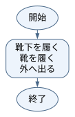

</div>

</div>

</section>

<section class="answer-section" data-exercise="1-B">

## 演習1-B　解答・解説

<div class="answer-part">

### 解答

<div class="solution-table" data-exercise="1-B">

| 解答欄の項目 | 解答 |
|---|---|
| 基本構造の名称 | 選択 |
| この例での条件 | 雨が降っているかどうか |

</div>

</div>

<div class="explanation-part">

### 解説

雨が降っているかを調べ、その結果で持ち物を変えます。条件が真なら傘、偽なら帽子というように、条件によって実行する処理を選びます。

<div class="exercise-flow">
<p class="flow-title">演習1-Bのフローチャート</p>
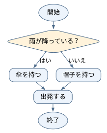

</div>

</div>

</section>

<section class="answer-section" data-exercise="1-C">

## 演習1-C　解答・解説

<div class="answer-part">

### 解答

<div class="solution-table" data-exercise="1-C">

| 解答欄の項目 | 解答 |
|---|---|
| 基本構造の名称 | 繰返し |
| 終了する条件 | 10枚すべてに確認印を押し終わったとき（残り0枚） |

</div>

</div>

<div class="explanation-part">

### 解説

一枚に印を押す処理を、全10枚に対して続けます。まだ印を押していない書類がある間は終わりません。

<div class="exercise-flow">
<p class="flow-title">演習1-Cのフローチャート</p>
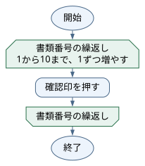

</div>

</div>

</section>

<section class="answer-section" data-exercise="1-D">

## 演習1-D　解答・解説

<div class="answer-part">

### 解答

<div class="solution-table" data-exercise="1-D">

| 解答欄の項目 | 解答 |
|---|---|
| 正しく動かない理由 | 並べる基準や、実行する手順が具体的に決まっていないから。 |

</div>

</div>

<div class="explanation-part">

### 解説

「小さい順」は並べる目標ですが、それだけでは比較・交換・終了の手順が分かりません。コンピュータが実行できる具体的な手順まで決める必要があります。

<div class="exercise-flow">
<p class="flow-title">演習1-Dのフローチャート</p>
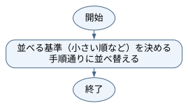

</div>

</div>

</section>

<section class="answer-section" data-exercise="1-E">

## 演習1-E　解答・解説

<div class="answer-part">

### 解答

<div class="solution-table" data-exercise="1-E">

| 解答欄の項目 | 解答 |
|---|---|
| 変数の役割 | 入力や計算途中の値を覚える場所。 |
| 「←」の意味 | 右辺の値を左辺の変数へ入れる。 |

</div>

</div>

<div class="explanation-part">

### 解説

変数を「名前付きの箱」と考えると、名前と中身を分けて考えられます。「←」は数学の等号ではありません。右辺の計算を先に行い、その結果で左辺の中身を更新する動作です。

<div class="exercise-flow">
<p class="flow-title">演習1-Eのフローチャート</p>
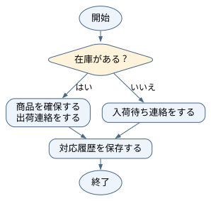

</div>

</div>

</section>

<section class="answer-section" data-exercise="1-F">

## 演習1-F　解答・解説

<div class="answer-part">

### 解答

<div class="solution-table" data-exercise="1-F">

| 解答欄の項目 | 解答 |
|---|---|
| 含まれる基本構造 | 順次・選択・繰返し |
| それぞれの対応関係 | 順次：答案を確認し、点数を調べ、印を押す順に進む。<br>選択：60点以上かどうかで押す印を変える。<br>繰返し：全員分が終わるまで一人分の作業を続ける。 |

</div>

</div>

<div class="explanation-part">

### 解説

全員分を処理する繰返しの内側で、点数に応じた選択を行います。一人分の作業は順次で進みます。このように、三つの基本構造を組み合わせて処理を作ります。

<div class="exercise-flow">
<p class="flow-title">演習1-Fのフローチャート</p>
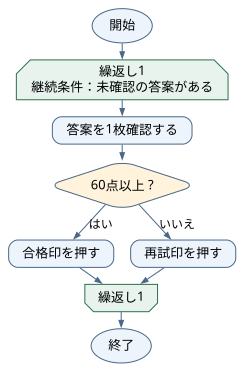

</div>

</div>

</section>

<section class="answer-section" data-exercise="2-A">

## 演習2-A　解答・解説

<div class="answer-part">

### 解答

<div class="solution-table" data-exercise="2-A">

| 解答欄の項目 | 解答 |
|---|---|
| total ← 2 実行後 | 2 |
| total ← total ＋ 3 実行後 | 5 |
| total ← total × 2 実行後（最終値） | 10 |

</div>

</div>

<div class="explanation-part">

### 解説

最初に2を入れます。次の行は、その2に3を足して5へ更新します。最後の行は、現在の5を2倍にして10へ更新します。右辺のtotalには、その行を実行する直前の値を使います。

#### 値の確認（各処理の実行後）

| 実行した処理 | その直後の値 |
|---|---|
| total ← 2 | total＝2 |
| total ← total ＋ 3 | total＝5 |
| total ← total × 2 | total＝10 |

<div class="exercise-flow">
<p class="flow-title">演習2-Aのフローチャート</p>
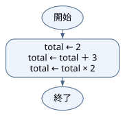
<p class="flow-caption">問題の入力と、空欄を埋めた処理を示しています。</p>
</div>

</div>

</section>

<section class="answer-section" data-exercise="2-B">

## 演習2-B　解答・解説

<div class="answer-part">

### 解答

<div class="solution-table" data-exercise="2-B">

| 解答欄の項目 | 解答 |
|---|---|
| 空欄 ① | `x` |
| 空欄 ② | `y` |
| 空欄 ③ | `temp` |

</div>

</div>

<div class="explanation-part">

### 解説

先に元のxの値7をtempへ残します。その後でxへyの値12を入れ、最後にyへtempの7を入れます。先にxを上書きしてしまうと、元の7を取り戻せません。

#### 値の確認（各処理の実行後）

| 実行した処理 | その直後の値 |
|---|---|
| x ← 7 | x＝7 |
| y ← 12 | x＝7、y＝12 |
| temp ← x | x＝7、y＝12、temp＝7 |
| x ← y | x＝12、y＝12、temp＝7 |
| y ← temp | x＝12、y＝7、temp＝7 |

<div class="exercise-flow">
<p class="flow-title">演習2-Bのフローチャート</p>
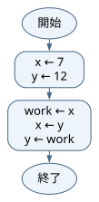
<p class="flow-caption">問題の入力と、空欄を埋めた処理を示しています。</p>
</div>

</div>

</section>

<section class="answer-section" data-exercise="2-C">

## 演習2-C　解答・解説

<div class="answer-part">

### 解答

<div class="solution-table" data-exercise="2-C">

| 解答欄の項目 | 解答 |
|---|---|
| 最後の a | 10 |
| 最後の b | 14 |

</div>

#### 表の完成例

| 実行する処理 | 実行後の a | 実行後の b |
|---|---:|---:|
| a ← 4 | 4 | 未定義 |
| b ← a | 4 | 4 |
| a ← a ＋ 6 | 10 | 4 |
| b ← b ＋ a | 10 | 14 |


</div>

<div class="explanation-part">

### 解説

bへコピーした4は、aを10に更新しても自動では変わりません。最後の行で、bの4とaの10を足してbを更新します。完成表で、各行の直後に覚えている値を確認してください。

<div class="exercise-flow">
<p class="flow-title">演習2-Cのフローチャート</p>
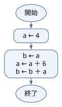

</div>

</div>

</section>

<section class="answer-section" data-exercise="2-D">

## 演習2-D　解答・解説

<div class="answer-part">

### 解答

<div class="solution-table" data-exercise="2-D">

| 解答欄の項目 | 解答 |
|---|---|
| 割引額 discount | 250 |
| 割引後 price | 1000 |

</div>

</div>

<div class="explanation-part">

### 解説

0.2を掛けると、元の1250円の20％である250円が求められます。discountは割引額、priceはその割引額を引いた後の支払金額です。

#### 値の確認（各処理の実行後）

| 実行した処理 | その直後の値 |
|---|---|
| price ← 1250 | price＝1250 |
| rate ← 0.2 | price＝1250、rate＝0.2 |
| discount ← price × rate | price＝1250、rate＝0.2、discount＝250 |
| price ← price − discount | price＝1000、rate＝0.2、discount＝250 |

<div class="exercise-flow">
<p class="flow-title">演習2-Dのフローチャート</p>
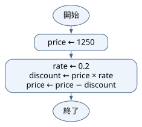

</div>

</div>

</section>

<section class="answer-section" data-exercise="2-E">

## 演習2-E　解答・解説

<div class="answer-part">

### 解答

<div class="solution-table" data-exercise="2-E">

| 解答欄の項目 | 解答 |
|---|---|
| a の値 | 3800 |
| b の値 | 3200 |
| total の値 | 7000 |

</div>

</div>

<div class="explanation-part">

### 解説

口座aから1200円を引き、口座bへ同じ1200円を足します。手数料がないため、二つの口座の合計は移動前の7000円から変わりません。

#### 値の確認（各処理の実行後）

| 実行した処理 | その直後の値 |
|---|---|
| a ← 5000 | a＝5000 |
| b ← 2000 | a＝5000、b＝2000 |
| amount ← 1200 | a＝5000、b＝2000、amount＝1200 |
| a ← a − amount | a＝3800、b＝2000、amount＝1200 |
| b ← b ＋ amount | a＝3800、b＝3200、amount＝1200 |
| total ← a ＋ b | a＝3800、b＝3200、amount＝1200、total＝7000 |

<div class="exercise-flow">
<p class="flow-title">演習2-Eのフローチャート</p>
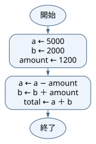

</div>

</div>

</section>

<section class="answer-section" data-exercise="2-F">

## 演習2-F　解答・解説

<div class="answer-part">

### 解答

<div class="solution-table" data-exercise="2-F">

| 解答欄の項目 | 解答 |
|---|---|
| a の値 | 20 |
| b の値 | 30 |
| c の値 | 10 |

</div>

</div>

<div class="explanation-part">

### 解説

aの元の10をtempへ残してから、aへbの20、bへcの30を入れます。最後にcへtempの10を入れるので、上書き前の値を失わずにずらせます。

#### 値の確認（各処理の実行後）

| 実行した処理 | その直後の値 |
|---|---|
| a ← 10 | a＝10 |
| b ← 20 | a＝10、b＝20 |
| c ← 30 | a＝10、b＝20、c＝30 |
| temp ← a | a＝10、b＝20、c＝30、temp＝10 |
| a ← b | a＝20、b＝20、c＝30、temp＝10 |
| b ← c | a＝20、b＝30、c＝30、temp＝10 |
| c ← temp | a＝20、b＝30、c＝10、temp＝10 |

<div class="exercise-flow">
<p class="flow-title">演習2-Fのフローチャート</p>
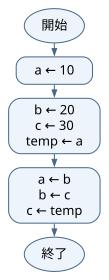

</div>

公開問題への接続：[2022年12月サンプル20問セット 問1 変数の退避と上書き](https://www.fe-siken.com/kakomon/sample/b1.html)（[IPA公式問題PDF](https://www.ipa.go.jp/shiken/syllabus/henkou/2022/gmcbt80000007cfs-att/fe_kamoku_b_set_sample_qs.pdf)）。本演習は研修用のオリジナル問題であり、リンク先の問題・正解と同一ではありません。

</div>

</section>

<section class="answer-section" data-exercise="3-A">

## 演習3-A　解答・解説

<div class="answer-part">

### 解答

<div class="solution-table" data-exercise="3-A">

| 解答欄の項目 | 解答 |
|---|---|
| 空欄 ① | `150` |
| 空欄 ② | `80` |
| 空欄 ③ | `apple × 3 ＋ orange × 4` |
| 各変数の役割（自分の言葉で） | apple：りんご一個の単価。<br>orange：みかん一個の単価。<br>total：計算した合計金額。 |

</div>

<div class="display-result" data-exercise="3-A">
  <p class="result-title">表示結果</p>
  <div class="result-case"><samp class="result-lines">770</samp></div>
</div>

</div>

<div class="explanation-part">

### 解説

単価と個数が入力値、単価×個数を足し合わせる計算が処理、totalを表示する命令が出力です。150 × 3 ＋ 80 × 4＝450 ＋ 320＝770なので、表示する値は770です。金額を覚える処理と、表示する処理を区別します。

#### 値の確認（各処理の実行後）

| 実行した処理 | その直後の値 |
|---|---|
| apple ← 150 | apple＝150 |
| orange ← 80 | apple＝150、orange＝80 |
| total ← apple × 3 ＋ orange × 4 | apple＝150、orange＝80、total＝770 |

<div class="exercise-flow">
<p class="flow-title">演習3-Aのフローチャート</p>
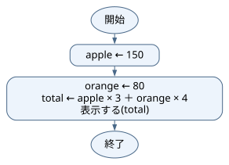
<p class="flow-caption">問題の入力と、空欄を埋めた処理を示しています。</p>
</div>

</div>

</section>

<section class="answer-section" data-exercise="3-B">

## 演習3-B　解答・解説

<div class="answer-part">

### 解答の例の一つ

<div class="solution-table" data-exercise="3-B">

| 解答欄の項目 | 解答 |
|---|---|
| 税込価格を求める処理 | `taxIncluded ← price × (1 ＋ rate)` |
| 表示する処理 | `表示する(taxIncluded)` |

</div>

<div class="display-result" data-exercise="3-B">
  <p class="result-title">表示結果</p>
  <div class="result-case"><samp class="result-lines">1320</samp></div>
</div>

</div>

<div class="explanation-part">

### 解説

税率10％は0.1です。元の価格の1倍と税額の0.1倍を足すので、1200 × 1.1＝1320となります。計算した1320をtaxIncludedへ入れ、その変数を表示します。

計算する行を `taxIncluded ← price ＋ price × rate` としても正解です。表示する行は上の解答例と同じです。与えられた税抜価格と税率から税込価格を正しく求めて表示できれば、別の式でも構いません。

#### 値の確認（各処理の実行後）

| 実行した処理 | その直後の値 |
|---|---|
| price ← 1200 | price＝1200 |
| rate ← 0.1 | price＝1200、rate＝0.1 |
| taxIncluded ← price × (1 ＋ rate) | price＝1200、rate＝0.1、taxIncluded＝1320 |

<div class="exercise-flow">
<p class="flow-title">演習3-Bのフローチャート</p>
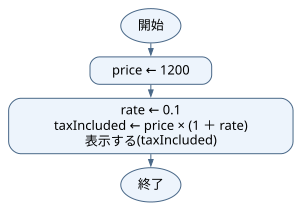
<p class="flow-caption">問題の入力と、空欄を埋めた処理を示しています。</p>
</div>

</div>

</section>

<section class="answer-section" data-exercise="3-C">

## 演習3-C　解答・解説

<div class="answer-part">

### 解答

<div class="solution-table" data-exercise="3-C">

| 解答欄の項目 | 解答 |
|---|---|
| 表示される値 | 600 |
| 入力 price（単価） | 200円 |
| 入力 quantity（個数） | 3個 |
| 処理 | `total ← price × quantity` で合計金額を計算する。 |
| 出力 | `表示する(total)` で600を表示する。 |

</div>

<div class="display-result" data-exercise="3-C">
  <p class="result-title">表示結果</p>
  <div class="result-case"><samp class="result-lines">600</samp></div>
</div>

</div>

<div class="explanation-part">

### 解説

入力値の200と3を材料に、200 × 3＝600を計算してtotalへ入れます。ここまでが計算と値を覚える処理です。その後でtotalの600を表示することが出力です。同じ意味を表す説明であれば、言葉の書き方が違っても構いません。

#### 値の確認（各処理の実行後）

| 実行した処理 | その直後の値 |
|---|---|
| price ← 200 | price＝200 |
| quantity ← 3 | price＝200、quantity＝3 |
| total ← price × quantity | price＝200、quantity＝3、total＝600 |

<div class="exercise-flow">
<p class="flow-title">演習3-Cのフローチャート</p>


</div>

</div>

</section>

<section class="answer-section" data-exercise="3-D">

## 演習3-D　解答・解説

<div class="answer-part">

### 解答

<div class="solution-table" data-exercise="3-D">

| 解答欄の項目 | 解答 |
|---|---|
| 最後の price | 2100 |
| 同じにならない理由 | 送料まで割引対象に含めるかどうかが異なるから。 |

</div>

</div>

<div class="explanation-part">

### 解説

割引後に送料を足すと、商品代金だけを割り引くため、2000 × 0.9 ＋ 300＝2100です。送料を足してから割り引くと、(2000 ＋ 300) × 0.9＝2070です。後者では送料300も10％引きになるため、結果が30円違います。

#### 値の確認（各処理の実行後）

| 実行した処理 | その直後の値 |
|---|---|
| price ← 2000 | price＝2000 |
| price ← price × 0.9 | price＝1800 |
| price ← price ＋ 300 | price＝2100 |

<div class="exercise-flow">
<p class="flow-title">演習3-Dのフローチャート</p>
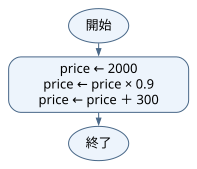

</div>

</div>

</section>

<section class="answer-section" data-exercise="3-E">

## 演習3-E　解答・解説

<div class="answer-part">

### 解答

<div class="solution-table" data-exercise="3-E">

| 解答欄の項目 | 解答 |
|---|---|
| 選択肢（ア〜エ） | **正解：イ** |

</div>

</div>

<div class="explanation-part">

### 解説

製造時間quantity × perItemに、全体で一回だけ必要な準備時間setupを足します。分を時間に換算するには60で割ります。138分＝2.3時間＝2時間18分です。0.3時間は0.3 × 60＝18分で、30分ではありません。

#### 値の確認（各処理の実行後）

| 実行した処理 | その直後の値 |
|---|---|
| quantity ← 18 | quantity＝18 |
| perItem ← 7 | quantity＝18、perItem＝7 |
| setup ← 12 | quantity＝18、perItem＝7、setup＝12 |
| minutes ← quantity × perItem ＋ setup | quantity＝18、perItem＝7、setup＝12、minutes＝138 |
| hours ← minutes ÷ 60 | quantity＝18、perItem＝7、setup＝12、minutes＝138、hours＝2.3 |

<div class="exercise-flow">
<p class="flow-title">演習3-Eのフローチャート</p>
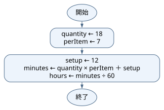

</div>

</div>

</section>

<section class="answer-section" data-exercise="3-F">

## 演習3-F　解答・解説

<div class="answer-part">

### 解答

<div class="solution-table" data-exercise="3-F">

| 解答欄の項目 | 解答 |
|---|---|
| 選択肢（ア〜エ） | **正解：エ** |

</div>

</div>

<div class="explanation-part">

### 解説

入荷時は在庫にreceivedを足し、出荷時はshippedを引きます。在庫は40→55→32と変化し、目標50との差は50 − 32＝18です。更新するたびに、現在のstockを使います。

#### 値の確認（各処理の実行後）

| 実行した処理 | その直後の値 |
|---|---|
| stock ← 40 | stock＝40 |
| received ← 15 | stock＝40、received＝15 |
| shipped ← 23 | stock＝40、received＝15、shipped＝23 |
| stock ← stock ＋ received | stock＝55、received＝15、shipped＝23 |
| stock ← stock − shipped | stock＝32、received＝15、shipped＝23 |
| shortage ← 50 − stock | stock＝32、received＝15、shipped＝23、shortage＝18 |

<div class="exercise-flow">
<p class="flow-title">演習3-Fのフローチャート</p>
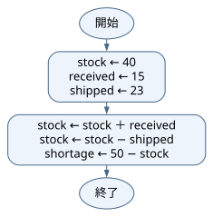

</div>

</div>

</section>

<section class="answer-section" data-exercise="4-A">

## 演習4-A　解答・解説

<div class="answer-part">

### 解答

<div class="solution-table" data-exercise="4-A">

| 解答欄の項目 | 解答 |
|---|---|
| 空欄 ①（条件式） | `x mod 2 ＝ 0` |

</div>

<div class="display-result" data-exercise="4-A">
  <p class="result-title">表示結果</p>
  <div class="result-case"><span class="result-label">x＝8の場合</span><samp class="result-lines">偶数</samp></div>
</div>

</div>

<div class="explanation-part">

### 解説

偶数は2で割り切れるので、余りが0になります。x＝8なら条件が真となり「偶数」、x＝7なら偽となり「奇数」を表示します。

<div class="exercise-flow">
<p class="flow-title">演習4-Aのフローチャート</p>
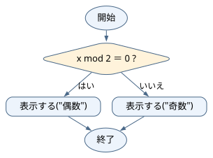
<p class="flow-caption">問題の入力と、空欄を埋めた処理を示しています。</p>
</div>

</div>

</section>

<section class="answer-section" data-exercise="4-B">

## 演習4-B　解答・解説

<div class="answer-part">

### 解答

<div class="solution-table" data-exercise="4-B">

| 解答欄の項目 | 解答 |
|---|---|
| score＝59 の表示 | 「再挑戦」 |
| score＝60 の表示 | 「合格」 |

</div>

<div class="display-result" data-exercise="4-B">
  <p class="result-title">表示結果</p>
  <div class="result-case"><span class="result-label">score＝59の場合</span><samp class="result-lines">再挑戦</samp></div>
  <div class="result-case"><span class="result-label">score＝60の場合</span><samp class="result-lines">合格</samp></div>
</div>

</div>

<div class="explanation-part">

### 解説

「60以上」は60点ちょうども含みます。59点は条件が偽なのでelse側へ、60点は真なのでif側へ進みます。

#### 値の確認（score＝59の場合）

| 実行した処理 | その直後の値 |
|---|---|
| result ← "再挑戦" | result＝再挑戦 |

<div class="exercise-flow">
<p class="flow-title">演習4-Bのフローチャート</p>
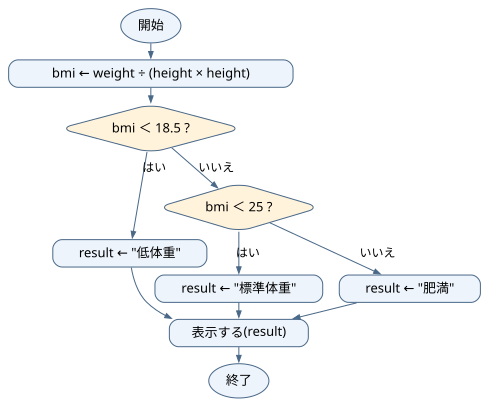
<p class="flow-caption">問題の入力と、空欄を埋めた処理を示しています。</p>
</div>

</div>

</section>

<section class="answer-section dense-answer" data-exercise="4-C">

## 演習4-C　解答・解説

<div class="answer-part">

### 解答

<div class="solution-table" data-exercise="4-C">

| 解答欄の項目 | 解答 |
|---|---|
| 空欄 ①（条件式） | `bmi ＜ 18.5` |
| 空欄 ②（条件式） | `bmi ＜ 25` |
| BMI 18.49 / 18.50 の期待結果 | 18.49：低体重／18.50：標準体重 |
| BMI 24.99 / 25.00 の期待結果 | 24.99：標準体重／25.00：肥満 |

</div>

<div class="display-result" data-exercise="4-C">
  <p class="result-title">表示結果</p>
  <div class="result-case"><span class="result-label">BMI＝18.49の場合</span><samp class="result-lines">低体重</samp></div>
  <div class="result-case"><span class="result-label">BMI＝18.50の場合</span><samp class="result-lines">標準体重</samp></div>
  <div class="result-case"><span class="result-label">BMI＝24.99の場合</span><samp class="result-lines">標準体重</samp></div>
  <div class="result-case"><span class="result-label">BMI＝25.00の場合</span><samp class="result-lines">肥満</samp></div>
</div>

</div>

<div class="explanation-part">

### 解説

最初の条件が偽でelseifへ来た時点で、BMIは18.5以上と分かっています。そこで25未満かを調べると、18.5以上25未満を判定できます。25ちょうどは二つ目も偽となり、else側へ進みます。

#### 値の確認（BMI＝18.50の場合）

| 実行した処理 | その直後の値 |
|---|---|
| bmi ← weight ÷ (height × height) | bmi＝18.5 |
| result ← "標準体重" | bmi＝18.5、result＝標準体重 |

<div class="exercise-flow">
<p class="flow-title">演習4-Cのフローチャート</p>
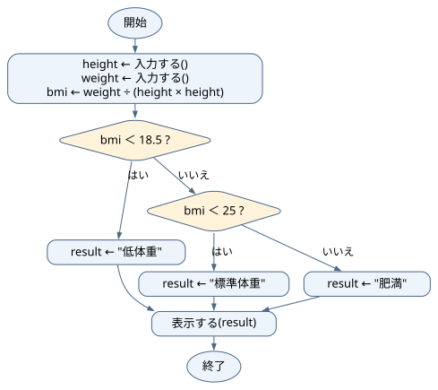

</div>

</div>

</section>

<section class="answer-section" data-exercise="4-D">

## 演習4-D　解答・解説

<div class="answer-part">

### 解答

<div class="solution-table" data-exercise="4-D">

| 解答欄の項目 | 解答 |
|---|---|
| 空欄 ①（条件式） | `age ≧ 12 and hasTicket ＝ 1` |
| (12, 1) の結果 | 入場可 |
| (11, 1) の結果 | 入場不可 |
| (20, 0) の結果 | 入場不可 |

</div>

</div>

<div class="explanation-part">

### 解説

年齢と券の有無の両方を満たす必要があるため、andでつなぎます。(11,1)は年齢、(20,0)は券の条件を満たしません。一方だけが真でも入場不可です。

表の確認に使う入力：age＝12、hasTicket＝1。

#### 値の確認（各処理の実行後）

| 実行した処理 | その直後の値 |
|---|---|
| result ← "入場可" | result＝入場可 |

<div class="exercise-flow">
<p class="flow-title">演習4-Dのフローチャート</p>
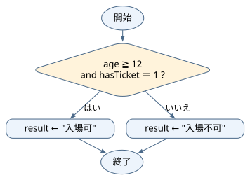

</div>

</div>

</section>

<section class="answer-section" data-exercise="4-E">

## 演習4-E　解答・解説

<div class="answer-part">

### 解答

<div class="solution-table" data-exercise="4-E">

| 解答欄の項目 | 解答 |
|---|---|
| 選択肢（ア〜エ） | **正解：ア** |

</div>

</div>

<div class="explanation-part">

### 解説

6歳未満には6歳を含めません。最初の条件が偽なら6歳以上と分かっているので、次のage ＜ 18で6歳以上18歳未満を判定できます。18歳ちょうどは900円の区分です。

表の確認に使う入力：age＝5。

#### 値の確認（各処理の実行後）

| 実行した処理 | その直後の値 |
|---|---|
| fee ← 0 | fee＝0 |

<div class="exercise-flow">
<p class="flow-title">演習4-Eのフローチャート</p>
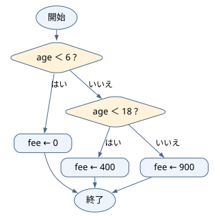

</div>

公開問題への接続：[2022年12月サンプル20問セット 問2 条件分岐の読み取り](https://www.fe-siken.com/kakomon/sample/b2.html)（[IPA公式問題PDF](https://www.ipa.go.jp/shiken/syllabus/henkou/2022/gmcbt80000007cfs-att/fe_kamoku_b_set_sample_qs.pdf)）。本演習は研修用のオリジナル問題であり、リンク先の問題・正解と同一ではありません。

</div>

</section>

<section class="answer-section" data-exercise="4-F">

## 演習4-F　解答・解説

<div class="answer-part">

### 解答

<div class="solution-table" data-exercise="4-F">

| 解答欄の項目 | 解答 |
|---|---|
| 選択肢（ア〜エ） | **正解：ウ** |

</div>

</div>

<div class="explanation-part">

### 解説

冷蔵が必要かどうかを最初に調べます。冷蔵が不要な場合だけ、購入額が5000円以上かを調べます。購入額を先に調べると、冷蔵便まで無料になる場合があるので、条件の順序が大切です。

表の確認に使う入力：cold＝1、amount＝6000。

#### 値の確認（各処理の実行後）

| 実行した処理 | その直後の値 |
|---|---|
| fee ← 600 | fee＝600 |

<div class="exercise-flow">
<p class="flow-title">演習4-Fのフローチャート</p>
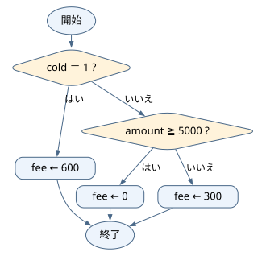

</div>

</div>

</section>

<section class="answer-section dense-answer" data-exercise="5-A">

## 演習5-A　解答・解説

<div class="answer-part">

### 解答

<div class="solution-table" data-exercise="5-A">

| 解答欄の項目 | 解答 |
|---|---|
| 空欄 ① | `0` |
| 空欄 ② | `1` |
| 空欄 ③ | `10` |
| 空欄 ④ | `total ＋ i` |
| 空欄 ⑤ | `total ÷ 10` |

</div>

</div>

<div class="explanation-part">

### 解説

totalを0から始め、i＝1〜10を順に足します。合計55を10で割ると平均5.5です。表示は1〜10、合計、平均の順です。

<div class="trace-with-result">
<div>

#### 値の確認（各処理の実行後）

| 実行した処理 | その直後の値 |
|---|---|
| total ← 0 | total＝0 |
| i＝1の回を終了 | total＝1、i＝1 |
| i＝2の回を終了 | total＝3、i＝2 |
| i＝3の回を終了 | total＝6、i＝3 |
| i＝4の回を終了 | total＝10、i＝4 |
| i＝5の回を終了 | total＝15、i＝5 |
| i＝6の回を終了 | total＝21、i＝6 |
| i＝7の回を終了 | total＝28、i＝7 |
| i＝8の回を終了 | total＝36、i＝8 |
| i＝9の回を終了 | total＝45、i＝9 |
| i＝10の回を終了 | total＝55、i＝10 |
| average ← total ÷ 10 | total＝55、i＝11、average＝5.5 |

</div>

<div class="display-result" data-exercise="5-A">
  <p class="result-title">表示結果</p>
  <div class="result-case"><samp class="result-lines">1<br>2<br>3<br>4<br>5<br>6<br>7<br>8<br>9<br>10<br>55<br>5.5</samp></div>
</div>

</div>

<div class="exercise-flow">
<p class="flow-title">演習5-Aのフローチャート</p>
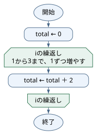
<p class="flow-caption">問題の入力と、空欄を埋めた処理を示しています。</p>
</div>

</div>

</section>

<section class="answer-section" data-exercise="5-B">

## 演習5-B　解答・解説

<div class="answer-part">

### 解答

<div class="solution-table" data-exercise="5-B">

| 解答欄の項目 | 解答 |
|---|---|
| 処理①の実行回数 | 5回 |
| 処理②の実行回数 | 3回 |
| 終了時の i の値 | 6 |

</div>

#### 表の完成例

| i | i ≦ 5 | 処理① | i mod 2 ＝ 1 | 処理② |
|---|---:|---:|---:|---:|
| 1 | ○ | ○ | ○ | ○ |
| 2 | ○ | ○ | × | × |
| 3 | ○ | ○ | ○ | ○ |
| 4 | ○ | ○ | × | × |
| 5 | ○ | ○ | ○ | ○ |
| 6 | × | × | ― | × |


</div>

<div class="explanation-part">

### 解説

表では、条件が真・処理を実行するときは○、条件が偽・処理を実行しないときは×です。条件を調べない欄は―とします。処理①の○は5個、処理②の○は3個です。i＝6ではwhileの条件が偽となるため、内側の条件も調べません。条件の判定自体は、最後の×を含め6回です。

<div class="exercise-flow">
<p class="flow-title">演習5-Bのフローチャート</p>
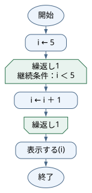
<p class="flow-caption">問題の入力と、空欄を埋めた処理を示しています。</p>
</div>

</div>

</section>

<section class="answer-section" data-exercise="5-C">

## 演習5-C　解答・解説

<div class="answer-part">

### 解答

<div class="solution-table" data-exercise="5-C">

| 解答欄の項目 | 解答 |
|---|---|
| 最後の total | 6 |
| 繰返しの実行回数 | 3回 |

</div>

</div>

<div class="explanation-part">

### 解説

i＝1・2・3の三回、それぞれ2を足します。totalは0→2→4→6と変わります。forの終了値3の回も実行します。

#### 値の確認（各処理の実行後）

| 実行した処理 | その直後の値 |
|---|---|
| total ← 0 | total＝0 |
| i＝1の回を終了 | total＝2、i＝1 |
| i＝2の回を終了 | total＝4、i＝2 |
| i＝3の回を終了 | total＝6、i＝3 |

<div class="exercise-flow">
<p class="flow-title">演習5-Cのフローチャート</p>


</div>

</div>

</section>

<section class="answer-section" data-exercise="5-D">

## 演習5-D　解答・解説

<div class="answer-part">

### 解答

<div class="solution-table" data-exercise="5-D">

| 解答欄の項目 | 解答 |
|---|---|
| 表示される i | 5 |
| 内部の実行回数 | 0回 |

</div>

<div class="display-result" data-exercise="5-D">
  <p class="result-title">表示結果</p>
  <div class="result-case"><samp class="result-lines">5</samp></div>
</div>

</div>

<div class="explanation-part">

### 解説

whileは内部の処理を行う前に条件を調べます。最初から5 ＜ 5が偽なので、一度も内部へ入りません。iは5のままで、繰返しの後の表示命令へ進みます。

#### 値の確認（各処理の実行後）

| 実行した処理 | その直後の値 |
|---|---|
| i ← 5 | i＝5 |

<div class="exercise-flow">
<p class="flow-title">演習5-Dのフローチャート</p>


</div>

</div>

</section>

<section class="answer-section" data-exercise="5-E">

## 演習5-E　解答・解説

<div class="answer-part">

### 解答

<div class="solution-table" data-exercise="5-E">

| 解答欄の項目 | 解答 |
|---|---|
| 選択肢（ア〜エ） | **正解：イ** |

</div>

</div>

<div class="explanation-part">

### 解説

残高が3000円未満の間だけ続け、毎回monthsを1増やします。3000円ちょうどになった次の判定は偽となり、4か月で終了します。≦を使うと3000円でも続けてしまいます。

#### 値の確認（各処理の実行後）

| 実行した処理 | その直後の値 |
|---|---|
| balance ← 1000 | balance＝1000 |
| 繰返し一回分を終了 | balance＝1500、months＝1 |
| 繰返し一回分を終了 | balance＝2000、months＝2 |
| 繰返し一回分を終了 | balance＝2500、months＝3 |
| 繰返し一回分を終了 | balance＝3000、months＝4 |

<div class="exercise-flow">
<p class="flow-title">演習5-Eのフローチャート</p>
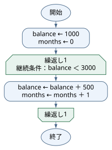

</div>

</div>

</section>

<section class="answer-section" data-exercise="5-F">

## 演習5-F　解答・解説

<div class="answer-part">

### 解答

<div class="solution-table" data-exercise="5-F">

| 解答欄の項目 | 解答 |
|---|---|
| 選択肢（ア〜エ） | **正解：エ** |

</div>

</div>

<div class="explanation-part">

### 解説

各伝票の通常処理でminutesへ2を足します。3の倍数は、3で割った余りが0かどうかで判定します。通常処理6 × 2＝12分と、二件の追加点検2 × 5＝10分を合わせて22分です。

#### 値の確認（各処理の実行後）

| 実行した処理 | その直後の値 |
|---|---|
| minutes ← 0 | minutes＝0 |
| i＝1の回を終了 | minutes＝2、i＝1 |
| i＝2の回を終了 | minutes＝4、i＝2 |
| i＝3の回を終了 | minutes＝11、i＝3 |
| i＝4の回を終了 | minutes＝13、i＝4 |
| i＝5の回を終了 | minutes＝15、i＝5 |
| i＝6の回を終了 | minutes＝22、i＝6 |

<div class="exercise-flow">
<p class="flow-title">演習5-Fのフローチャート</p>
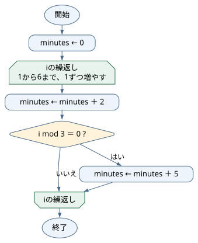

</div>

</div>

</section>

<section class="answer-section dense-answer" data-exercise="6-A">

## 演習6-A　解答・解説

<div class="answer-part">

### 解答

<div class="solution-table" data-exercise="6-A">

| 解答欄の項目 | 解答 |
|---|---|
| 空欄 ① | `0` |
| 空欄 ② | `1` |
| 空欄 ③ | `10` |
| 空欄 ④ | `total ＋ A[i]` |

</div>

<div class="trace-with-result">
<div>

<div class="completed-trace" data-exercise="6-A">

#### 表の完成例

| i | A[i] | 加算前のtotal | 加算後のtotal |
|---|---:|---:|---:|
| 初期化 | ― | ― | 0 |
| 1 | 3 | 0 | 3 |
| 2 | 8 | 3 | 11 |
| 3 | 2 | 11 | 13 |
| 4 | 5 | 13 | 18 |
| 5 | 1 | 18 | 19 |
| 6 | 4 | 19 | 23 |
| 7 | 6 | 23 | 29 |
| 8 | 7 | 29 | 36 |
| 9 | 9 | 36 | 45 |
| 10 | 10 | 45 | 55 |


</div>

</div>

<div class="display-result" data-exercise="6-A">
  <p class="result-title">表示結果</p>
  <div class="result-case"><span class="result-label">A＝{3, 8, 2, 5, 1, 4, 6, 7, 9, 10}の場合</span><samp class="result-lines">55</samp></div>
</div>

</div>

</div>

<div class="explanation-part">

### 解説

表では、位置iと、その位置に入っているA[i]を分けます。一回目に足すのはiの1ではなくA[1]の3です。次の回では前の回の加算後のtotalを引き継ぎます。合計は0→3→11→13→18→19→23→29→36→45→55です。最後の55を表示します。

<div class="exercise-flow">
<p class="flow-title">演習6-Aのフローチャート</p>

<p class="flow-caption">問題の入力と、空欄を埋めた処理を示しています。</p>
</div>

</div>

</section>

<section class="answer-section dense-answer" data-exercise="6-B">

## 演習6-B　解答・解説

<div class="answer-part">

### 解答

<div class="solution-table" data-exercise="6-B">

| 解答欄の項目 | 解答 |
|---|---|
| 最終的な max の値 | 10 |

</div>

<div class="display-result" data-exercise="6-B">
  <p class="result-title">表示結果</p>
  <div class="result-case"><span class="result-label">A＝{4, 2, 9, 6, 3, 8, 1, 7, 5, 10}の場合</span><samp class="result-lines">10</samp></div>
</div>

<div class="completed-trace" data-exercise="6-B">

#### 表の完成例

| i | A[i] | 比較前のmax | A[i] ＞ max | 比較後のmax |
|---|---:|---:|---:|---:|
| 初期化 | 4 | ― | ― | 4 |
| 2 | 2 | 4 | 偽 | 4 |
| 3 | 9 | 4 | 真 | 9 |
| 4 | 6 | 9 | 偽 | 9 |
| 5 | 3 | 9 | 偽 | 9 |
| 6 | 8 | 9 | 偽 | 9 |
| 7 | 1 | 9 | 偽 | 9 |
| 8 | 7 | 9 | 偽 | 9 |
| 9 | 5 | 9 | 偽 | 9 |
| 10 | 10 | 9 | 真 | 10 |


</div>

</div>

<div class="explanation-part">

### 解説

まずA[1]の4をmaxへ入れます。表の「比較前のmax」には前の行の「比較後のmax」を引き継ぎます。A[i]がそれより大きいときだけ更新し、偽の行では前のmaxを保ちます。途中で9へ更新した後も残りを比較し、最後の要素10でmaxが10になることを確認します。

<div class="exercise-flow">
<p class="flow-title">演習6-Bのフローチャート</p>
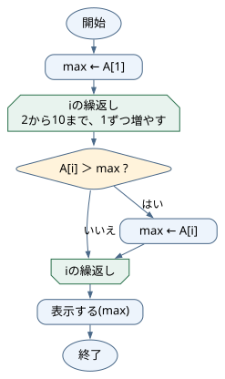
<p class="flow-caption">問題の入力と、空欄を埋めた処理を示しています。</p>
</div>

</div>

</section>

<section class="answer-section" data-exercise="6-C">

## 演習6-C　解答・解説

<div class="answer-part">

### 解答

<div class="solution-table" data-exercise="6-C">

| 解答欄の項目 | 解答 |
|---|---|
| 最後の x | 3 |
| 処理後の配列 A | {3, 3, 6} |

</div>

表の確認に使う入力：A＝{8,3,6}。

<div class="completed-trace" data-exercise="6-C">

#### 表の完成例

| 実行した処理 | x | A[1] | A[2] | A[3] |
|---|---:|---:|---:|---:|
| 初期状態 | ― | 8 | 3 | 6 |
| x ← A[2] | 3 | 8 | 3 | 6 |
| A[1] ← x | 3 | 3 | 3 | 6 |


</div>

</div>

<div class="explanation-part">

### 解説

表の最初の行へ配列の8・3・6を記録します。x ← A[2]では、2番目の値3をxへ入れ、配列は変えません。次の行でxの3をA[1]へ入れます。表で更新される列を確認すると、A[2]とA[3]は元の値を保つことが分かります。

<div class="exercise-flow">
<p class="flow-title">演習6-Cのフローチャート</p>
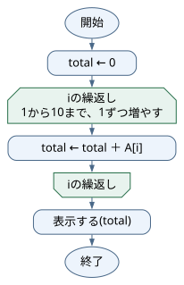

</div>

</div>

</section>

<section class="answer-section" data-exercise="6-D">

## 演習6-D　解答・解説

<div class="answer-part">

### 解答

<div class="solution-table" data-exercise="6-D">

| 解答欄の項目 | 解答 |
|---|---|
| 表示される順番 | 4 → 7 → 2 |

</div>

<div class="display-result" data-exercise="6-D">
  <p class="result-title">表示結果</p>
  <div class="result-case"><span class="result-label">A＝{4, 7, 2}の場合</span><samp class="result-lines">4<br>7<br>2</samp></div>
</div>

<div class="completed-trace" data-exercise="6-D">

#### 表の完成例

| i | A[i] | 表示される値 |
|---|---:|---:|
| 1 | 4 | 4 |
| 2 | 7 | 7 |
| 3 | 2 | 2 |


</div>

</div>

<div class="explanation-part">

### 解説

表のiは位置、A[i]はその位置にある値です。i＝1・2・3で参照するのは4・7・2なので、表示の列も4・7・2となります。添字の1・2・3と、実際に表示する値を別々に書いて確かめます。

<div class="exercise-flow">
<p class="flow-title">演習6-Dのフローチャート</p>
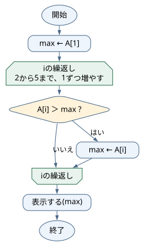

</div>

</div>

</section>

<section class="answer-section" data-exercise="6-E">

## 演習6-E　解答・解説

<div class="answer-part">

### 解答

<div class="solution-table" data-exercise="6-E">

| 解答欄の項目 | 解答 |
|---|---|
| 選択肢（ア〜エ） | **正解：ア** |

</div>

表の確認に使う入力：A＝{2,8,0,5}。

<div class="completed-trace" data-exercise="6-E">

#### 表の完成例

| i | A[i] | 条件aの真偽 | 実行後のcount | 実行後のneeded |
|---|---:|---:|---:|---:|
| 初期化 | ― | ― | 0 | 0 |
| 1 | 2 | 真 | 1 | 3 |
| 2 | 8 | 偽 | 1 | 3 |
| 3 | 0 | 真 | 2 | 8 |
| 4 | 5 | 偽 | 2 | 8 |


</div>

</div>

<div class="explanation-part">

### 解説

表の初期化の行ではcountとneededが0です。在庫2なら3個不足するのでcountを1、neededを3にします。在庫8の回は条件が偽で、両方の値を保ちます。在庫0でcountを2、neededを8に更新し、在庫5では更新しません。表の最後は2種類、補充8個です。

<div class="exercise-flow">
<p class="flow-title">演習6-Eのフローチャート</p>
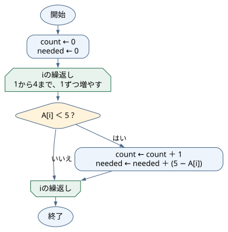

</div>

</div>

</section>

<section class="answer-section" data-exercise="6-F">

## 演習6-F　解答・解説

<div class="answer-part">

### 解答

<div class="solution-table" data-exercise="6-F">

| 解答欄の項目 | 解答 |
|---|---|
| 選択肢（ア〜エ） | **正解：ウ** |

</div>

表の確認に使う入力：A＝{7,4,7,9}、target＝7。

<div class="completed-trace" data-exercise="6-F">

#### 表の完成例

| i | A[i] | 条件aの真偽 | 実行後のposition |
|---|---:|---:|---:|
| 初期化 | ― | ― | 0 |
| 1 | 7 | 真 | 1 |
| 2 | 4 | 偽 | 1 |
| 3 | 7 | 偽 | 1 |
| 4 | 9 | 偽 | 1 |


</div>

</div>

<div class="explanation-part">

### 解説

初期化でpositionは未発見の目印0になります。一回目はA[1]がtargetの7と一致し、まだ未発見なので位置1を記録します。三回目も値は7ですが、すでにpositionは1です。表で前の行の値を引き継ぐと、最初の位置を残すには「未発見か」の条件も必要だと分かります。

<div class="exercise-flow">
<p class="flow-title">演習6-Fのフローチャート</p>
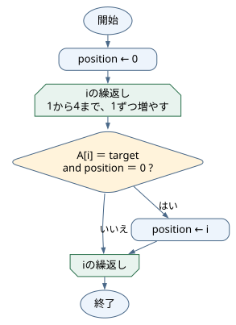

</div>

公開問題への接続：[2022年12月サンプル20問セット 問13 探索の考え方（公開問題は二分探索）](https://www.fe-siken.com/kakomon/sample/b13.html)（[IPA公式問題PDF](https://www.ipa.go.jp/shiken/syllabus/henkou/2022/gmcbt80000007cfs-att/fe_kamoku_b_set_sample_qs.pdf)）。本演習は研修用のオリジナル問題であり、リンク先の問題・正解と同一ではありません。

</div>

</section>

<section class="answer-section" data-exercise="7-A">

## 演習7-A　解答・解説

<div class="answer-part">

### 解答

<div class="solution-table" data-exercise="7-A">

| 解答欄の項目 | 解答 |
|---|---|
| 最初に誤っている行（i の値） | 3 |
| その行の正しい計算結果 | 6 |
| 最終的な total の値 | 24 |

</div>

</div>

<div class="explanation-part">

### 解説

i＝3の行は2 × 3なので6になります。i＝4の行も、修正した6を使って6 × 4＝24と計算し直します。最初の誤りを直したら、その値を使う後の行も直します。

#### 値の確認（各処理の実行後）

| 実行した処理 | その直後の値 |
|---|---|
| total ← 1 | total＝1 |
| i＝1の回を終了 | total＝1、i＝1 |
| i＝2の回を終了 | total＝2、i＝2 |
| i＝3の回を終了 | total＝6、i＝3 |
| i＝4の回を終了 | total＝24、i＝4 |

<div class="exercise-flow">
<p class="flow-title">演習7-Aのフローチャート</p>

<p class="flow-caption">問題の入力と、空欄を埋めた処理を示しています。</p>
</div>

</div>

</section>

<section class="answer-section" data-exercise="7-B">

## 演習7-B　解答・解説

<div class="answer-part">

### 解答

<div class="solution-table" data-exercise="7-B">

| 解答欄の項目 | 解答 |
|---|---|
| 二行目の実行直前の x | 3 |
| 二行目の実行直後の x | 7 |

</div>

</div>

<div class="explanation-part">

### 解説

右辺のxには、二行目を実行する直前の3を使います。3 ＋ 4を計算してからxを7へ更新します。実行前と実行後の値を分けて考えます。

#### 値の確認（各処理の実行後）

| 実行した処理 | その直後の値 |
|---|---|
| x ← 3 | x＝3 |
| x ← x ＋ 4 | x＝7 |

<div class="exercise-flow">
<p class="flow-title">演習7-Bのフローチャート</p>
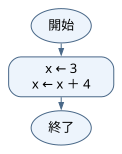

</div>

</div>

</section>

<section class="answer-section" data-exercise="7-C">

## 演習7-C　解答・解説

<div class="answer-part">

### 解答

<div class="solution-table" data-exercise="7-C">

| 解答欄の項目 | 解答 |
|---|---|
| 実行される代入文 | `x ← 2` → `y ← 20` |
| 最後の y | 20 |

</div>

</div>

<div class="explanation-part">

### 解説

x＝2なので、条件2 ＞ 5は偽です。if側のy ← 10を飛ばし、else側のy ← 20だけを実行します。通らない行はyの値を変えません。

#### 値の確認（各処理の実行後）

| 実行した処理 | その直後の値 |
|---|---|
| x ← 2 | x＝2 |
| y ← 20 | x＝2、y＝20 |

<div class="exercise-flow">
<p class="flow-title">演習7-Cのフローチャート</p>
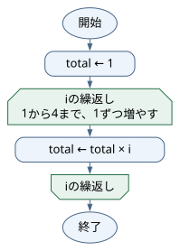

</div>

</div>

</section>

<section class="answer-section" data-exercise="7-D">

## 演習7-D　解答・解説

<div class="answer-part">

### 解答

<div class="solution-table" data-exercise="7-D">

| 解答欄の項目 | 解答 |
|---|---|
| 最後の i | 4 |
| 最後の total | 6 |

</div>

#### 表の完成例

| 判定時の i | 条件 i ≦ 3 の真偽 | 判定直後の total |
|---|---:|---:|
| 1 | 真 | 0 |
| 2 | 真 | 1 |
| 3 | 真 | 3 |
| 4 | 偽 | 6 |


</div>

<div class="explanation-part">

### 解説

一周ごとにtotalへ現在のiを足してから、iを1増やします。最後にi＝4で条件を調べると偽なので、内部は実行しません。この終了の判定も表へ記録します。

<div class="exercise-flow">
<p class="flow-title">演習7-Dのフローチャート</p>
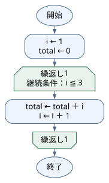

</div>

</div>

</section>

<section class="answer-section" data-exercise="7-E">

## 演習7-E　解答・解説

<div class="answer-part">

### 解答

<div class="solution-table" data-exercise="7-E">

| 解答欄の項目 | 解答 |
|---|---|
| 選択肢（ア〜エ） | **正解：イ** |

</div>

</div>

<div class="explanation-part">

### 解説

1000円以上には1000円ちょうどを含めます。値引きは現在のpayから100を引く処理です。999円はそのまま、1000円は900円、1500円は1400円となり、合計は3299円です。

表の確認に使う入力：A＝{999,1000,1500}。

#### 値の確認（各処理の実行後）

| 実行した処理 | その直後の値 |
|---|---|
| total ← 0 | total＝0 |
| i＝1の回を終了 | total＝999、i＝1、pay＝999 |
| i＝2の回を終了 | total＝1899、i＝2、pay＝900 |
| i＝3の回を終了 | total＝3299、i＝3、pay＝1400 |

<div class="exercise-flow">
<p class="flow-title">演習7-Eのフローチャート</p>
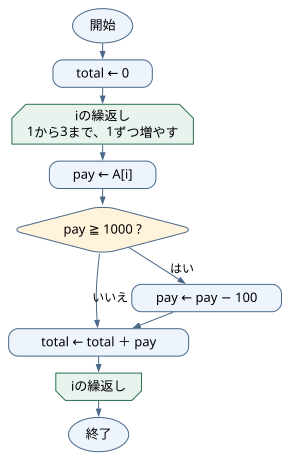

</div>

</div>

</section>

<section class="answer-section dense-answer" data-exercise="7-F">

## 演習7-F　解答・解説

<div class="answer-part">

### 解答

<div class="solution-table" data-exercise="7-F">

| 解答欄の項目 | 解答 |
|---|---|
| 選択肢（ア〜エ） | **正解：エ** |

</div>

</div>

<div class="explanation-part">

### 解説

前の値と違ったときに新しいグループが始まるので、A[i] ≠ A[i − 1]を調べ、そのときだけgroupsを1増やします。グループは「2,2」「5,5」「2」の三つです。アも最後は偶然3になりますが、同じ値のときに増やすため仕様に合いません。

| 選択肢 | i＝2後 | i＝3後 | i＝4後 | i＝5後 |
|---|---:|---:|---:|---:|
| ア | 2 | 2 | 3 | 3 |
| エ | 1 | 2 | 2 | 3 |

全要素が同じ{2,2,2,2,2}なら、正しいグループ数は1ですが、アは5になります。

表の確認に使う入力：A＝{2,2,5,5,2}。

#### 表の完成例

| i | A[i − 1] | A[i] | 前の値と違うか | 実行後のgroups |
|---|---:|---:|---:|---:|
| 初期化 | ― | 2 | ― | 1 |
| 2 | 2 | 2 | 偽 | 1 |
| 3 | 2 | 5 | 真 | 2 |
| 4 | 5 | 5 | 偽 | 2 |
| 5 | 5 | 2 | 真 | 3 |


<div class="exercise-flow">
<p class="flow-title">演習7-Fのフローチャート</p>
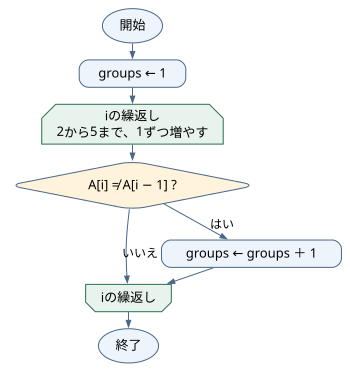

</div>

公開問題への接続：[2022年12月サンプル20問セット 問3 配列を一行ずつ追う練習](https://www.fe-siken.com/kakomon/sample/b3.html)（[IPA公式問題PDF](https://www.ipa.go.jp/shiken/syllabus/henkou/2022/gmcbt80000007cfs-att/fe_kamoku_b_set_sample_qs.pdf)）。本演習は研修用のオリジナル問題であり、リンク先の問題・正解と同一ではありません。

</div>

</section>

<section class="answer-section dense-answer" data-exercise="8-A">

## 演習8-A　解答・解説

<div class="answer-part">

### 解答

<div class="solution-table" data-exercise="8-A">

| 解答欄の項目 | 解答 |
|---|---|
| 空欄 ① | `0` |
| 空欄 ② | `A[i] ≧ 5` |
| 空欄 ③ | `count ← count ＋ 1` |

</div>

</div>

<div class="explanation-part">

### 解説

countは件数を覚えるので0から始めます。条件が真のときだけ1を足し、偽なら前の値を保ちます。5ちょうども対象です。以下の確認用入力が1〜10なら6件になります。

<div class="trace-with-result">
<div>

#### 表の完成例

| i | A[i] | A[i] ≧ 5 | 実行後のcount |
|---|---:|---:|---:|
| 1 | 1 | 偽 | 0 |
| 2 | 2 | 偽 | 0 |
| 3 | 3 | 偽 | 0 |
| 4 | 4 | 偽 | 0 |
| 5 | 5 | 真 | 1 |
| 6 | 6 | 真 | 2 |
| 7 | 7 | 真 | 3 |
| 8 | 8 | 真 | 4 |
| 9 | 9 | 真 | 5 |
| 10 | 10 | 真 | 6 |


</div>

<div class="display-result" data-exercise="8-A">
  <p class="result-title">表示結果</p>
  <div class="result-case"><span class="result-label">確認用：A＝{1, 2, 3, 4, 5, 6, 7, 8, 9, 10}の場合</span><samp class="result-lines">6</samp></div>
</div>

</div>

<div class="exercise-flow">
<p class="flow-title">演習8-Aのフローチャート</p>
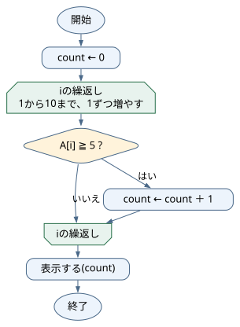
<p class="flow-caption">問題の入力と、空欄を埋めた処理を示しています。</p>
</div>

</div>

</section>

<section class="answer-section" data-exercise="8-B">

## 演習8-B　解答・解説

<div class="answer-part">

### 解答

<div class="solution-table" data-exercise="8-B">

| 解答欄の項目 | 解答 |
|---|---|
| 選択肢（ア〜エ） | **正解：ア** |

</div>

<div class="display-result" data-exercise="8-B">
  <p class="result-title">表示結果</p>
  <div class="result-case"><span class="result-label">確認用：A＝{4, 9, 9}の場合</span><samp class="result-lines">9<br>2</samp></div>
</div>

</div>

<div class="explanation-part">

### 解説

最大値を更新するときは、同じ条件の内側で位置も更新します。＞を使うと、同じ最大値では更新せず、最初の位置を残せます。A＝{4,9,9}ならmax＝9、maxIndex＝2です。

#### 値の確認（各処理の実行後）

| 実行した処理 | その直後の値 |
|---|---|
| max ← A[1] | max＝4 |
| i＝2の回を終了 | max＝9、maxIndex＝2、i＝2 |
| i＝3の回を終了 | max＝9、maxIndex＝2、i＝3 |

<div class="exercise-flow">
<p class="flow-title">演習8-Bのフローチャート</p>
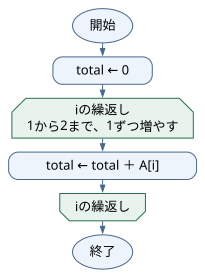
<p class="flow-caption">問題の入力と、空欄を埋めた処理を示しています。</p>
</div>

公開問題への接続：[令和8年度 問1 配列の位置と上書きに注目する練習](https://www.fe-siken.com/kakomon/08_haru/b1.html)（[IPA公式問題PDF](https://www.ipa.go.jp/shiken/mondai-kaiotu/sg_fe/koukai/rcu1hd0000012qj6-att/2026r08_fe_kamoku_b_qs.pdf)）。本演習は研修用のオリジナル問題であり、リンク先の問題・正解と同一ではありません。

</div>

</section>

<section class="answer-section dense-answer" data-exercise="8-C">

## 演習8-C　解答・解説

<div class="answer-part">

### 解答

<div class="solution-table" data-exercise="8-C">

| 解答欄の項目 | 解答 |
|---|---|
| 選択肢（ア〜エ） | **正解：ウ** |

</div>

<div class="display-result" data-exercise="8-C">
  <p class="result-title">表示結果</p>
  <div class="result-case"><span class="result-label">num＝3の場合</span><samp class="result-lines">***<br>***<br>***</samp></div>
</div>

<div class="completed-trace" data-exercise="8-C">

#### 表の完成例

| 表示順 | 外側のi | 内側のj | 表示する文字 | 表示後の改行 |
|---|---:|---:|---:|---:|
| 1 | 1 | 1 | * | しない |
| 2 | 1 | 2 | * | しない |
| 3 | 1 | 3 | * | する |
| 4 | 2 | 1 | * | しない |
| 5 | 2 | 2 | * | しない |
| 6 | 2 | 3 | * | する |
| 7 | 3 | 1 | * | しない |
| 8 | 3 | 2 | * | しない |
| 9 | 3 | 3 | * | する |


</div>

</div>

<div class="explanation-part">

### 解説

外側のiは行、内側のjは一行の文字を担当します。完成表の最初の3行ではi＝1のまま、jが1→2→3と進みます。次の行へ移るとi＝2、j＝1から再び始まります。内側を終えた後で改行するので、表示順3・6・9の後に改行し、一行3文字、全体3行の正方形になります。

<div class="exercise-flow">
<p class="flow-title">演習8-Cのフローチャート</p>

<p class="flow-caption">問題の入力と、空欄を埋めた処理を示しています。</p>
</div>

</div>

</section>

<section class="answer-section" data-exercise="8-D">

## 演習8-D　解答・解説

<div class="answer-part">

### 解答

<div class="solution-table" data-exercise="8-D">

| 解答欄の項目 | 解答 |
|---|---|
| 最後の result | 6 |

</div>

</div>

<div class="explanation-part">

### 解説

最初はA[1]の2をresultへ入れます。A[2]の6の方が大きいので、条件が真となってresultを6へ更新します。

表の確認に使う入力：A＝{2,6}。

#### 値の確認（各処理の実行後）

| 実行した処理 | その直後の値 |
|---|---|
| result ← A[1] | result＝2 |
| result ← A[2] | result＝6 |

<div class="exercise-flow">
<p class="flow-title">演習8-Dのフローチャート</p>
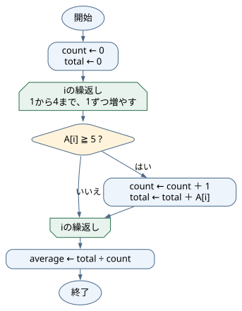

</div>

</div>

</section>

<section class="answer-section" data-exercise="8-E">

## 演習8-E　解答・解説

<div class="answer-part">

### 解答

<div class="solution-table" data-exercise="8-E">

| 解答欄の項目 | 解答 |
|---|---|
| 最後の total | 8 |

</div>

</div>

<div class="explanation-part">

### 解説

最初のtotalは0です。一周目で3、二周目で5を足すので、0→3→8と変わります。前の合計を使って次の値を足します。

表の確認に使う入力：A＝{3,5}。

#### 値の確認（各処理の実行後）

| 実行した処理 | その直後の値 |
|---|---|
| total ← 0 | total＝0 |
| i＝1の回を終了 | total＝3、i＝1 |
| i＝2の回を終了 | total＝8、i＝2 |

<div class="exercise-flow">
<p class="flow-title">演習8-Eのフローチャート</p>


</div>

</div>

</section>

<section class="answer-section" data-exercise="8-F">

## 演習8-F　解答・解説

<div class="answer-part">

### 解答

<div class="solution-table" data-exercise="8-F">

| 解答欄の項目 | 解答 |
|---|---|
| count | 2 |
| total | 13 |
| average | 6.5 |

</div>

</div>

<div class="explanation-part">

### 解説

対象は5以上の8と5です。二つを足して13、対象の件数は2なので、平均は13 ÷ 2＝6.5です。配列全体の4個ではなく、条件に合った2個で割ります。

表の確認に使う入力：A＝{3,8,5,1}。

#### 値の確認（各処理の実行後）

| 実行した処理 | その直後の値 |
|---|---|
| count ← 0 | count＝0 |
| i＝1の回を終了 | count＝0、total＝0、i＝1 |
| i＝2の回を終了 | count＝1、total＝8、i＝2 |
| i＝3の回を終了 | count＝2、total＝13、i＝3 |
| i＝4の回を終了 | count＝2、total＝13、i＝4 |
| average ← total ÷ count | count＝2、total＝13、i＝5、average＝6.5 |

<div class="exercise-flow">
<p class="flow-title">演習8-Fのフローチャート</p>
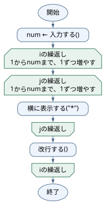

</div>

</div>

</section>

<div class="page-break"></div>

<a id="roadmap"></a>

# 研修後の学習ロードマップ

## 公開問題へ進む前の補助レッスン

公開問題は本教材より長く、まだ学んでいない言葉が登場することがあります。知らない単語だけで止まらず、次の表で読み方を確認します。解けなかった場合は、その知識を補ってから同じ問題へ戻りましょう。

| 新しい言葉・記法 | 初心者向けの意味 |
|---|---|
| 関数 | 名前を付けてまとめた処理。例えば「合計を求める」という一まとまり。 |
| 引数（ひきすう） | 関数へ渡す材料。配列や、探したい値など。 |
| 戻り値・return | 処理の結果として呼出し元へ返す値。画面への表示とは別。returnに到達すると、その関数の処理を終える。 |
| 配列の末尾に追加 | 最後の後ろに新しい要素を一つ増やす。元の末尾の上書きとは違う。 |
| 1ずつ減らすfor | 例えばi＝5、4、3、2の順で処理する。終了値2も処理する。 |
| 昇順 | 小さい値から大きい値へ並んだ状態。 |
| 二分探索 | 並んだ配列の中央と比べ、探す範囲を狭める方法。単に先頭から探す方法とは違い、並び順が前提となる。 |

<section class="supplement-lesson">

### 関数へ値を渡して結果を受け取る

関数の名前の前の`○`は、ここから関数を定義する目印です。`○整数型: addOne(整数型: x)`は「整数xを受け取り、整数を返すaddOneという関数」の意味です。addOneは名前で、英単語を暗記する必要はありません。

使うときは`addOne(3)`と書き、括弧の3を引数xへ渡します。`return x ＋ 1`は計算結果を呼出し元へ返し、関数の処理を終える命令です。`result ← addOne(3)`では、その戻り値をresultへ入れます。

<div class="code-example" data-example="27">
<p class="example-task"><strong>問題：</strong>受け取った値に1を足して返す関数を作る。3を渡し、受け取った結果を表示する。</p>

```text
○整数型: addOne(整数型: x)
  return x ＋ 1

整数型: result
result ← addOne(3)
表示する(result)
```

<div class="display-result" data-example="27">
  <p class="result-title">表示結果</p>
  <div class="result-case"><samp class="result-lines">4</samp></div>
</div>

</div>

定義を読むだけでは、関数の中は実行されません。呼び出す行に来たら、次の順で進みます。

| 順番 | 処理 | 値と進む先 |
|---|---|---|
| 1 | addOne(3)を呼び出す | 3を引数xへ渡し、関数の中へ進む |
| 2 | return x ＋ 1 | 3＋1の4を返し、呼び出した行へ戻る |
| 3 | resultへの代入 | 戻り値4をresultへ入れる |
| 4 | 表示する(result) | 4を画面へ表示する |

`return`は結果を返す操作、`表示する`は画面へ見せる操作です。同じものではありません。

</section>

### 配列の発展

#### 公開問題の読み解き例：配列の要素を移動する

[令和8年度 科目B 問1と解説](https://www.fe-siken.com/kakomon/08_haru/b1.html)（[IPA公式問題PDF](https://www.ipa.go.jp/shiken/mondai-kaiotu/sg_fe/koukai/rcu1hd0000012qj6-att/2026r08_fe_kamoku_b_qs.pdf)の問1）を開き、問題文の「末尾を先頭へ」「それ以外は一つ後ろへ」を確認しましょう。原問題と解答群はリンク先で読みます。以下は同じ処理の考え方を、小さい別の配列で練習するための説明です。

**先に確認：** len（レン）は要素数、top（トップ）は退避用の変数です。data[i − 1]は移動元、data[i]は移動先です。処理中に値を上書きするので、どちらを先に動かすかが重要です。

data＝{4,8,2,6}なら、目標は{6,4,8,2}です。まず最後の6をtopへ保存します。その後、iを4→3→2と減らしながら、一つ前の値を移します。

| 実行した処理 | data | top |
|---|---|---:|
| top ← data[4] | {4,8,2,6} | 6 |
| data[4] ← data[3] | {4,8,2,2} | 6 |
| data[3] ← data[2] | {4,8,8,2} | 6 |
| data[2] ← data[1] | {4,4,8,2} | 6 |
| data[1] ← top | {6,4,8,2} | 6 |

逆にiを2から増やすと、最初にdata[2]を4で上書きします。次に読むdata[2]も既に4なので、元の8を移せません。繰返しの方向は「増やすのが普通」と暗記せず、**これから読む値を先に消していないか**で判断します。原問題に戻り、開始値・終了値・増減の三つが合う選択肢を選びます。

#### 配列が増える公開問題の読み方

[2022年12月公開 サンプル問題20問セット 問3と解説](https://www.fe-siken.com/kakomon/sample/b3.html)（[IPA公式問題PDF](https://www.ipa.go.jp/shiken/syllabus/henkou/2022/gmcbt80000007cfs-att/fe_kamoku_b_set_sample_qs.pdf)の問3）では、配列の末尾への追加と、直前までに求めた値の利用を確認します。読む前に「引数が入力」「戻り値が出力」「末尾に追加すると要素数が1増える」を整理してください。

小さい別例で、入力が{2,4,1}なら、先頭からの合計を順に並べると{2,6,7}になります。2を置く→最後の2に4を足して6を追加→最後の6に1を足して7を追加、という順です。「入力配列」と「作成中の出力配列」を別々に表へ書けば、どの配列の最後を読んでいるか混同しにくくなります。

### 難しい探索問題は、前提を学んでから取り組む

[2022年12月公開 サンプル問題20問セット 問13と解説](https://www.fe-siken.com/kakomon/sample/b13.html)（[IPA公式問題PDF](https://www.ipa.go.jp/shiken/syllabus/henkou/2022/gmcbt80000007cfs-att/fe_kamoku_b_set_sample_qs.pdf)の問13）は二分探索の不具合を扱います。第6章の「先頭から探す」練習より先の内容です。まず上の用語表を読み、lowは探索範囲の左端、highは右端、middleは中央の位置を表す変数だと整理します。

例えば二つの値{3,9}から9を探すとき、中央を小さい側の位置1とします。見つからなかったのに左端を再び1にすると、範囲は1〜2のままです。同じ判定を繰り返して終わりません。「繰返した後に範囲が本当に小さくなったか」を、low・high・middleの表で確認します。講師は二分探索の前提を補足してから取り上げてください。

> 公開問題を自習するときの質問例：この公開問題の問題文・コードを提示します。まだ二分探索を習っていません。必要な用語と前提を説明し、要素が二つの具体例で一回ずつ処理の流れを教えてください。

公開問題の原文はリンク先で確認します。解説サイトを開けない場合は、併記したIPA公式PDFの年度・版と問番号から確認できます。自習でAIに質問する場合は、第0章0.3の方法で、問題文・コード・選択肢をコピーまたは写真で渡します。本書の演習1-A〜8-Fは、研修用の共有ノートブックで問題番号だけを指定して質問できます。

本研修で扱った内容は、科目Bのアルゴリズム問題を読むための入口です。次の順番で学習を続けます。

| 段階 | 学習内容 | 到達目標 |
|---|---|---|
| 1 | 変数・代入・条件分岐・繰返し | 短いコードをトレースできる |
| 2 | 一次元・二次元配列 | 添字と要素を区別できる |
| 3 | 合計・件数・最大・最小 | 基本パターンを説明できる |
| 4 | 線形探索・二分探索 | 探索範囲の変化を追える |
| 5 | 基本的な整列 | 要素の交換を追える |
| 6 | スタック・キュー・リスト | データ構造の操作を理解できる |
| 7 | 再帰・木・グラフ | 呼出しと探索順を追える |
| 8 | 科目B形式の総合問題 | 時間内に必要な値を追える |

## 自習の一週間モデル

一単元について繰り返す学習の例です。全範囲を一週間で終える予定ではありません。理解に合わせて日数を増やし、基礎問題をAIなしで解いて、途中の値と理由を説明できたら、その単元に対応する本番形式へ進みます。難しければ、関係する章の★問題へ戻ります。

| 曜日 | 学習内容 |
|---|---|
| 1日目 | 概念説明を読み、例題をトレースする |
| 2日目 | 基本問題をAIなしで解く |
| 3日目 | 間違えた問題についてAIへ質問する |
| 4日目 | AIが作成した易しい類題を解く |
| 5日目 | 本番形式の問題を時間を測って解く |
| 6日目 | 間違いを「読解・条件・添字・計算・トレース」に分類する |
| 7日目 | AIを使わず、間違えた問題を解き直す |

## 研修後に別のFE参考書で自習する場合

第0章0.3の手順に沿って、初回設定、問題の提示、疑問点の質問へ進みます。

<div class="ai-box">
  <p class="ai-label">AIへの質問例｜別の参考書で自習するとき</p>
  <p>添付した問題について質問です。</p>
  <p><strong>分かっていること：</strong>「←」は右の値を左へ入れる記号です。<br><strong>試したこと：</strong>○行目まで、変数の値を一行ずつ計算しました。<br><strong>分からないこと：</strong>次の行で使う値の時点が分かりません。確認するヒントを一つください。</p>
</div>

本書の演習を復習する場合は、研修用の共有ノートブックで問題番号を指定し、同じ三つの項目を伝えます。

<div class="important-box">
  <p class="box-title">最後は必ずAIなしで解く</p>
  <p>AIの説明を理解できても、本番でAIは使用できません。各単元の最後には、AIを閉じ、問題文と紙だけで同じ問題をもう一度解いてください。</p>
</div>

## 学習記録

| 日付 | 学習範囲 | 自力で解けた問題 | AIへ質問した内容 | 解き直し |
|---|---|---|---|---|
| | | | | □ |
| | | | | □ |
| | | | | □ |
| | | | | □ |

<div class="page-break"></div>

# 参考資料

- [IPA「機能要件の合意形成ガイド 分冊6 バッチ編」74ページ：JISのフローチャート記号](https://www.ipa.go.jp/archive/files/000004501.pdf)（ループ端の図形の確認に使用）
- [慶應義塾大学の公開講義「繰り返し for / while の基本」](https://web.sfc.keio.ac.jp/~maooon/kiso_pro/ex8th.html)（第5章の説明の構成を参考にしました）
- [法政大学の公開講義「繰り返し（while）、複雑な条件式」](https://java2005.cis.k.hosei.ac.jp/materials/lecture05/while.html)（条件の再判定、forとの対応、入力で回数が変わる例を参考にしました）
- [基本情報技術者試験.com「科目B 過去問題」](https://www.fe-siken.com/fekakomon_b.php)（公開問題の所在と解説を確認。教材の48問は研修用オリジナル問題。）
- [Google ヘルプ「ソースの追加」](https://support.google.com/gemininotebook/answer/16215270?hl=ja)
- [Google ヘルプ「ノートブックの共有」](https://support.google.com/gemininotebook/answer/16206563?hl=ja)
- [Google ヘルプ「チャットの設定」](https://support.google.com/gemininotebook/answer/16179559?hl=ja)
- [独立行政法人情報処理推進機構（IPA）「試験要綱・シラバスについて」](https://www.ipa.go.jp/shiken/syllabus/gaiyou.html)
- [独立行政法人情報処理推進機構（IPA）「2022年12月公開 科目Bサンプル問題20問セット」](https://www.ipa.go.jp/shiken/syllabus/henkou/2022/gmcbt80000007cfs-att/fe_kamoku_b_set_sample_qs.pdf)
- [独立行政法人情報処理推進機構（IPA）「同20問セットの正解」](https://www.ipa.go.jp/shiken/syllabus/henkou/2022/gmcbt80000007cfs-att/fe_kamoku_b_set_sample_ans.pdf)
- [独立行政法人情報処理推進機構（IPA）「令和8年度 基本情報技術者試験 科目B 公開問題」](https://www.ipa.go.jp/shiken/mondai-kaiotu/sg_fe/koukai/rcu1hd0000012qj6-att/2026r08_fe_kamoku_b_qs.pdf)
- [独立行政法人情報処理推進機構（IPA）「SG・FE 公開問題」](https://www.ipa.go.jp/shiken/mondai-kaiotu/sg_fe/koukai/index.html)

---

本教材の擬似言語は、基本情報技術者試験用の記述形式に合わせています。演習量、難易度、解説の粒度は、研修対象者と実施時間に合わせて調整します。
